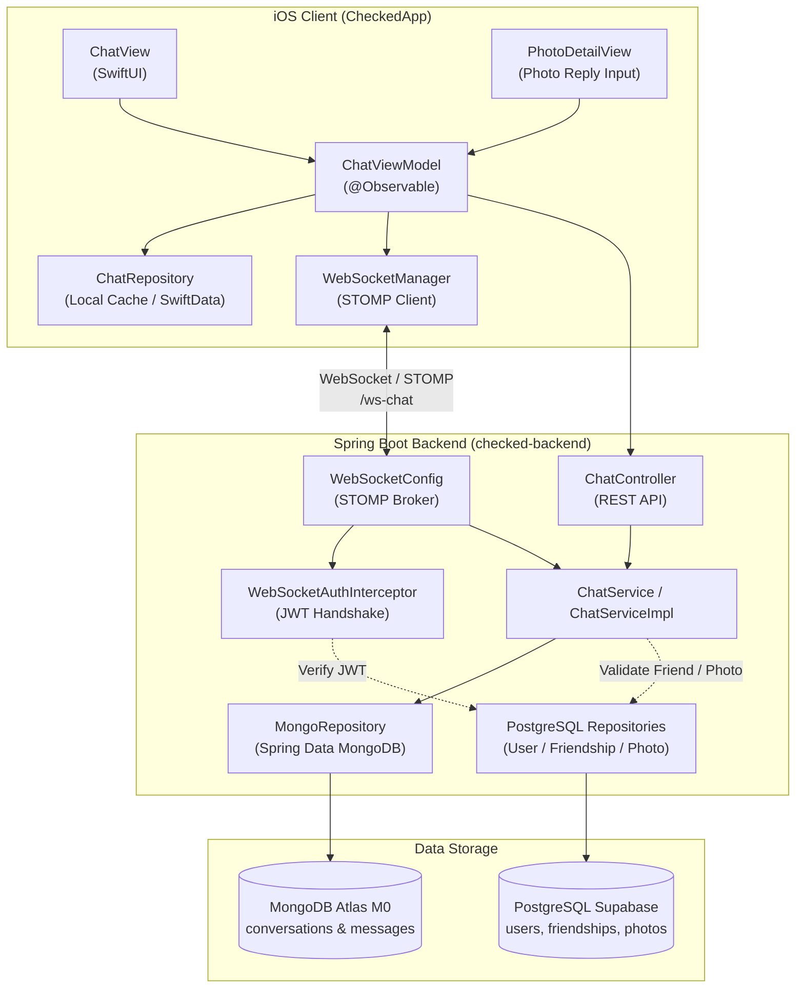
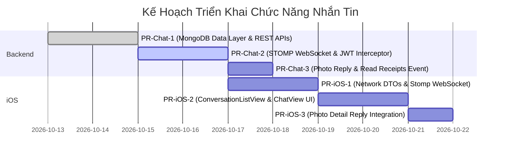

# 📬 Kế Hoạch Triển Khai Chức Năng Nhắn Tin 1-1 (Messaging Module)

> **Dự án**: Checked (Spring Boot Backend + iOS Native SwiftUI)  
> **Phạm vi**: Nhắn tin 1-1 giữa bạn bè (phong cách Locket / iMessage)  
> **Kiến trúc CSDL**: NoSQL MongoDB Atlas (M0 Free Tier) kết hợp PostgreSQL (Supabase)  
> **Giao thức Realtime**: WebSocket + STOMP Broker  
> **Tác giả**: Nguyen Kim Quoc Khanh  
> **Ngày lập**: 13/10/2026  
> **Trạng thái**: Draft / Sẵn sàng triển khai  

---

## 1. Tôn Chỉ & Phạm Vi Thiết Kế

1. **Trải nghiệm tức thời (Realtime & Low Latency)**: Tin nhắn hiển thị ngay lập tức không cần tải lại trang, hỗ trợ chỉ báo đã đọc (Read Receipts) và thông báo tin nhắn mới.
2. **Kiến trúc dữ liệu phân tách (Dual-Database Strategy)**:
   - **PostgreSQL (Supabase)**: Giữ vai trò Source of Truth cho dữ liệu quan hệ ACID: `users`, `friendships`, `photos`, `expenses`, `calories`.
   - **MongoDB Atlas (M0)**: Đảm nhận lưu trữ `conversations` và `messages`. Dữ liệu chat có đặc tính ghi liên tục (write-heavy), schema biến đổi linh hoạt (tin nhắn kèm trích dẫn, ảnh context, metadata), không cần relational join phức tạp.
3. **Đặc trưng tính năng Locket-style**:
   - **Text thuần**: Tập trung vào trò chuyện văn bản gọn nhẹ, không hỗ trợ gửi tệp ảnh đính kèm tùy tiện trong khung chat.
   - **Photo Reply Context**: Cho phép gửi phản hồi trực tiếp khi xem ảnh trên Feed / History / Photo Detail, tự động đính kèm snapshot của bức ảnh đó vào cuộc trò chuyện.
   - **Trích dẫn trả lời (Reply / Quote)**: Cho phép trích dẫn một tin nhắn cụ thể trong đoạn chat.
   - **Trạng thái đã đọc (Seen / Read Receipt)**: Hiển thị thời điểm đối phương đã xem tin nhắn.

---

## 2. Kiến Trúc Hệ Thống (System Architecture)



---

## 3. Thiết Kế NoSQL MongoDB Schema & Indexes

Database Name: `checked_chat`

### 3.1. Collection: `conversations`
Mỗi document đại diện cho một cuộc hội thoại 1-1 giữa hai người bạn.

```json
{
  "_id": { "$oid": "670c1234abcd5678ef901234" },
  "participantIds": [
    "c8a1b2c3-4d5e-6f7a-8b9c-0d1e2f3a4b5c",
    "f1e2d3c4-b5a6-7890-abcd-ef1234567890"
  ],
  "createdAt": { "$date": "2026-10-13T10:00:00.000Z" },
  "updatedAt": { "$date": "2026-10-13T12:30:15.000Z" },
  
  "lastMessage": {
    "messageId": { "$oid": "670c5678abcd5678ef909999" },
    "senderId": "c8a1b2c3-4d5e-6f7a-8b9c-0d1e2f3a4b5c",
    "content": "Bát phở sáng nay trông ngon thế!",
    "type": "PHOTO_REPLY",
    "sentAt": { "$date": "2026-10-13T12:30:15.000Z" }
  },
  
  "readStatus": {
    "c8a1b2c3-4d5e-6f7a-8b9c-0d1e2f3a4b5c": { "$date": "2026-10-13T12:30:15.000Z" },
    "f1e2d3c4-b5a6-7890-abcd-ef1234567890": { "$date": "2026-10-13T12:00:00.000Z" }
  }
}
```

#### Index Strategy cho `conversations`:
```javascript
// 1. Lấy danh sách cuộc trò chuyện của một User, sắp xếp theo thời gian mới nhất:
db.conversations.createIndex(
  { "participantIds": 1, "updatedAt": -1 },
  { name: "idx_conversations_user_updated" }
);

// 2. Đảm bảo mỗi cặp user chỉ có duy nhất 1 cuộc trò chuyện (sort participantIds trước khi lưu):
db.conversations.createIndex(
  { "participantIds": 1 },
  { name: "idx_conversations_participants_unique", unique: true }
);
```

---

### 3.2. Collection: `messages`
Mỗi document tương ứng với một tin nhắn gửi đi trong cuộc trò chuyện.

```json
{
  "_id": { "$oid": "670c5678abcd5678ef909999" },
  "conversationId": { "$oid": "670c1234abcd5678ef901234" },
  "senderId": "c8a1b2c3-4d5e-6f7a-8b9c-0d1e2f3a4b5c",
  "content": "Bát phở sáng nay trông ngon thế!",
  "type": "PHOTO_REPLY",
  "sentAt": { "$date": "2026-10-13T12:30:15.000Z" },
  
  "replyTo": {
    "messageId": { "$oid": "670c1111abcd5678ef908888" },
    "senderId": "f1e2d3c4-b5a6-7890-abcd-ef1234567890",
    "content": "Sáng nay ăn gì chưa?",
    "type": "TEXT"
  },
  
  "photoContext": {
    "photoId": "9a8b7c6d-5e4f-3a2b-1c0d-ef9876543210",
    "imageUrl": "https://res.cloudinary.com/.../pho_bo_thumbnail.jpg",
    "senderName": "Quốc Khánh"
  },
  
  "readBy": [
    "c8a1b2c3-4d5e-6f7a-8b9c-0d1e2f3a4b5c"
  ],
  "deletedFor": []
}
```

#### Chi tiết các trường đặc thù:
- **`type`**: Enum `TEXT` (tin thông thường) hoặc `PHOTO_REPLY` (nhắn trực tiếp từ trang xem ảnh).
- **`photoContext`**: Snapshot cố định lưu `photoId`, `imageUrl` (thumbnail nhẹ), `senderName`. Giúp hiển thị thẻ xem trước ảnh ngay trong luồng chat mà không cần lookup lại PostgreSQL, và không bị lỗi UI kể cả khi ảnh gốc sau này bị xoá.
- **`replyTo`**: Snapshot tin nhắn gốc được trích dẫn (id, người gửi, nội dung vắn tắt).
- **`readBy`**: Danh sách `senderId` đã đọc tin.

#### Index Strategy cho `messages`:
```javascript
// 1. Phân trang tin nhắn trong một cuộc trò chuyện (cursor-based bằng sentAt):
db.messages.createIndex(
  { "conversationId": 1, "sentAt": -1 },
  { name: "idx_messages_conversation_sent_at" }
);

// 2. Hỗ trợ truy vấn đếm tin chưa đọc:
db.messages.createIndex(
  { "conversationId": 1, "readBy": 1 },
  { name: "idx_messages_conversation_read_by" }
);
```

---

## 4. Đặc Tả Giao Thức & API (REST + WebSocket STOMP)

### 4.1. REST Endpoints

| HTTP | Đường dẫn API | Chức năng | Phản hồi chính |
|:---|:---|:---|:---|
| `GET` | `/api/conversations` | Lấy danh sách cuộc trò chuyện của user hiện tại | Danh sách `ConversationResponse` kèm unreadCount, lastMessage, thông tin bạn chat |
| `POST` | `/api/conversations` | Mở/Tạo cuộc trò chuyện với bạn bè qua `friendId` | `ConversationResponse` |
| `GET` | `/api/conversations/{id}/messages` | Lấy tin nhắn (Cursor-based: `before={isoDate}&limit=30`) | Danh sách `MessageResponse` + `nextCursor` |
| `PUT` | `/api/conversations/{id}/read` | Đánh dấu đã đọc toàn bộ tin đến hiện tại | `{ success: true, readAt: "..." }` |

---

### 4.2. Giao Thức Realtime WebSocket (STOMP)

- **Handshake Endpoint**: `/ws-chat` (hỗ trợ SockJS fallback)
- **Authentication**: Truyền Token qua STOMP CONNECT Frame Header:
  ```stomp
  CONNECT
  accept-version:1.2,1.1,1.0
  heart-beat:10000,10000
  Authorization:Bearer <JWT_ACCESS_TOKEN>
  ```
- **Kênh lắng nghe (Client Subscriptions)**:
  - `/user/queue/messages`: Nhận tin nhắn mới gửi riêng cho user hiện tại.
  - `/user/queue/read-receipts`: Nhận sự kiện đối phương đã đọc tin nhắn trong hội thoại.
- **Kênh gửi lên (Client Destinations)**:
  - `/app/chat.send`: Gửi một tin nhắn mới.
  - `/app/chat.read`: Báo trạng thái đã đọc cuộc hội thoại.

---

### 4.3. Cấu Trúc Payload Mẫu (STOMP Payloads)

#### 1. Gửi tin nhắn Text (`/app/chat.send`):
```json
{
  "conversationId": "670c1234abcd5678ef901234",
  "content": "Trưa nay ăn gì thế?",
  "type": "TEXT",
  "replyToMessageId": "670c1111abcd5678ef908888",
  "photoContext": null
}
```

#### 2. Gửi phản hồi từ ảnh (`/app/chat.send`):
```json
{
  "conversationId": "670c1234abcd5678ef901234",
  "content": "Quán này ở đâu thế ông?",
  "type": "PHOTO_REPLY",
  "replyToMessageId": null,
  "photoContext": {
    "photoId": "9a8b7c6d-5e4f-3a2b-1c0d-ef9876543210",
    "imageUrl": "https://res.cloudinary.com/.../pho_thumbnail.jpg",
    "senderName": "Quốc Khánh"
  }
}
```

#### 3. Client nhận tin nhắn mới (`/user/queue/messages`):
```json
{
  "id": "670c5678abcd5678ef909999",
  "conversationId": "670c1234abcd5678ef901234",
  "sender": {
    "id": "c8a1b2c3-4d5e-6f7a-8b9c-0d1e2f3a4b5c",
    "fullName": "Quốc Khánh",
    "avatarUrl": "https://..."
  },
  "content": "Quán này ở đâu thế ông?",
  "type": "PHOTO_REPLY",
  "sentAt": "2026-10-13T12:30:15.000Z",
  "replyTo": null,
  "photoContext": {
    "photoId": "9a8b7c6d-5e4f-3a2b-1c0d-ef9876543210",
    "imageUrl": "https://res.cloudinary.com/.../pho_thumbnail.jpg",
    "senderName": "Quốc Khánh"
  },
  "isRead": false
}
```

#### 4. Báo đã đọc (`/app/chat.read`):
```json
{
  "conversationId": "670c1234abcd5678ef901234"
}
```

#### 5. Nhận thông báo đối phương đã đọc (`/user/queue/read-receipts`):
```json
{
  "conversationId": "670c1234abcd5678ef901234",
  "readerId": "f1e2d3c4-b5a6-7890-abcd-ef1234567890",
  "readAt": "2026-10-13T12:35:00.000Z"
}
```

---

## 5. Kế Hoạch Triển Khai Backend (Spring Boot 3.x)

### 5.1. Cấu Trúc Gói Mã Nguồn (Package Architecture)
```
com.codegym.locketclone.
├── chat/
│   ├── document/
│   │   ├── Conversation.java
│   │   ├── Message.java
│   │   ├── MessageType.java
│   │   ├── LastMessageInfo.java
│   │   ├── ReplyToInfo.java
│   │   └── PhotoContextInfo.java
│   ├── repository/
│   │   ├── ConversationRepository.java
│   │   └── MessageRepository.java
│   ├── service/
│   │   ├── ChatService.java
│   │   └── impl/ChatServiceImpl.java
│   ├── controller/
│   │   ├── ChatController.java
│   │   └── ChatWebSocketController.java
│   └── dto/
│       ├── request/
│       │   ├── CreateConversationRequest.java
│       │   ├── SendMessagePayload.java
│       │   └── MarkReadPayload.java
│       └── response/
│           ├── ConversationResponse.java
│           ├── MessageResponse.java
│           └── ReadReceiptEvent.java
├── common/
│   └── config/
│       ├── MongoConfig.java
│       └── WebSocketConfig.java
└── security/
    └── websocket/
        └── WebSocketAuthChannelInterceptor.java
```

### 5.2. Các Bước Triển Khai Chi Tiết:

1. **Gradle Dependencies**:
   - Thêm `org.springframework.boot:spring-boot-starter-data-mongodb`
   - Thêm `org.springframework.boot:spring-boot-starter-websocket`
2. **Cấu hình MongoDB (`MongoConfig.java`)**:
   - Kích hoạt `@EnableMongoAuditing`, cấu hình chuyển đổi UUID/ObjectId nếu cần.
   - Định nghĩa `MONGODB_URI` trong `application.yml` lấy từ biến môi trường.
3. **Cấu hình STOMP WebSocket (`WebSocketConfig.java`)**:
   - Khởi tạo message broker với `/topic`, `/queue`.
   - Cấu hình application destination prefix `/app`.
   - Cấu hình user destination prefix `/user`.
   - Cấu hình Heartbeat STOMP `10000, 10000` (10 giây) để giữ kết nối không bị timeout trên Heroku Router (vốn có giới hạn 55s idle).
4. **Xác thực JWT trên WebSocket (`WebSocketAuthChannelInterceptor.java`)**:
   - Đăng ký `ChannelInterceptor` vào `ClientInboundChannel`.
   - Bắt sự kiện lệnh `StompCommand.CONNECT`.
   - Trích xuất token từ header `Authorization: Bearer ...`, dùng `JwtUtils` để validate và gán `Principal` vào context kết nối.
5. **Business Logic (`ChatServiceImpl.java`)**:
   - Kiểm tra quan hệ bạn bè (`friendshipRepository.areFriends(userA, userB)`): Chỉ cho phép chat khi hai người đã là bạn bè được chấp thuận.
   - Chuẩn hoá cặp `participantIds` theo thứ tự từ điển UUID để truy vấn hội thoại duy nhất.
   - Gửi tin nhắn: Lưu vào MongoDB, cập nhật `lastMessage` và `readStatus` của hội thoại, bắn event qua `SimpMessagingTemplate.convertAndSendToUser(...)`.
   - Đánh dấu đã đọc: Cập nhật timestamp trong `readStatus` của conversation và thêm userId vào `readBy` của messages.

---

## 6. Kế Hoạch Triển Khai iOS Client (SwiftUI)

### 6.1. Cấu Trúc Mã Nguồn (CheckedApp Architecture)
```
CheckedApp/
├── Domain/
│   └── Models/
│       └── ChatModels.swift               // Conversation, ChatMessage, MessageType, PhotoContext
├── Core/
│   └── Network/
│       ├── WebSocket/
│       │   ├── WebSocketManager.swift     // Quản lý kết nối STOMP & reconnection logic
│       │   └── StompFrame.swift           // Parser / Serializer cho STOMP frames
│       ├── Endpoints/
│       │   └── ChatEndpoints.swift
│       └── DTOs/
│           └── ChatDTOs.swift
├── Data/
│   └── Repositories/
│       └── ChatRepository.swift          // REST fetch, caching, pagination
└── Features/
    └── Chat/
        ├── ViewModels/
        │   ├── ConversationListViewModel.swift
        │   └── ChatViewModel.swift
        └── Views/
            ├── ConversationListView.swift  // Danh sách tin nhắn
            ├── ConversationRowView.swift   // Dòng item trong danh sách
            ├── ChatView.swift              // Màn hình chat 1-1
            ├── ChatBubble.swift            // Bong bóng tin nhắn kèm quote/photo card
            ├── ChatInputBar.swift          // Ô nhập nội dung + reply preview
            └── PhotoReplyThumbnailCard.swift // Thẻ hiển thị context ảnh
```

### 6.2. Các Điểm Chạm Giao Diện (Touchpoints):
1. **`HomeTopBar`**: Thêm icon Chat cạnh icon thông báo kèm chấm đỏ Badge khi có tin nhắn chưa đọc.
2. **`FriendshipView`**: Thêm nút Action "Nhắn tin" ngay trên hồ sơ bạn bè để điều hướng thẳng vào `ChatView`.
3. **`PhotoDetailView`**: Thanh Input phản hồi nhanh dưới ảnh. Khi gõ và nhấn gửi, sẽ tự động bắn tin nhắn dạng `PHOTO_REPLY` đính kèm ảnh vào phòng chat của bạn bè đó.
4. **Trải nghiệm ChatView**:
   - Đảo chiều danh sách (`inverted List / ScrollView`) để mượt mà khi nhận tin mới hoặc cuộn lên tải thêm tin cũ.
   - Haptic Feedback nhẹ khi gửi hoặc nhận tin.
   - Chế độ tự động cuộn xuống dưới cùng khi có tin mới từ người đối diện nếu đang ở gần đáy.

---

## 7. Thiết Lập Môi Trường (MongoDB Atlas Setup)

- **Tier**: M0 Free Tier (AWS Provider, Region: `ap-southeast-1` Singapore)
- **Database Name**: `checked_chat`
- **Network Access**: Allow Access from Anywhere (`0.0.0.0/0`) hoặc IP cố định của Cloud Provider.
- **Biến môi trường cần cấu hình**:
  ```env
  # .env (local) & Heroku Config Vars (production)
  MONGODB_URI=mongodb+srv://<username>:<password>@cluster0.xxxxx.mongodb.net/checked_chat?retryWrites=true&w=majority&appName=CheckedCluster
  ```

> [!WARNING]
> **Heroku Router WebSocket Timeout**:
> Heroku ngắt kết nối WebSocket nếu không có dữ liệu trao đổi trong 55 giây. Cấu hình STOMP Heartbeat `10000, 10000` (10 giây gửi ping/pong 1 lần) là bắt buộc để duy trì socket luôn active.

---

## 8. Lộ Trình Triển Khai Theo Pull Request (PR Roadmap)



### Chi Tiết Từng Milestone:

- **Milestone 1 (Backend Data & REST)**:
  - Cấu hình MongoDB driver và kết nối Atlas M0.
  - Tạo Documents, Repositories, Services, Controller.
  - Viết Unit / Integration Test cho các thao tác CRUD tin nhắn và phân trang cursor.
- **Milestone 2 (Backend Realtime STOMP)**:
  - Cấu hình WebSocket, STOMP broker và ChannelInterceptor cho JWT.
  - Xử lý gửi/nhận message realtime qua `/user/queue/messages`.
  - Xử lý cập nhật đã đọc qua `/user/queue/read-receipts`.
- **Milestone 3 (iOS Core Network & Realtime)**:
  - Xây dựng `WebSocketManager` xử lý STOMP handshake, ping/pong heartbeat, auto reconnect.
  - Xây dựng `ChatRepository` gọi REST APIs và lắng nghe luồng tin nhắn mới.
- **Milestone 4 (iOS UI & Flow)**:
  - Hoàn thiện `ConversationListView`, `ChatView`, `ChatBubble` và `ChatInputBar`.
  - Tích hợp thanh phản hồi nhanh từ `PhotoDetailView` (Photo Reply).
  - Tích hợp Unread Badge trên thanh điều hướng chính.
