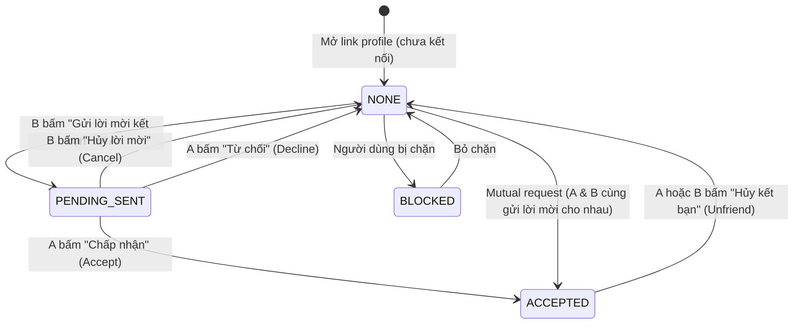

# 🤝 Kế Hoạch Triển Khai Chức Năng Kết Bạn Qua Link Profile & Lời Mời (Friend Invitation via Profile Link)

> **Dự án**: Checked Backend (`locket-clone-api`)  
> **Phạm vi**: Kết bạn thông qua chia sẻ Link Profile cá nhân (không dùng thanh tìm kiếm, bảo vệ sự riêng tư tối đa)  
> **Kiến trúc CSDL**: PostgreSQL (Neon Cloud / Supabase) với ràng buộc duy nhất hai chiều `uk_friendships_bidirectional`  
> **Giao thức Realtime & Cache**: WebSocket STOMP (`/queue/friend-requests`) + Redis Cache Eviction (`friends`, `feed`)  
> **Tác giả**: Nguyen Kim Quoc Khanh  
> **Ngày lập**: 17/10/2026  
> **Trạng thái**: Draft / Sẵn sàng triển khai  

---

## 1. Tôn Chỉ & Phạm Vi Thiết Kế (Philosophy & Scope)

1. **Bảo vệ tính riêng tư tuyệt đối (Privacy-First / Anti-Spam)**:
   - Ứng dụng theo phong cách bạn thân (Locket / Close Friends Widget), **không cung cấp thanh tìm kiếm người dùng công khai (No Global User Search)** để tránh bị làm phiền hoặc quét tài khoản hàng loạt.
   - Người dùng chỉ có thể kết nối với nhau khi được đối phương chủ động chia sẻ **Link Profile cá nhân** (ví dụ: `https://checked.app/u/{username}` hoặc quét mã QR).

2. **Trải nghiệm mượt mà từ Link chia sẻ (Seamless Profile Link Flow)**:
   - Người nhận bấm vào link profile $\rightarrow$ Mở trang cá nhân của người gửi.
   - Hệ thống tự động xác định trạng thái quan hệ giữa người đang xem và chủ profile để hiển thị nút bấm tương ứng:
     - Chưa quen biết: Nút **[Gửi lời mời kết bạn]**.
     - Đã gửi: Hiển thị **[Đã gửi lời mời • Hủy]**.
     - Đối phương đã gửi cho mình: Hiển thị **[Chấp nhận]** và **[Từ chối]**.
     - Đã là bạn bè: Hiển thị **[Bạn bè ✓]**.
     - Chính mình: Hiển thị **[Chia sẻ liên kết cá nhân]**.

3. **Cơ chế duyệt lời mời 2 chiều rõ ràng**:
   - Khi B bấm "Gửi lời mời" trên profile của A, quan hệ được lưu ở trạng thái `PENDING`.
   - A nhận được thông báo thời gian thực (WebSocket / Push) và có chấm đỏ thông báo (Badge count).
   - A có thể chọn **Chấp nhận (Accept)** để trở thành bạn bè hoặc **Từ chối (Decline)**.

---

## 2. Kiến Trúc CSDL & Vòng Đời Quan Hệ (State Machine)

### 2.1 Cấu Trúc Bảng `friendships`
Bảng `friendships` sử dụng cấu trúc quan hệ có hướng nhưng được bảo vệ bởi Unique Index hai chiều:
```sql
CREATE TABLE friendships (
    id UUID PRIMARY KEY DEFAULT uuid_generate_v4(),
    user_id UUID NOT NULL REFERENCES users(id) ON DELETE CASCADE,   -- Requester (Người gửi)
    friend_id UUID NOT NULL REFERENCES users(id) ON DELETE CASCADE, -- Addressee (Người nhận)
    status VARCHAR(20) NOT NULL DEFAULT 'PENDING',                  -- PENDING | ACCEPTED | BLOCKED
    created_at TIMESTAMP DEFAULT CURRENT_TIMESTAMP,
    updated_at TIMESTAMP DEFAULT CURRENT_TIMESTAMP
);

-- Ràng buộc chống trùng lặp quan hệ hai chiều (đã có từ migration V15)
CREATE UNIQUE INDEX uk_friendships_bidirectional
    ON friendships (LEAST(user_id, friend_id), GREATEST(user_id, friend_id));
```

### 2.2 Sơ Đồ Chuyển Đổi Trạng Thái (Relationship State Machine)



### 2.3 Bảng Ánh Xạ Trạng Thái Hiển Thị Cho Frontend (`RelationshipStatus`)

| Trạng thái | Điều kiện xác định trong Backend | Nút bấm giao diện (UI Action) |
| :--- | :--- | :--- |
| `UNAUTHENTICATED` | Khách chưa đăng nhập vào ứng dụng | Nút **[Đăng nhập / Đăng ký để kết bạn]** |
| `SELF` | `currentUserId == targetUser.id` | Nút **[Chia sẻ liên kết của tôi]** |
| `NONE` | Chưa có bản ghi nào trong bảng `friendships` | Nút **[+ Gửi lời mời kết bạn]** |
| `PENDING_SENT` | Có bản ghi `PENDING` và `f.user_id == currentUserId` | Nút **[Đã gửi lời mời • Hủy]** |
| `PENDING_RECEIVED` | Có bản ghi `PENDING` và `f.friend_id == currentUserId` | Hai nút: **[Chấp nhận]** & **[Từ chối]** |
| `ACCEPTED` | Có bản ghi với `status == 'ACCEPTED'` | Nút **[Bạn bè ✓]** (Menu phụ: Hủy kết bạn) |
| `BLOCKED` | Quan hệ đang ở trạng thái `BLOCKED` | Ẩn các nút kết bạn, báo người dùng không khả dụng |

---

## 3. Đặc Tả Chi Tiết API Endpoints (API Contract)

### 3.1 Xem Profile Qua Link Cá Nhân & Kiểm Tra Trạng Thái
- **Đường dẫn**: `GET /api/v1/users/profile/{username}`
- **Quyền hạn**: Public (Hỗ trợ cả trường hợp chưa đăng nhập lẫn đã đăng nhập).
- **Mục đích**: Frontend gọi API này khi mở link `https://checked.app/u/{username}` để render trang cá nhân và nút bấm hành động.

#### Headers:
- `Authorization: Bearer <token>` *(Optional - nếu có thì trả về quan hệ chính xác, nếu không trả về `UNAUTHENTICATED`)*

#### Success Response (`200 OK`):
```json
{
  "id": "e4b6d39a-7a54-4a5c-bfa8-0b54378f45a1",
  "username": "khanhnkq",
  "firstName": "Khanh",
  "lastName": "Nguyen",
  "displayName": "Quoc Khanh",
  "avatarUrl": "https://storage.checked.app/avatars/khanh.jpg",
  "isGoldMember": true,
  "relationshipStatus": "NONE",
  "friendshipId": null
}
```

---

### 3.2 Gửi Lời Mời Kết Bạn
- **Đường dẫn**: `POST /api/v1/friendships/requests`
- **Quyền hạn**: Authenticated (`Bearer <token>`)
- **Mục đích**: Người xem profile bấm nút "Gửi lời mời kết bạn".

#### Request Body:
```json
{
  "targetUserId": "e4b6d39a-7a54-4a5c-bfa8-0b54378f45a1"
}
```

#### Success Response (`201 Created` - Gửi thành công):
```json
{
  "friendshipId": "c928421b-4172-4d2a-89aa-55f72cf89823",
  "status": "PENDING",
  "relationshipStatus": "PENDING_SENT",
  "targetUser": {
    "id": "e4b6d39a-7a54-4a5c-bfa8-0b54378f45a1",
    "username": "khanhnkq",
    "displayName": "Quoc Khanh",
    "avatarUrl": "https://storage.checked.app/avatars/khanh.jpg",
    "isGoldMember": true
  },
  "createdAt": "2026-10-17T12:00:00"
}
```

#### Success Response (`200 OK` - Trường hợp đặc biệt: Mutual Auto-Accept):
> Nếu đối phương đã từng gửi lời mời cho mình trước đó, hệ thống sẽ tự động chuyển ngay trạng thái thành `ACCEPTED` (hai bên lập tức thành bạn bè).
```json
{
  "friendshipId": "c928421b-4172-4d2a-89aa-55f72cf89823",
  "status": "ACCEPTED",
  "relationshipStatus": "ACCEPTED",
  "targetUser": { ... },
  "createdAt": "2026-10-17T12:00:00"
}
```

#### Mã lỗi thường gặp:
- `400 CANNOT_ADD_SELF_AS_FRIEND`: Tự gửi lời mời cho chính mình.
- `400 FRIEND_REQUEST_ALREADY_SENT`: Bạn đã gửi lời mời cho người này rồi, đang chờ duyệt.
- `403 USER_BLOCKED`: Một trong hai người dùng đã chặn người kia.
- `404 USER_NOT_FOUND`: Người dùng mục tiêu không tồn tại.
- `409 FRIEND_ALREADY_EXISTS`: Hai người đã là bạn bè từ trước.

---

### 3.3 Lấy Danh Sách Lời Mời Đã Nhận (Incoming Requests)
- **Đường dẫn**: `GET /api/v1/friendships/requests/received`
- **Quyền hạn**: Authenticated
- **Mục đích**: Hiển thị danh sách những người đang chờ mình đồng ý kết bạn.

#### Success Response (`200 OK`):
```json
[
  {
    "friendshipId": "c928421b-4172-4d2a-89aa-55f72cf89823",
    "requester": {
      "id": "18f8e07a-2489-408a-b8b8-07e324c4786d",
      "username": "anh_tuan",
      "displayName": "Anh Tuan",
      "avatarUrl": "https://storage.checked.app/avatars/tuan.jpg",
      "isGoldMember": false
    },
    "createdAt": "2026-10-17T11:45:00"
  }
]
```

---

### 3.4 Lấy Số Lượng Lời Mời Đang Chờ Duyệt (Badge Count)
- **Đường dẫn**: `GET /api/v1/friendships/requests/count`
- **Quyền hạn**: Authenticated
- **Mục đích**: Hiển thị chấm đỏ thông báo trên avatar/menu thanh điều hướng.

#### Success Response (`200 OK`):
```json
{
  "pendingCount": 3
}
```

---

### 3.5 Chấp Nhận Lời Mời Kết Bạn
- **Đường dẫn**: `PUT /api/v1/friendships/requests/{friendshipId}/accept`
- **Quyền hạn**: Authenticated (Chỉ người nhận mới có quyền duyệt)
- **Mục đích**: Đồng ý kết bạn.

#### Success Response (`200 OK`):
```json
{
  "friendshipId": "c928421b-4172-4d2a-89aa-55f72cf89823",
  "status": "ACCEPTED",
  "friend": {
    "id": "18f8e07a-2489-408a-b8b8-07e324c4786d",
    "username": "anh_tuan",
    "displayName": "Anh Tuan",
    "avatarUrl": "https://storage.checked.app/avatars/tuan.jpg",
    "isGoldMember": false
  },
  "acceptedAt": "2026-10-17T12:05:00"
}
```
*Tác vụ ngầm*: Tự động xóa cache `friends` và `feed` của cả 2 tài khoản, đồng thời gửi tín hiệu WebSocket realtime tới người gửi lời mời.

---

### 3.6 Từ Chối Lời Mời Kết Bạn
- **Đường dẫn**: `PUT /api/v1/friendships/requests/{friendshipId}/decline`
- **Quyền hạn**: Authenticated (Chỉ người nhận có quyền từ chối)
- **Mục đích**: Không đồng ý kết bạn (bản ghi lời mời sẽ bị xóa để sạch dữ liệu).

#### Success Response (`204 No Content`)

---

### 3.7 Hủy Lời Mời Đã Gửi (Cancel Request)
- **Đường dẫn**: `DELETE /api/v1/friendships/requests/{friendshipId}/cancel`
- **Quyền hạn**: Authenticated (Chỉ người gửi mới có quyền hủy lời mời của mình)
- **Mục đích**: Người dùng rút lại lời mời khi đối phương chưa kịp duyệt.

#### Success Response (`204 No Content`)

---

### 3.8 Hủy Kết Bạn (Unfriend)
- **Đường dẫn**: `DELETE /api/v1/friendships/{friendId}`
- **Quyền hạn**: Authenticated
- **Mục đích**: Hủy quan hệ bạn bè với một tài khoản.

#### Success Response (`204 No Content`)
*Tác vụ ngầm*: Xóa quan hệ trong CSDL, xóa cache `friends` và `feed` của cả 2 tài khoản.

---

## 4. Kiến Trúc Đồng Bộ Realtime & Quản Lý Cache

### 4.1 Quản Lý Cache Redis
Khi quan hệ bạn bè thay đổi, hệ thống đảm bảo tính nhất quán dữ liệu bằng cách evict chính xác các phân vùng cache:

```java
public void evictFriendshipAndFeedCache(UUID userA, UUID userB) {
    if (cacheManager == null) return;
    
    // 1. Xóa danh sách bạn bè được lưu trong CacheConfig.FRIENDS_CACHE
    Cache friendsCache = cacheManager.getCache(CacheConfig.FRIENDS_CACHE);
    if (friendsCache != null) {
        friendsCache.evict(userA);
        friendsCache.evict(userB);
    }
    
    // 2. Xóa Feed ảnh widget được lưu trong CacheConfig.FEED_CACHE
    Cache feedCache = cacheManager.getCache(CacheConfig.FEED_CACHE);
    if (feedCache != null) {
        feedCache.evict(userA);
        feedCache.evict(userB);
    }
}
```

### 4.2 WebSocket STOMP Realtime Fanout
Hệ thống sử dụng `SimpMessagingTemplate` để đẩy thông báo tức thì xuống ứng dụng iOS / Web Client qua user queue:
- **Kênh lắng nghe trên Client**: `/user/queue/friend-requests`
- **Các sự kiện đẩy xuống**:
  1. `NEW_FRIEND_REQUEST`: Bắn tới người nhận khi có ai đó gửi lời mời.
  2. `FRIEND_REQUEST_ACCEPTED`: Bắn tới người gửi ban đầu khi lời mời được chấp nhận.
  3. `FRIEND_REMOVED`: Bắn tới đối phương khi bị hủy kết bạn.

```json
{
  "type": "NEW_FRIEND_REQUEST",
  "friendshipId": "c928421b-4172-4d2a-89aa-55f72cf89823",
  "sender": {
    "id": "18f8e07a-2489-408a-b8b8-07e324c4786d",
    "username": "anh_tuan",
    "displayName": "Anh Tuan",
    "avatarUrl": "https://storage.checked.app/avatars/tuan.jpg"
  },
  "timestamp": "2026-10-17T12:00:00"
}
```

---

## 5. Kế Hoạch Triển Khai Kỹ Thuật (Task Breakdown)

### Phase 1: Data Access Layer, DTOs & Public Profile API (✅ Hoàn thành & Merged)
- [x] **Task 1.1**: Định nghĩa các DTOs: `UserProfileWithRelationResponse.java`, `SendFriendRequest.java`, `FriendRequestResponse.java`, `FriendRequestCountResponse.java`.
- [x] **Task 1.2**: Bổ sung các Custom Query JPQL trong `FriendshipRepository.java` (`findRelationBetweenUsers`, `findPendingReceivedRequests`, `countPendingReceivedRequests`).
- [x] **Task 1.3**: Bổ sung ErrorCode mới trong `ErrorCode.java` (`FRIEND_REQUEST_ALREADY_SENT`, `USER_BLOCKED`, `NOT_REQUEST_RECIPIENT`, `FRIEND_REQUEST_NOT_FOUND`).
- [x] **Task 1.4**: Endpoint `GET /api/v1/users/profile/{username}` (Public/Authenticated) trong `UserController.java` và `UserServiceImpl.java`.

### Phase 2: Friendship Request Management API & Realtime Sync (✅ Hoàn thành & Merged)
- [x] **Task 2.1**: Quản lý vòng đời lời mời kết bạn trong `FriendshipService` & `FriendshipServiceImpl`:
  - `sendFriendRequest` (có xử lý Mutual Auto-Accept và bắt xung đột race condition `uk_friendships_bidirectional`).
  - `getPendingReceivedRequests` & `getPendingReceivedCount`.
  - `acceptFriendRequest`, `declineFriendRequest`, `cancelFriendRequest`, `unfriend`.
- [x] **Task 2.2**: Endpoints tương ứng trong `FriendshipController.java`.
- [x] **Task 2.3**: Xóa đồng thời 2 phân vùng cache `FRIENDS_CACHE` và `FEED_CACHE` cho cả 2 người dùng.
- [x] **Task 2.4**: Đồng bộ thông báo realtime WebSocket STOMP qua `SimpMessagingTemplate` (`/queue/friend-requests`).

### Phase 3: Block/Unblock, QR Code Generator & Security Hardening (✅ Hoàn thành & Merged)
- [x] **Task 3.1**: Tích hợp thư viện ZXing QR Code (`com.google.zxing:core:3.5.3`, `com.google.zxing:javase:3.5.3`).
- [x] **Task 3.2**: Chức năng Chặn & Bỏ chặn (`POST /{userId}/block`, `DELETE /{userId}/block`, `GET /blocked`).
- [x] **Task 3.3**: Dịch vụ & Endpoint sinh mã QR cá nhân 512x512 PNG (`GET /api/v1/users/profile/{username}/qr`).
- [x] **Task 3.4**: Gia cố bảo mật FriendInviteLink (chặn bypass block, pessimistic write lock chống lost update `usedCount`, evict feed cache, endpoint preview `GET /api/v1/friend-invite-links/preview`).
- [x] **Task 3.5**: Rate limiting Bucket4j cho Friend Requests (15 req/10m) và Profile View (60 req/1m).

### Phase 4: Mutual Friends, Sent Requests, Quota & Social Share Page (✅ Hoàn thành & Merged)
> Chi tiết tài liệu: [`docs/PHASE_4_MUTUAL_FRIENDS_OUTGOING_REQUESTS_AND_QUOTA_PLAN.md`](file:///Users/nguyenkimquockhanh/Desktop/checked-backend/docs/PHASE_4_MUTUAL_FRIENDS_OUTGOING_REQUESTS_AND_QUOTA_PLAN.md)
- [x] **Task 4.1**: Quản lý Lời Mời Đã Gửi (`GET /api/v1/friendships/requests/sent` & `GET /requests/sent/count`).
- [x] **Task 4.2**: Tính toán Bạn Chung (Mutual Friends Engine):
  - Bổ sung `mutualFriendsCount` và `mutualFriendsPreview` vào `GET /api/v1/users/profile/{username}`.
  - Endpoint `GET /api/v1/friendships/{targetUserId}/mutual`.
- [x] **Task 4.3**: Kiểm soát Hạn Ngạch Bạn Bè (Standard 20 bạn, Gold 100 bạn, bắt lỗi `MAX_FRIENDS_REACHED` và `TARGET_USER_MAX_FRIENDS_REACHED`).
- [x] **Task 4.4**: Thao tác Hàng Loạt (`PUT /requests/accept-all`, `PUT /requests/decline-all`).
- [x] **Task 4.5**: Trang OpenGraph Social Share Page (`GET /u/{username}`) phục vụ hiển thị card khi chia sẻ link lên Zalo, Messenger, iMessage và hỗ trợ Deep Link.
- [x] **Task 4.6**: Unit Testing & Toàn diện hóa kiểm thử 100% (326/326 tests passed).

---

## 6. Hướng Dẫn Tích Hợp Frontend (FE Integration Guide)

### Cấu hình Deep Link & URL Routing
Khi người dùng chia sẻ link cá nhân, link sẽ có định dạng:
`https://checked.app/u/:username`

```typescript
// Ví dụ xử lý trên trang Profile Page (React / Next.js / iOS Deep Link)
async function loadUserProfile(username: string) {
  const res = await api.get(`/api/v1/users/profile/${username}`);
  const profile = res.data;

  switch (profile.relationshipStatus) {
    case 'SELF':
      renderShareMyLinkButton(profile.username);
      break;
    case 'NONE':
      renderButton("Gửi lời mời kết bạn", () => sendRequest(profile.id));
      break;
    case 'PENDING_SENT':
      renderButton("Đã gửi lời mời (Hủy)", () => cancelRequest(profile.friendshipId));
      break;
    case 'PENDING_RECEIVED':
      renderAcceptAndDeclineButtons(profile.friendshipId);
      break;
    case 'ACCEPTED':
      renderButton("Bạn bè ✓", () => showFriendOptions(profile.id));
      break;
  }
}
```
