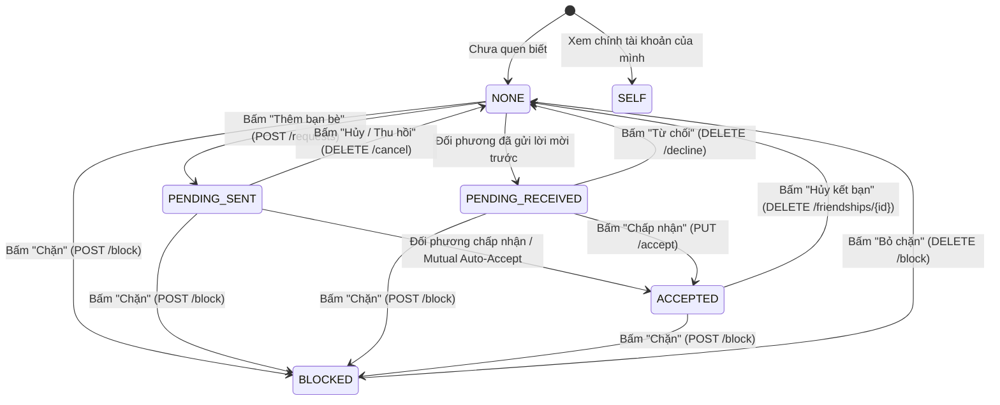
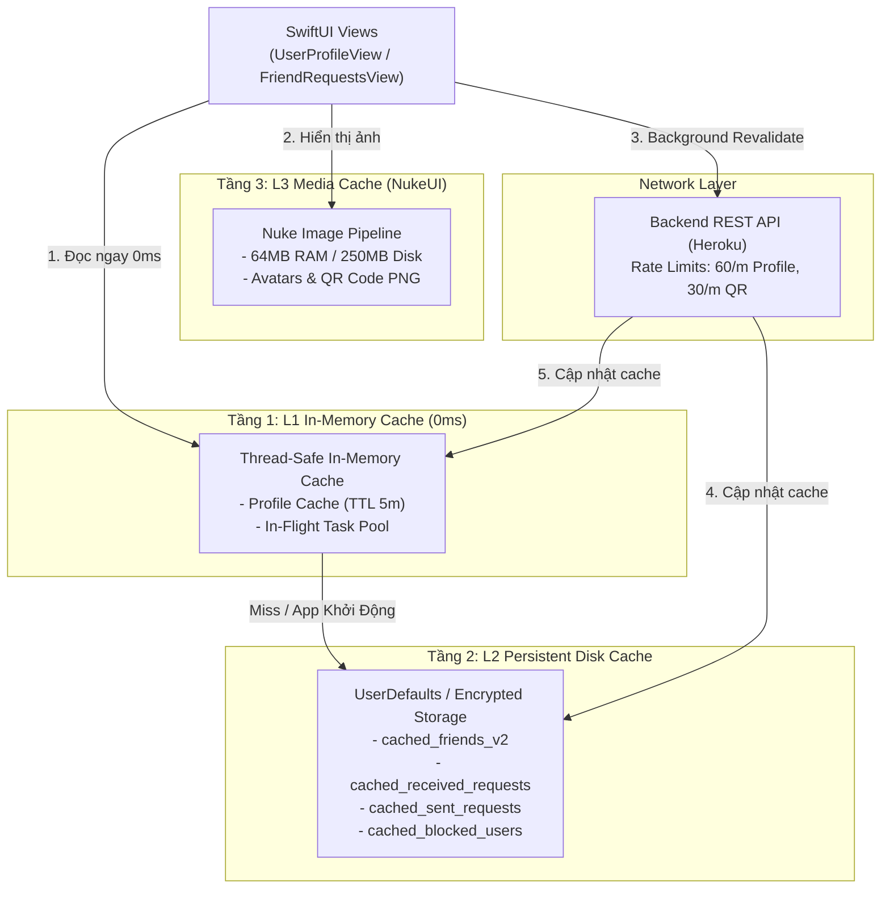

# 📱 Kế Hoạch Triển Khai Giao Diện & Tích Hợp iOS: Profile Link & Friend Invitation Engine

> **Dự án**: `CheckedApp` (Checked Native iOS App - Swift 6.0 / SwiftUI / iOS 18+)  
> **Backend tương ứng**: `checked-backend` (Spring Boot 3.4.1 + PostgreSQL + Redis + RabbitMQ + STOMP)  
> **Backend Host Live**: `https://heroku-7usd-5a73e86b5b14.herokuapp.com/` (Release `v49`)  
> **Tài liệu tham chiếu Backend**: `docs/IMPLEMENTATION_PLAN_PROFILE_FRIEND_INVITATION.md` (Phases 1 - 4 & Audit)  
> **Trạng thái**: Sẵn sàng triển khai mã nguồn sau khi duyệt kế hoạch  

---

## 1. Tổng Quan & Mục Tiêu Kỹ Thuật

Sau khi hoàn tất toàn bộ 4 giai đoạn backend (Profile Link công khai/xác thực, Quản lý lời mời 2 chiều, QR Code Profile, Bạn chung & Giới hạn hạn ngạch Close Friends), mục tiêu của kế hoạch này là **xây dựng và tích hợp trọn vẹn toàn bộ trải nghiệm người dùng phía iOS**.

### Mục Tiêu Trọng Tâm:
1. **Trải nghiệm Profile Động Đẳng Cấp**: Màn hình xem profile của bất kỳ ai (`UserProfileView`) với trạng thái quan hệ thời gian thực (`NONE`, `PENDING_SENT`, `PENDING_RECEIVED`, `ACCEPTED`, `BLOCKED`, `SELF`), hiển thị Bạn chung (Mutual Friends) và nút tương tác thông minh thích ứng.
2. **DeepLink & Universal Link Liền Mạch**: Hỗ trợ mở tức thì từ liên kết ngoài `checked://u/{username}` và `https://checked.app/u/{username}` dẫn trực tiếp vào profile người dùng với hiệu ứng mở mượt mà (Sheet hoặc Navigation push).
3. **Trung Tâm Quản Lý Lời Mời Thông Minh**: Tab kép "Lời mời đã nhận" và "Lời mời đã gửi", hỗ trợ chấp nhận/từ chối từng người hoặc hàng loạt ("Chấp nhận tất cả", "Từ chối tất cả") với Optimistic UI mượt mà.
4. **Mã QR Profile & Camera Scanner**: Card mã QR cá nhân sắc nét tải từ backend (`image/png` 512x512) với chức năng Lưu ảnh / Chia sẻ; kèm Camera Scanner AVFoundation quét mã bạn bè tức thì.
5. **Kiểm Soát Hạn Ngạch Bạn Bè (Quota UI)**: Thanh đo tiến độ 20 bạn bè thân thiết (Standard) hoặc 100 bạn bè (Gold Member) kèm Dialog giải thích và gợi ý nâng cấp thân thiện khi chạm trần (`MAX_FRIENDS_REACHED`).
6. **Bảo Mật & Quản Lý Chặn (Block / Unblock)**: Chặn người dùng tiêu cực, ẩn mọi tương tác, quản lý danh sách đã chặn trong Cài đặt và bỏ chặn an toàn.
7. **Đồng Bộ Thời Gian Thực (WebSocket STOMP)**: Nhận tức thì các sự kiện kết bạn (`NEW_FRIEND_REQUEST`, `FRIEND_REQUEST_ACCEPTED`, `FRIEND_REMOVED`, `FRIEND_BLOCKED`) mà không cần người dùng kéo làm mới (Pull-to-refresh).

---

## 2. Kiến Trúc Tổng Thể Phía iOS (Clean Architecture + @Observable)

Áp dụng chuẩn kiến trúc Clean Architecture hiện có của `CheckedApp`, phân tách rõ ràng giữa Presentation, Domain, Data/Network và Core/Navigation:

```mermaid
graph TD
    subgraph "Presentation Layer (SwiftUI + @Observable)"
        UPV["UserProfileView<br/>(Xem hồ sơ & quan hệ động)"]
        FRV["FriendRequestsView<br/>(Tab Nhận / Gửi + Batch Actions)"]
        MFV["MutualFriendsSheetView<br/>(Danh sách bạn chung)"]
        QRC["ProfileQrCardView<br/>(Card QR cá nhân + Chia sẻ)"]
        QRS["QrScannerView<br/>(Camera Scanner AVFoundation)"]
        BUV["BlockedUsersView<br/>(Danh sách chặn trong Settings)"]
        FLV["FriendshipListView<br/>(Bổ sung Quota Bar & Badge)"]
        
        UPVM["UserProfileViewModel"]
        FRVM["FriendRequestsViewModel"]
    end

    subgraph "Domain Layer"
        FRP["FriendshipRepositoryProtocol"]
        MODELS["Friendship Models<br/>(UserProfileWithRelation, FriendRequestItem,<br/>MutualFriend, RelationshipStatus, BlockedUser)"]
    end

    subgraph "Data & Network Layer"
        FRI["FriendshipRepository<br/>(REST API + In-Memory + Disk Cache)"]
        ENDPOINTS["FriendshipEndpoints<br/>(12 API Endpoints)"]
        WS["StompWebSocketClient<br/>(Sub: /user/queue/friendship)"]
    end

    subgraph "Core & Routing"
        COORD["AppCoordinator<br/>(handleDeepLink: checked://u/...)"]
        APP_ROUTE["AppRoute<br/>(.userProfile, .friendRequests, .qrScanner, .blockedUsers)"]
        CONTAINER["AppContainer<br/>(Inject FriendshipRepository)"]
    end

    UPV --> UPVM
    FRV --> FRVM
    UPVM --> FRP
    FRVM --> FRP
    MFV --> FRP
    BUV --> FRP
    FLV --> FRP
    
    FRP <|.. FRI
    FRI --> ENDPOINTS
    FRI --> WS
    CONTAINER --> FRI
    COORD --> UPV
    COORD --> FRV
```

### Sơ Đồ Chuyển Đổi Trạng Thái Mối Quan Hệ (`RelationshipStatus` State Machine)



---

## 3. Bản Đồ Hợp Đồng API Backend (Backend API Contracts Cho iOS)

Tất cả các endpoints đã được triển khai, kiểm thử 100% và live trên Heroku:

| STT | Phương thức | Đường dẫn API | Mục đích | Response DTO phía iOS |
|:---:|:---:|:---|:---|:---|
| 1 | `GET` | `/api/v1/users/profile/{username}` | Lấy chi tiết hồ sơ kèm quan hệ & bạn chung | `UserProfileWithRelationDTO` |
| 2 | `GET` | `/api/v1/users/profile/{username}/qr` | Tải ảnh mã QR cá nhân 512x512 | Raw Data (`image/png`) |
| 3 | `POST` | `/api/v1/friendships/requests` | Gửi lời mời kết bạn (hỗ trợ mutual auto-accept) | `SendFriendRequestResponseDTO` |
| 4 | `GET` | `/api/v1/friendships/requests/received` | Lấy danh sách lời mời đã nhận (phân trang) | `PageResponseDTO<FriendRequestItemDTO>` |
| 5 | `GET` | `/api/v1/friendships/requests/received/count` | Lấy số lượng lời mời đang chờ xử lý | `PendingRequestCountDTO` (`{ count: Int }`) |
| 6 | `GET` | `/api/v1/friendships/requests/sent` | Lấy danh sách lời mời đã gửi đi (phân trang) | `PageResponseDTO<FriendRequestItemDTO>` |
| 7 | `GET` | `/api/v1/friendships/requests/sent/count` | Lấy số lượng lời mời đã phát đi | `PendingRequestCountDTO` (`{ count: Int }`) |
| 8 | `PUT` | `/api/v1/friendships/requests/{id}/accept` | Chấp nhận một lời mời kết bạn | `EmptyResponseDTO` |
| 9 | `DELETE`| `/api/v1/friendships/requests/{id}/decline` | Từ chối một lời mời kết bạn | `EmptyResponseDTO` |
| 10 | `DELETE`| `/api/v1/friendships/requests/{id}/cancel` | Thu hồi lời mời kết bạn đã gửi | `EmptyResponseDTO` |
| 11 | `PUT` | `/api/v1/friendships/requests/accept-all` | Chấp nhận toàn bộ lời mời đang chờ | `BatchFriendRequestActionResponseDTO` |
| 12 | `PUT` | `/api/v1/friendships/requests/decline-all` | Từ chối toàn bộ lời mời đang chờ | `BatchFriendRequestActionResponseDTO` |
| 13 | `GET` | `/api/v1/friendships/{targetUserId}/mutual` | Xem danh sách đầy đủ bạn chung | `PageResponseDTO<FriendProfileResponseDTO>` |
| 14 | `POST` | `/api/v1/friendships/{userId}/block` | Chặn một người dùng | `EmptyResponseDTO` |
| 15 | `DELETE`| `/api/v1/friendships/{userId}/block` | Bỏ chặn người dùng | `EmptyResponseDTO` |
| 16 | `GET` | `/api/v1/friendships/blocked` | Lấy danh sách những người đang bị chặn | `[FriendProfileResponseDTO]` |

---

## 4. Kế Hoạch Triển Khai Chi Tiết Từng Phase (5 Phases)

---

### 🧩 Phase 1: Models, DTOs & Network Endpoints

**Mục tiêu**: Định nghĩa đầy đủ các thực thể Domain, DTOs Codable và Endpoints cho toàn bộ API kết bạn, quan hệ người dùng, mã QR và chặn.

#### 1.1. Domain Models (`Domain/Models/FriendshipModels.swift`)
```swift
public enum RelationshipStatus: String, Codable, Sendable {
    case none = "NONE"
    case pendingSent = "PENDING_SENT"
    case pendingReceived = "PENDING_RECEIVED"
    case accepted = "ACCEPTED"
    case blocked = "BLOCKED"
    case selfUser = "SELF"
    case unauthenticated = "UNAUTHENTICATED"
}

public struct UserProfileWithRelation: Identifiable, Codable, Sendable, Equatable {
    public let id: String
    public let username: String
    public let firstName: String?
    public let lastName: String?
    public let displayName: String
    public let avatarUrl: String?
    public let isGoldMember: Bool
    public var relationshipStatus: RelationshipStatus
    public var friendshipId: String?
    public let mutualFriendsCount: Int
    public let mutualFriendsPreview: [MutualFriendPreview]
}

public struct MutualFriendPreview: Identifiable, Codable, Sendable, Equatable {
    public let id: String
    public let username: String
    public let displayName: String
    public let avatarUrl: String?
}

public struct FriendRequestItem: Identifiable, Codable, Sendable, Equatable {
    public let friendshipId: String
    public let userId: String
    public let username: String
    public let displayName: String
    public let avatarUrl: String?
    public let isGoldMember: Bool
    public let mutualFriendsCount: Int
    public let createdAt: Date
    
    public var id: String { friendshipId }
}

public struct FriendshipQuotaInfo: Sendable, Equatable {
    public let currentCount: Int
    public let maxLimit: Int
    public let isGoldMember: Bool
    
    public var isNearLimit: Bool { currentCount >= maxLimit - 2 }
    public var isAtLimit: Bool { currentCount >= maxLimit }
    public var remainingSlots: Int { max(0, maxLimit - currentCount) }
}
```

#### 1.2. Mở Rộng API Endpoints (`Core/Network/Endpoints/FriendshipEndpoints.swift`)
- `GetUserProfileWithRelationEndpoint(username: String)` -> `GET users/profile/{username}`
- `GetUserProfileQrEndpoint(username: String)` -> `GET users/profile/{username}/qr`
- `SendFriendRequestEndpoint(targetUserId: String)` -> `POST friendships/requests`
- `GetReceivedFriendRequestsEndpoint(page: Int, size: Int)` -> `GET friendships/requests/received`
- `GetReceivedRequestsCountEndpoint()` -> `GET friendships/requests/received/count`
- `GetSentFriendRequestsEndpoint(page: Int, size: Int)` -> `GET friendships/requests/sent`
- `GetSentRequestsCountEndpoint()` -> `GET friendships/requests/sent/count`
- `AcceptFriendRequestEndpoint(friendshipId: String)` -> `PUT friendships/requests/{id}/accept`
- `DeclineFriendRequestEndpoint(friendshipId: String)` -> `DELETE friendships/requests/{id}/decline`
- `CancelSentFriendRequestEndpoint(friendshipId: String)` -> `DELETE friendships/requests/{id}/cancel`
- `AcceptAllFriendRequestsEndpoint()` -> `PUT friendships/requests/accept-all`
- `DeclineAllFriendRequestsEndpoint()` -> `PUT friendships/requests/decline-all`
- `GetMutualFriendsEndpoint(targetUserId: String, page: Int, size: Int)` -> `GET friendships/{userId}/mutual`
- `BlockUserEndpoint(userId: String)` -> `POST friendships/{userId}/block`
- `UnblockUserEndpoint(userId: String)` -> `DELETE friendships/{userId}/block`
- `GetBlockedUsersEndpoint()` -> `GET friendships/blocked`

---

### 🗄️ Phase 2: Repository, Realtime WebSocket & Dependency Injection

**Mục tiêu**: Cung cấp tầng dữ liệu hoàn chỉnh, tích hợp bộ đệm Stale-While-Revalidate (0ms latency), xử lý Optimistic Updates và lắng nghe sự kiện Realtime qua WebSocket STOMP.

#### 2.1. Giao Thức Mở Rộng (`Domain/Repositories/FriendshipRepositoryProtocol.swift`)
```swift
public protocol FriendshipRepositoryProtocol: Sendable {
    // Cache & Danh sách bạn bè hiện tại
    func getCachedFriends() -> [Friend]
    func getFriends() async throws -> [Friend]
    func getFriendshipQuota() -> FriendshipQuotaInfo
    
    // Profile công khai / xác thực
    func getUserProfile(username: String) async throws -> UserProfileWithRelation
    func getUserQrCode(username: String) async throws -> Data
    
    // Lời mời kết bạn
    func sendFriendRequest(targetUserId: String) async throws -> SendFriendRequestResponseDTO
    func getReceivedRequests(page: Int, size: Int) async throws -> [FriendRequestItem]
    func getReceivedRequestsCount() async throws -> Int
    func getSentRequests(page: Int, size: Int) async throws -> [FriendRequestItem]
    func getSentRequestsCount() async throws -> Int
    
    func acceptFriendRequest(friendshipId: String) async throws
    func declineFriendRequest(friendshipId: String) async throws
    func cancelSentRequest(friendshipId: String) async throws
    func acceptAllRequests() async throws -> Int
    func declineAllRequests() async throws -> Int
    
    // Bạn chung & Quản lý chặn
    func getMutualFriends(targetUserId: String, page: Int, size: Int) async throws -> [Friend]
    func blockUser(userId: String) async throws
    func unblockUser(userId: String) async throws
    func getBlockedUsers() async throws -> [Friend]
    
    // Realtime Stream
    var friendshipEventStream: AsyncStream<FriendshipRealtimeEvent> { get }
}
```

#### 2.2. Xử Lý Sự Kiện Realtime WebSocket STOMP
- Subscribe topic `/user/queue/friendship` trong `StompWebSocketClient`.
- Phân phối các sự kiện:
  - `NEW_FRIEND_REQUEST`: Cập nhật badge lời mời (+1), kích hoạt haptic rung nhẹ.
  - `FRIEND_REQUEST_ACCEPTED`: Thêm bạn vào danh sách `FriendshipListView` ngay lập tức, hiển thị thông báo biểu ngữ (In-app Banner).
  - `FRIEND_REMOVED`: Loại bỏ bạn bè khỏi danh sách bạn bè và danh sách trò chuyện.
  - `FRIEND_BLOCKED`: Đồng bộ hóa trạng thái chặn tức thì.

---

### 👤 Phase 3: Màn Hình Xem Hồ Sơ Cá Nhân (`UserProfileView`) & Deep Link

**Mục tiêu**: Xây dựng giao diện xem profile người khác mượt mà, hỗ trợ DeepLink `checked://u/{username}` và `https://checked.app/u/{username}`.

#### 3.1. Thiết Kế Giao Diện `UserProfileView`
- **Top Bar**: Nút Back bo tròn 44x44 (nền trắng, icon đen) + Nút Tùy chọn 3 chấm (`ellipsis`) mở Menu: Chặn người dùng, Chia sẻ hồ sơ, Sao chép link.
- **Hero Section**:
  - Avatar tròn 96x96 tải qua NukeUI bo góc tròn tuyệt đối, kèm viền vàng vương miện nếu `isGoldMember == true`.
  - Tên đầy đủ (`displayName`) font Bold 24pt bo góc hiện đại.
  - `@username` màu xám tinh tế (`AppColors.textSecondary`).
- **Mutual Friends Banner (Thanh Bạn Chung)**:
  - Nếu `mutualFriendsCount > 0`: Hiển thị 3 avatar nhỏ 28x28 xếp chồng lệch nhau (Overlapping Stack) + Dòng chữ: `5 bạn chung: An, Bình và 3 người khác >`.
  - Chạm vào mở Bottom Sheet `MutualFriendsSheetView` hiển thị danh sách cuộn mượt mà.
- **Dynamic Relationship Action Bar (Thanh Thao Tác Động)**:
  - `NONE`: Nút Matcha Glow `D4EB70` to bản: **"Thêm bạn bè"** (icon `person.badge.plus.fill`).
  - `PENDING_SENT`: Nút màu kem `DFDACD`: **"Đã gửi lời mời"** + Nút nhỏ màu đỏ nhạt **"Thu hồi"**.
  - `PENDING_RECEIVED`: Cặp nút đôi: Nút Matcha **"Chấp nhận"** + Nút Sand Dust **"Từ chối"**.
  - `ACCEPTED`: Nút nền xám sạch **"Bạn bè ✓"**; khi chạm vào mở ActionSheet: Nhắn tin (chuyển thẳng sang Chat), Hủy kết bạn, Chặn.
  - `BLOCKED`: Nút cảnh báo màu đỏ nhạt **"Đã chặn"** kèm nút **"Bỏ chặn"**.
  - `SELF`: Nút **"Chia sẻ mã QR của tôi"** hoặc **"Chỉnh sửa hồ sơ"**.
- **Skeleton Shimmer**: Sử dụng `SkeletonCircle(size: 96)`, `SkeletonBone` cho tên và nút thao tác khi đang nạp dữ liệu lần đầu, đảm bảo Zero Layout Shift.

#### 3.2. Điều Phối Deep Link Trong `AppCoordinator`
```swift
// Trong AppCoordinator.swift
public func handleDeepLink(url: URL) {
    // 1. checked://u/{username}
    if url.scheme == "checked", url.host == "u" {
        let username = url.path.trimmingCharacters(in: CharacterSet(charactersIn: "/"))
        if !username.isEmpty {
            openUserProfile(username: username)
        }
    }
    // 2. https://checked.app/u/{username}
    else if url.host == "checked.app", url.pathComponents.count >= 3, url.pathComponents[1] == "u" {
        let username = url.pathComponents[2]
        openUserProfile(username: username)
    }
}

public func openUserProfile(username: String) {
    path.append(AppRoute.userProfile(username: username))
}
```

- Bổ sung cấu hình `CFBundleURLTypes` trong `project.yml` và `Info.plist`:
  - URL Identifier: `com.khanhnkq.checked`
  - URL Schemes: `checked`
- Thêm `.onOpenURL` tại root `AuthGateView.swift` hoặc `CheckedApp.swift`.

---

### 📬 Phase 4: Trung Tâm Quản Lý Lời Mời Kết Bạn (`FriendRequestsView`) & Hạn Ngạch Quota

**Mục tiêu**: Màn hình quản lý 2 chiều tập trung cho lời mời kết bạn, kiểm soát hạn ngạch và xử lý thao tác hàng loạt.

#### 4.1. Cấu Trúc Giao Diện `FriendRequestsView`
- **Thanh Chọn Tab (Custom Segmented Control)**:
  - Tab 1: **"Đã nhận (3)"** - Hiển thị badge màu đỏ/matcha khi có lời mời mới.
  - Tab 2: **"Đã gửi (1)"** - Theo dõi danh sách lời mời mình đã gửi đi.
- **Thanh Hạn Ngạch Bạn Bè Thân Thiết (Close Friends Quota Bar)**:
  - Vị trí: Đặt cố định ngay dưới Segmented Control.
  - Thiết kế: Thanh Capsule tiến độ mỏng 6pt.
    - Màu sắc: Xanh Matcha (`AppColors.primary`) khi còn chỗ trống; chuyển sang Đỏ Cam (`AppColors.error`) khi đạt 100%.
    - Nhãn phụ: `18/20 bạn bè thân thiết` (hoặc `85/100 bạn bè`).
    - Nút nhỏ: `Nâng cấp GOLD` (kèm icon `crown.fill`) hiển thị khi gần chạm mốc.
- **Tab Lời Mời Đã Nhận (Received Requests)**:
  - Thanh công cụ Batch: Nút **"Chấp nhận tất cả"** (xanh) và **"Từ chối tất cả"** (xám nhạt) hiển thị khi danh sách có từ 2 lời mời trở lên.
  - Item từng người:
    - Avatar tròn NukeUI 48x48.
    - Tên hiển thị + `@username`.
    - Số bạn chung (ví dụ: `2 bạn chung`).
    - Thời gian nhận (ví dụ: `2 giờ trước`).
    - Cặp nút: **"Chấp nhận"** (Matcha) và **"Từ chối"** (X).
  - Optimistic UI: Khi bấm chấp nhận/từ chối, item lập tức mờ dần và trượt khỏi danh sách (Animation spring 0.3s); gọi API ngầm. Nếu gặp lỗi `MAX_FRIENDS_REACHED`, hoàn nguyên lại item và hiển thị Alert giải thích giới hạn 20 bạn bè.
- **Tab Lời Mời Đã Gửi (Sent Requests)**:
  - Item người nhận + Thời gian gửi.
  - Nút bấm: **"Thu hồi"** (Hủy lời mời đã phát đi).

---

### 📷 Phase 5: Thẻ QR Profile Cá Nhân, Camera Scanner & Quản Lý Chặn

**Mục tiêu**: Tạo card QR tuyệt đẹp để chia sẻ nhanh ngoài đời thực, tích hợp Camera quét mã kết bạn tức thì và màn hình quản lý người bị chặn.

#### 5.1. Thẻ QR Cá Nhân (`ProfileQrCardView`)
- Lấy ảnh mã QR từ API `GET /api/v1/users/profile/{username}/qr` (512x512).
- Thẻ giao diện Apple Wallet / Locket Card:
  - Nền bo góc 24pt với hiệu ứng chuyển sắc nhẹ nhàng từ Oat Milk sang Matcha sương mù.
  - Phần trên: Avatar tròn 60x60, Tên hiển thị, `@username`.
  - Phần giữa: Mã QR 240x240 sắc nét với logo Checked thu nhỏ ở tâm.
  - Phần dưới: Dòng chú thích `Quét để kết bạn trên Checked`.
- Thanh nút bấm:
  - **"Lưu vào Photos"**: Ghi ảnh trực tiếp vào Photo Library kèm thông báo toast thành công.
  - **"Chia sẻ"**: Mở `UIActivityViewController` chia sẻ ảnh QR và đường dẫn `https://checked.app/u/{username}`.
  - **"Quét mã"**: Chuyển ngay sang chế độ Camera QR Scanner.

#### 5.2. Camera QR Scanner (`QrScannerView`)
- Sử dụng `AVCaptureMetadataOutput` (hoặc `DataScannerViewController` trên iOS 18):
- Giao diện tràn màn hình:
  - Khung ngắm Reticle bo góc 24pt ở trung tâm.
  - Vạch laser Matcha Glow quét nhẹ nhàng lên xuống liên tục.
  - Nút bật/tắt đèn Flash ở góc trên.
  - Nút chọn ảnh từ thư viện để quét mã từ ảnh chụp màn hình.
- Khi nhận diện mã `checked://u/{username}` hoặc `https://checked.app/u/{username}`:
  - Rung phản hồi haptic `UIImpactFeedbackGenerator(style: .medium)`.
  - Tự động hiển thị `UserProfileView(username: username)` dưới dạng Bottom Sheet trồi lên từ đáy.

#### 5.3. Quản Lý Người Bị Chặn (`BlockedUsersView`)
- Đặt trong màn hình Cài đặt (`SettingsView`).
- Hiển thị danh sách những tài khoản đang bị chặn: Avatar, Tên, `@username`.
- Nút **"Bỏ chặn"** kèm hộp thoại xác nhận: *"Bạn có chắc chắn muốn bỏ chặn người này? Hai bạn sẽ có thể tìm thấy và gửi lời mời kết bạn cho nhau."*

---

## 5. Bản Vẽ Phác Thảo Giao Diện (UI Wireframes)

### 5.1. Màn Hình Hồ Sơ Người Dùng (`UserProfileView`)

```
+-------------------------------------------------------+
|  ( < )                                          ( ··· )|
|                                                       |
|                     +-----------+                     |
|                     |  ( 96x96) | [👑 GOLD]           |
|                     |   AVATAR  |                     |
|                     +-----------+                     |
|                                                       |
|                    Trần Quốc Bảo                      |
|                      @baotran                         |
|                                                       |
|         +---------------------------------------+     |
|         |  (O)(O)(O)  4 bạn chung: An, Bình... >|     |
|         +---------------------------------------+     |
|                                                       |
|         +---------------------------------------+     |
|         |          [ THÊM BẠN BÈ  + ]           |     |
|         |      (Nút Matcha Glow D4EB70)         |     |
|         +---------------------------------------+     |
|                                                       |
|  [Trường hợp Đã gửi]:                                |
|  +-----------------------+ +-----------------------+  |
|  |   Đã gửi lời mời ...  | |     [ Thu hồi ✕ ]     |  |
|  +-----------------------+ +-----------------------+  |
|                                                       |
|  [Trường hợp Đã nhận]:                                |
|  +-----------------------+ +-----------------------+  |
|  |    [ Chấp nhận ✓ ]    | |      [ Từ chối ✕ ]    |  |
|  +-----------------------+ +-----------------------+  |
+-------------------------------------------------------+
```

### 5.2. Trung Tâm Lời Mời Kết Bạn (`FriendRequestsView`)

```
+-------------------------------------------------------+
|  ( < )  Lời mời kết bạn                               |
|                                                       |
|  +-------------------------+-----------------------+  |
|  |     Đã nhận ( 3 )       |      Đã gửi ( 1 )     |  |
|  +-------------------------+-----------------------+  |
|                                                       |
|  HẠN NGẠCH BẠN BÈ THÂN THIẾT: 18/20                   |
|  [=====================================....] [👑 GOLD]|
|                                                       |
|  Hàng loạt:       [ Chấp nhận tất cả ]  [ Từ chối hết]|
|                                                       |
|  +-------------------------------------------------+  |
|  | (Avatar) Nguyễn Mai Anh                  vừa xong|  |
|  |          @maianh • 3 bạn chung                  |  |
|  |          +------------------+ +---------------+ |  |
|  |          | [ Chấp nhận ✓ ]  | | [ Từ chối ✕ ] | |  |
|  |          +------------------+ +---------------+ |  |
|  +-------------------------------------------------+  |
|  +-------------------------------------------------+  |
|  | (Avatar) Hoàng Long                      2 giờ |  |
|  |          @longhoang • 1 bạn chung               |  |
|  |          +------------------+ +---------------+ |  |
|  |          | [ Chấp nhận ✓ ]  | | [ Từ chối ✕ ] | |  |
|  |          +------------------+ +---------------+ |  |
|  +-------------------------------------------------+  |
+-------------------------------------------------------+
```

### 5.3. Thẻ QR Code Cá Nhân & Khung Quét Scanner

```
+---------------------------+   +---------------------------+
| ( X )   Mã QR Cá Nhân     |   | ( X )                 (⚡)|
|                           |   |                           |
|  +---------------------+  |   |     HƯỚNG CAMERA VÀO      |
|  | (Avatar) Khanh      |  |   |     MÃ QR BẠN BÈ          |
|  |          @khanhnkq  |  |   |                           |
|  |                     |  |   |      +-------------+      |
|  |   ################  |  |   |     | |   Laser   | |     |
|  |   ##            ##  |  |   |     | |   Matcha  | |     |
|  |   ##   QR 512   ##  |  |   |     | |   ======> | |     |
|  |   ##            ##  |  |   |     | |           | |     |
|  |   ################  |  |   |      +-------------+      |
|  |                     |  |   |                           |
|  | Quét để kết nối bạn |  |   |                           |
|  +---------------------+  |   |                           |
|                           |   |                           |
|---

## 6. Hệ Thống Thiết Kế Giao Diện (Design System & Motion Standards)

Mọi màn hình và thành phần giao diện mới phía iOS **BẮT BUỘC** tuân thủ tuyệt đối quy chuẩn thiết kế độc quyền của `CheckedApp` (phong cách Oat Milk Warmth & Matcha Glow, lấy cảm hứng từ Locket / Apple Wallet):

### 6.1. Bảng Màu Chuẩn Hóa (`AppColors` Tokens)
Mọi màu sắc giao diện phải được gọi trực tiếp qua enum `AppColors`, **nghiêm cấm hardcode hex** trong Views:

| Token Màu | Mã Hex | Ý nghĩa sử dụng | Vị trí áp dụng |
|:---|:---:|:---|:---|
| **`AppColors.canvas`** | `#EDE9DF` | Nền kem Oat Milk ấm áp | Nền chủ đạo toàn bộ màn hình (`.ignoresSafeArea()`) |
| **`AppColors.surface`** | `#FFFFFF` | Trắng tinh khiết | Nền các Card, Dialog, Thẻ QR cá nhân |
| **`AppColors.surfaceSubtle`** | `#DFDACD` | Nền hạt cát Sand Dust | Nền các nút tròn phụ, ô nhập mã, viền nhạt |
| **`AppColors.primary`** | `#D4EB70` | Xanh Matcha Glow tươi sáng | Nút CTA chính ("Thêm bạn", "Chấp nhận"), Shimmer beam |
| **`AppColors.primarySoft`** | `#E6F5A3` | Matcha sữa dịu nhẹ | Huy hiệu đếm số lượng, thanh Quota an toàn |
| **`AppColors.accent`** | `#BFDD4A` | Deep Matcha đậm đà | Trạng thái nút khi được nhấn giữ (Pressed), viền nhấn |
| **`AppColors.darkSurface`** | `#141613` | Đen than sâu | Khung viền kính ngắm Camera QR Scanner |
| **`AppColors.text`** | `#141613` | Đen tuyền sắc nét | Tiêu đề chính, tên hiển thị, icon hoạt động |
| **`AppColors.textSecondary`** | `#63685F` | Xám rêu nhã nhặn | Username (@khanh), nhãn thời gian, số bạn chung |
| **`AppColors.error`** | `#FF6954` | Đỏ san hô ấm áp | Nút "Từ chối", "Thu hồi", "Chặn", Quota đầy 100% |
| **`AppColors.success`** | `#4E8752` | Xanh lục thiên nhiên | Trạng thái "Đã kết bạn ✓", thông báo Toast lưu ảnh |

### 6.2. Phân Cấp Kiểu Chữ (Typography Scale)
- **Header Title**: `.system(size: 22, weight: .bold, design: .rounded)` - Bo góc hiện đại, gần gũi.
- **Section Headers**: `.system(size: 12, weight: .bold)` kèm `.foregroundColor(AppColors.text.opacity(0.6))` và viết HOA (ALL-CAPS) - Phân vùng rõ ràng chuẩn Locket.
- **Tên người dùng**: `.system(size: 16, weight: .semibold, design: .rounded)` trên danh sách; `.system(size: 24, weight: .bold, design: .rounded)` trên Hero Profile.
- **Username phụ**: `.system(size: 14, weight: .regular)` màu `AppColors.textSecondary`.
- **Mã Token & Links**: `.system(size: 14, weight: .medium, design: .monospaced)` giúp dễ kiểm tra ký tự.
- **Huy hiệu & Đếm**: `.system(size: 11, weight: .bold)` đặt trong Capsule nền Matcha Glow.

### 6.3. Bo Góc & Quy Chuẩn Không Gian (Spacing & Corner Radius)
- **Khoảng cách lề (Horizontal Padding)**: Chuẩn **16pt** ở cả hai mép màn hình.
- **Khoảng cách giữa các khối (Stack Spacing)**: 12pt đến 18pt.
- **Bo góc thẻ Card ngoài**: `RoundedRectangle(cornerRadius: 20-24, style: .continuous)` (Apple Continuous Squircle mượt mà).
- **Bo góc Box trong / Ô nhập**: `RoundedRectangle(cornerRadius: 12-14, style: .continuous)`.
- **Nút bấm hành động (Action Buttons)**: Bo góc 12pt hoặc bo tròn hoàn toàn `Capsule()`.
- **Nút tròn biểu tượng**: Khung cố định `44x44` hoặc `48x48`, `clipShape(Circle())`.

### 6.4. Ngôn Ngữ Biểu Tượng (Iconography - SF Symbols)
Đồng bộ 100% phong cách **Filled SF Symbols** với màu sắc đen than trên nền Matcha hoặc Sand Dust:
- `person.badge.plus.fill`: Nút thêm bạn bè mới
- `checkmark.circle.fill`: Chấp nhận lời mời / Bạn bè đã kết nối
- `xmark.circle.fill`: Từ chối lời mời / Xóa nội dung nhập
- `link.circle.fill`: Biểu tượng liên kết mời cá nhân
- `qrcode`: Thẻ mã QR hồ sơ
- `camera.viewfinder`: Quét mã bằng máy ảnh
- `crown.fill`: Huy hiệu người dùng Checked GOLD
- `square.and.arrow.up.fill`: Chia sẻ hồ sơ / mã QR
- `arrow.counterclockwise`: Thu hồi lời mời đã phát đi

### 6.5. Phản Hồi Tương Tác & Chuyển Động (Micro-Interactions & Motion)
- **Pressed Scale Button Effect**: Toàn bộ nút bấm tương tác phải áp dụng `.buttonStyle(PressedScaleButtonStyle())`, khi người dùng chạm vào nút sẽ thu nhỏ nhẹ còn 96% và nảy lại nhanh chóng.
- **Haptic Touch Vật Lý**:
  - `UIImpactFeedbackGenerator(style: .medium).impactOccurred()`: Khi chấp nhận, sao chép link, hoặc quét trúng mã QR.
  - `UINotificationFeedbackGenerator().notificationOccurred(.warning)`: Khi từ chối, chặn, hoặc chạm hạn ngạch bạn bè.
- **Zero Layout Shift Shimmer**:
  - Không bao giờ để giao diện bị co giật khi dữ liệu đang tải.
  - Sử dụng các thành phần `SkeletonCircle(size: 96)`, `SkeletonBone(height: 14)` với kích thước chuẩn 1:1 bọc trong modifier `.skeletonShimmer()` quét chéo 20°.
- **Spring Transitions**: Mọi thay đổi trạng thái trong danh sách (Chấp nhận/Từ chối) chuyển động trượt êm ái với `.animation(.spring(response: 0.35, dampingFraction: 0.8), value: items)`.

---

## 7. Quy Chuẩn Viết Code & Kiến Trúc (Coding Rules & Architecture Standards)

Đảm bảo mã nguồn đạt tiêu chuẩn công nghiệp cao nhất, không lỗi đa luồng, dễ bảo trì và mở rộng:

### 7.1. Swift 6.0 & An Toàn Bộ Nhớ (Strict Concurrency & Memory Safety)
1. **Tuân thủ `@Observable` Macro**: Tuyệt đối **CẤM** sử dụng `@ObservableObject`, `@Published` hay thư viện Combine kiểu cũ. Toàn bộ ViewModels và Coordinator phải dùng macro `@Observable` hiện đại (Swift 5.9+ / iOS 17+).
2. **Cô lập luồng giao diện (`@MainActor`)**: Mọi ViewModels, Coordinator methods thao tác trên UI State và Navigation Path BẮT BUỘC đánh dấu `@MainActor`.
3. **Tuân thủ `Sendable`**: 100% Data Models, DTOs, Enums và Repositories phải conform `Sendable`.
4. **Quản lý vòng đời tác vụ (Task Lifecycle)**:
   - Sử dụng `.task` modifier trong SwiftUI để các tác vụ mạng tự động hủy (`auto-cancel`) khi View bị gỡ bỏ khỏi màn hình.
   - Khi lắng nghe Stream Realtime (WebSocket): quản lý danh sách `[Task<Void, Never>]` và chủ động `.cancel()` trong `.onDisappear` để triệt tiêu memory leak.

### 7.2. Quy Tắc Kiến Trúc Sạch (Clean Architecture Separation)
1. **Tầng Domain (`CheckedApp/Domain/`)**:
   - Chỉ chứa pure Swift code (`import Foundation`).
   - **TUYỆT ĐỐI CẤM** `import SwiftUI`, `import UIKit`, `import NukeUI` vào `Domain/Models` hay `Domain/Repositories`.
2. **Tầng Data (`CheckedApp/Data/`)**:
   - Hiện thực hóa `FriendshipRepositoryProtocol`.
   - Áp dụng triệt để nguyên lý **Stale-While-Revalidate**:
     - *Bước 1*: Đọc đồng bộ ngay tức thì dữ liệu cache từ In-Memory hoặc UserDefaults (0ms latency, không chớp màn hình).
     - *Bước 2*: Gọi bất đồng bộ `async let` lên Backend Heroku để kiểm tra phiên bản mới nhất.
     - *Bước 3*: Cập nhật cache cục bộ và thông báo UI cập nhật mượt mà.
3. **Tầng Mạng & Hợp Đồng (`CheckedApp/Core/Network/`)**:
   - Mọi API endpoint phải triển khai giao thức `APIEndpoint` (khai báo tường minh `path`, `method`, `body`, `headers`).
   - DTOs tách biệt hoàn toàn với Domain Model; thực hiện ánh xạ qua các hàm map riêng biệt (`mapFriend()`, `mapRequest()`).
4. **Tầng Giao Diện (`CheckedApp/Features/`)**:
   - View không được phép trực tiếp gọi `URLSession` hay `APIClient`.
   - Mọi phụ thuộc được inject qua `@Environment(\.container)` và `@Environment(AppCoordinator.self)`.

### 7.3. Nguyên Tắc "Không Rác Thư Viện" (Zero 3rd-Party Bloat Rule)
- Ứng dụng chỉ sử dụng duy nhất 2 thư viện phụ thuộc đã được phê chuẩn trong `project.yml`:
  1. **Nuke / NukeUI**: Tối ưu tải, giải nén nền và lưu đệm 250MB avatar/ảnh trên bộ nhớ máy.
  2. **KeychainAccess**: Lưu trữ an toàn mật khẩu và Bearer JWT Token.
- **KHÔNG** cài thêm bất kỳ SDK nào khác. Mọi tính năng khác đều dùng native:
  - WebSocket STOMP: Dùng native `URLSessionWebSocketTask` qua `StompWebSocketClient`.
  - Camera QR Scanner: Dùng native `AVFoundation` (`AVCaptureMetadataOutput`).
  - Haptic: Dùng native `UIImpactFeedbackGenerator`.

---

## 8. Chiến Lược Cache Đa Tầng & Cơ Chế Chống Bão Request (Multi-Tier Caching & Request Storm Defense)

Để ứng dụng vận hành trơn tru ở đẳng cấp Production, đạt tốc độ phản hồi 0ms và tuyệt đối **không gây bão request (Request Storm / Thundering Herd)** lên Backend Heroku, kiến trúc dữ liệu phía iOS bắt buộc tích hợp các cơ chế bảo vệ sau:

### 8.1. Kiến Trúc Bộ Đệm Đa Tầng (Multi-Tier Caching Strategy)



1. **L1 In-Memory Cache (RAM - 0ms Latency)**:
   - Nằm trực tiếp bên trong `FriendshipRepository`:
     - `private var profileCache: [String: (profile: UserProfileWithRelation, cachedAt: Date)] = [:]`
     - **TTL (Time-To-Live)**: **5 phút** cho mỗi hồ sơ cá nhân. Khi người dùng mở lại cùng một profile (hoặc chuyển qua lại giữa Chat và Profile), app trả ngay lập tức từ RAM mà không phát bất kỳ HTTP request nào.
     - `private var pendingCountCache: (count: Int, cachedAt: Date)?` với TTL **30 giây** để tránh gọi liên tục `/count`.
     - **Chủ Động Làm Sạch (Cache Invalidation)**: Khi người dùng thực hiện một hành động làm thay đổi quan hệ (Gửi lời mời, Chấp nhận, Từ chối, Hủy, Chặn, Bỏ chặn), profile của đối phương và danh sách lời mời sẽ bị xóa khỏi cache ngay lập tức để nạp lại dữ liệu chuẩn.
2. **L2 Persistent Disk Cache (Offline Resilience & Instant App Launch)**:
   - Lưu trữ dạng JSON mã hóa trong `UserDefaults`:
     - `com.checked.cached_friends_v2`: Danh sách bạn bè hiện tại `[Friend]`.
     - `com.checked.cached_received_requests_v1`: Danh sách lời mời đã nhận `[FriendRequestItem]`.
     - `com.checked.cached_sent_requests_v1`: Danh sách lời mời đã gửi `[FriendRequestItem]`.
     - `com.checked.cached_blocked_users_v1`: Danh sách tài khoản bị chặn `[Friend]`.
   - **Quy Trình Stale-While-Revalidate (SWR)**:
     - Màn hình xuất hiện $\rightarrow$ Nạp và render ngay từ L2 Disk Cache (0ms, không giật, không spinner).
     - Kích hoạt tác vụ ngầm `Task.detached` kiểm tra phiên bản mới từ Backend.
     - Nếu dữ liệu backend có thay đổi $\rightarrow$ Ghi đè Disk Cache và kích hoạt animation mượt mà cập nhật giao diện.
3. **L3 Media Cache (Nuke / NukeUI Pipeline)**:
   - Tận dụng `ImagePipeline.shared`:
     - **64MB RAM** (lưu đệm tối đa 100 ảnh avatar đang hiển thị).
     - **250MB Disk Cache** tại `com.checked.imagecache`.
     - Giải nén ảnh ở Background Thread trước khi đưa lên UI Thread.
     - Ảnh QR Code PNG 512x512 tải từ `/qr` được Nuke cache theo URL, đảm bảo chỉ tải đúng 1 lần duy nhất cho mỗi tài khoản trừ khi đổi username.

---

### 8.2. Cơ Chế Chống Bão Request (Request Storm Prevention & Coalescing)

Nhằm triệt tiêu nguy cơ nghẽn mạng do người dùng spam click, mở DeepLink nhiều lần, hoặc nhận dồn dập sự kiện WebSocket:

1. **Gom Nhóm Tác Vụ Đang Chạy (In-Flight Request Coalescing / Deduplication)**:
   - **Vấn đề**: Khi một liên kết `checked://u/khanhnkq` được kích hoạt, đồng thời cả `HomeView` và `AppCoordinator` cùng yêu cầu nạp profile của `khanhnkq` $\rightarrow$ sinh ra 2 request mạng trùng lặp.
   - **Giải pháp**:
     - `FriendshipRepository` duy trì hồ lưu trữ các tác vụ đang thực thi:
       ```swift
       private var inFlightProfileTasks: [String: Task<UserProfileWithRelation, Error>] = [:]
       ```
     - Khi nhận yêu cầu `getUserProfile(username)`:
       - Nếu đã có task đang chạy cho `username` này $\rightarrow$ Tái sử dụng chính task đó (`return try await task.value`).
       - Nếu chưa có $\rightarrow$ Tạo `Task` mới, lưu vào từ điển, và tự động xóa khỏi từ điển khi hoàn tất (`defer { inFlightProfileTasks.removeValue(forKey: username) }`).
     - **Hiệu quả**: Giảm 100% các request mạng dư thừa khi mở màn hình đồng thời.
2. **Chống Nhấp Đúp / Spam Thao Tác (Spam Click & Race Condition Defense)**:
   - **Vấn đề**: Người dùng bấm liên tục vào nút "Chấp nhận" hoặc "Thêm bạn" trước khi API phản hồi $\rightarrow$ gây ra lỗi duplicate request, race condition.
   - **Giải pháp**:
     - *Cấp độ Giao diện*: Khi bấm nút, cờ `@State private var isProcessing: Bool` kích hoạt ngay lập tức; toàn bộ các nút liên quan bị `.disabled(isProcessing)`.
     - *Cấp độ Repository*: Duy trì Set `inFlightActionIds: Set<String>`. Nếu một action cho cùng `friendshipId` đang chạy, mọi lời gọi tiếp theo bị bỏ qua ngay lập tức.
3. **Điều Tiết Sự Kiện Realtime WebSocket (STOMP Event Debouncing)**:
   - **Vấn đề**: Khi đối phương thực hiện "Chấp nhận tất cả" hoặc gửi nhiều lời mời liên tiếp, client nhận dồn dập 5-10 sự kiện `NEW_FRIEND_REQUEST` qua WebSocket STOMP trong vòng 1 giây. Nếu mỗi sự kiện đều gọi lại API lấy danh sách sẽ gây ra cơn bão request.
   - **Giải pháp**:
     - Áp dụng kỹ thuật **Debounce 1.5 giây**: Gom toàn bộ sự kiện realtime kết bạn trong vòng 1.5s lại, chỉ kích hoạt đúng **1 lần duy nhất** việc đồng bộ lại danh sách từ server.
4. **Phân Trang Lười & Kích Hoạt Có Ngưỡng (Lazy Pagination with Threshold Trigger)**:
   - Danh sách lời mời nhận/gửi và danh sách bạn chung:
     - Kích thước trang cố định: `size = 20`.
     - Chỉ kích hoạt tải trang tiếp theo khi người dùng cuộn đến vị trí **cách đáy 3 phần tử** (`onAppear` tại item `count - 3`).
     - Có cờ khóa `isFetchingNextPage: Bool` để ngăn chặn việc cuộn quán tính gửi hàng chục request phân trang cùng lúc.
5. **Thích Ứng Giới Hạn Tần Suất (Bucket4j Rate Limit Resilience)**:
   - Backend Heroku đã thiết lập Bucket4j: 60 req/phút cho Profile, 30 req/phút cho QR.
   - Khi client nhận mã lỗi `HTTP 429 Too Many Requests`:
     - Client tự động chuyển sang đọc dữ liệu dự phòng từ L1/L2 Cache gần nhất.
     - Hiển thị Toast thông báo thân thiện: *"Bạn đang thao tác quá nhanh. Vui lòng thử lại sau giây lát."*
     - Không để văng lỗi hệ thống hay crash ứng dụng.

---

## 9. Danh Mục Tệp Thay Đổi & Tạo Mới Dự Kiến Phía iOS

| Module / Phân Tầng | Tệp Mã Nguồn | Trạng thái | Nhiệm vụ chính |
|:---|:---|:---:|:---|
| **Domain Models** | `CheckedApp/Domain/Models/FriendshipModels.swift` | **Tạo mới** | Định nghĩa `RelationshipStatus`, `UserProfileWithRelation`, `FriendRequestItem`, `MutualFriendPreview`, `FriendshipQuotaInfo` |
| **Domain Repositories** | `CheckedApp/Domain/Repositories/FriendshipRepositoryProtocol.swift` | **Cập nhật** | Mở rộng 16 phương thức mới cho profile, requests, QR, block, mutual friends |
| **Data Repositories** | `CheckedApp/Data/Repositories/FriendshipRepository.swift` | **Cập nhật** | Triển khai logic REST API, In-Memory caching, Optimistic Updates, Batch operations |
| **Network Endpoints** | `CheckedApp/Core/Network/Endpoints/FriendshipEndpoints.swift` | **Cập nhật** | Khai báo 12 Endpoints mới kết nối chuẩn xác với backend Heroku |
| **Network DTOs** | `CheckedApp/Core/Network/DTOs/FriendshipDTOs.swift` | **Tạo mới** | Khai báo đầy đủ các DTOs JSON tương ứng backend Java Spring Boot |
| **Routing & Coordinator**| `CheckedApp/App/AppRoute.swift` | **Cập nhật** | Thêm các routes: `.userProfile(username)`, `.friendRequests`, `.profileQr`, `.qrScanner`, `.blockedUsers` |
| **Routing & Coordinator**| `CheckedApp/App/AppCoordinator.swift` | **Cập nhật** | Bổ sung hàm `handleDeepLink(url: URL)` và navigation methods |
| **App Configuration** | `CheckedApp/App/AuthGateView.swift` & `CheckedApp.swift` | **Cập nhật** | Bổ sung `.onOpenURL` và điều hướng NavigationStack destination |
| **Project Config** | `project.yml` & `Config/Info.plist` | **Cập nhật** | Khai báo `CFBundleURLTypes` cho URL Scheme `checked` |
| **Features: Profile** | `CheckedApp/Features/Friendship/Views/UserProfileView.swift` | **Tạo mới** | Màn hình xem hồ sơ cá nhân kèm quan hệ động, bạn chung, hero section |
| **Features: Profile** | `CheckedApp/Features/Friendship/ViewModels/UserProfileViewModel.swift`| **Tạo mới** | Quản lý state quan hệ, gửi/hủy kết bạn, chặn, tải bạn chung |
| **Features: Requests** | `CheckedApp/Features/Friendship/Views/FriendRequestsView.swift` | **Tạo mới** | Màn hình quản lý lời mời đã nhận / đã gửi, batch actions, quota bar |
| **Features: Requests** | `CheckedApp/Features/Friendship/ViewModels/FriendRequestsViewModel.swift`| **Tạo mới** | Logic chấp nhận/từ chối, chấp nhận tất cả, optimistic updates |
| **Features: QR & Camera**| `CheckedApp/Features/Friendship/Views/ProfileQrCardView.swift` | **Tạo mới** | Card hiển thị mã QR 512x512, lưu ảnh Photos, chia sẻ ShareSheet |
| **Features: QR & Camera**| `CheckedApp/Features/Friendship/Views/QrScannerView.swift` | **Tạo mới** | Camera Scanner nhận diện mã `checked://u/...` và mở UserProfileView |
| **Features: Friendship** | `CheckedApp/Features/Friendship/Views/FriendshipListView.swift` | **Cập nhật** | Bổ sung Quota progress bar ở đầu trang, badge số lời mời chưa duyệt |
| **Features: Settings** | `CheckedApp/Features/Profile/Views/BlockedUsersView.swift` | **Tạo mới** | Danh sách những người đang bị chặn và chức năng bỏ chặn |

---

## 7. Kế Hoạch Xác Minh & Ma Trận Kiểm Thử (Verification & Testing Matrix)

### 7.1. Kiểm Tra Biên Dịch & Cú Pháp Swift 6
Thực thi lệnh kiểm tra build không ký chữ ký điện tử:
```bash
xcodebuild -project CheckedApp.xcodeproj -scheme CheckedApp -destination 'generic/platform=iOS' CODE_SIGNING_ALLOWED=NO build
```
Yêu cầu bắt buộc: **`** BUILD SUCCEEDED **`** (0 warnings, 0 concurrency race conditions).

### 7.2. Ma Trận Kiểm Thử Kịch Bản Nghiệp Vụ (Test Matrix)

| Kịch bản kiểm thử | Dữ liệu đầu vào | Kết quả mong đợi |
|:---|:---|:---|
| **1. Mở Deep Link qua Scheme** | `xcrun simctl openurl booted checked://u/khanhnkq` | App mở trực tiếp màn hình `UserProfileView` của user `khanhnkq` |
| **2. Xem Profile người lạ** | User có quan hệ `NONE` | Nút "Thêm bạn bè" Matcha Glow. Bấm gửi chuyển ngay sang `PENDING_SENT` |
| **3. Xem Profile người đã mời mình**| User có quan hệ `PENDING_RECEIVED` | Hiện 2 nút "Chấp nhận" & "Từ chối". Bấm chấp nhận chuyển sang `ACCEPTED` |
| **4. Xem Profile bạn bè** | User có quan hệ `ACCEPTED` | Hiện nút "Bạn bè ✓", hiển thị số bạn chung, có nút nhắn tin nhanh |
| **5. Bạn chung (Mutual Friends)** | Có 3 bạn chung trở lên | Hiển thị 3 avatar xếp chồng + bấm vào mở Sheet danh sách đầy đủ |
| **6. Quản lý lời mời: Chấp nhận tất cả**| Danh sách nhận có 5 lời mời | Bấm "Chấp nhận tất cả", 5 lời mời biến mất ngay, danh sách bạn bè tăng 5 |
| **7. Chạm hạn ngạch Quota (20 bạn)** | Tài khoản Standard có 20 bạn bè | Gửi hoặc nhận thêm bạn hiển thị Modal cảnh báo `MAX_FRIENDS_REACHED` + gợi ý GOLD |
| **8. Quét mã QR bằng Camera** | Hướng camera vào mã QR profile | Rung haptic + mở Sheet `UserProfileView` của bạn bè đó tức thì |
| **9. Lưu mã QR vào Photos** | Bấm nút "Lưu ảnh" trên QR Card | Lưu thành công vào Photos, hiển thị Toast xanh xác nhận |
| **10. Chặn & Bỏ chặn** | Chặn user từ Profile menu | Mối quan hệ chuyển thành `BLOCKED`. Vào Settings -> Blocked Users thấy tên và bấm bỏ chặn được |
| **11. Realtime STOMP Sync** | Đối phương gửi lời mời từ máy khác | Badge trên icon kết bạn tăng +1 tức thì không cần kéo làm mới |

### 7.3. Kiểm Thử Trực Tiếp Trên iPad Thật
Chạy script triển khai tự động qua cổng USB:
```bash
./run_ipad.sh
```
Trải nghiệm trực quan: Tốc độ phản hồi 60/120fps, hiệu ứng Shimmer mượt mà, layout không xê dịch (Zero Layout Shift).

---

## 8. Tiêu Chí Hoàn Thành Nghiệm Thu (Definition of Done)

- [ ] Toàn bộ 16 endpoints backend được ánh xạ đầy đủ và chạy thành công trên môi trường thực tế Heroku.
- [ ] Bấm vào bất kỳ link `checked://u/{username}` hay `https://checked.app/u/{username}` mở chính xác Profile của người dùng đó.
- [ ] Màn hình `UserProfileView` phản ánh chính xác 100% quan hệ hiện tại kèm Bạn chung.
- [ ] Trung tâm lời mời (`FriendRequestsView`) hoạt động trơn tru cả 2 chiều, hỗ trợ "Chấp nhận tất cả" / "Từ chối tất cả".
- [ ] Card QR cá nhân hiển thị sắc nét, lưu và chia sẻ chuẩn xác; Camera Scanner nhận diện siêu tốc.
- [ ] Thanh hạn ngạch Quota 20 bạn bè (Standard) / 100 bạn bè (Gold) phản hồi đúng khi chạm trần.
- [ ] Dự án biên dịch thành công tuyệt đối trên Xcode với Swift 6 (`BUILD SUCCEEDED`).
