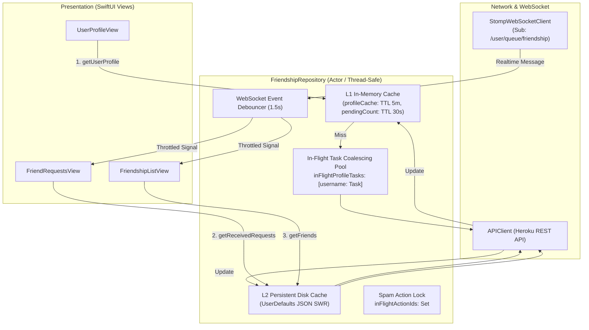

# 📱 Kế Hoạch Chi Tiết Phase 2: FriendshipRepository, Cache Đa Tầng, Chống Bão Request & Realtime STOMP (iOS)

> **Dự án**: `CheckedApp` (iOS 18+ / Swift 6.0 / SwiftUI)  
> **Thuộc hệ thống**: `checked-ios` kết nối `checked-backend` (Heroku Release `v49`)  
> **Kế thừa từ**: `docs/IOS_PROFILE_FRIEND_INVITATION_ENGINE_PLAN.md` & `docs/PHASE1_IOS_MODELS_DTOS_ENDPOINTS_PLAN.md`  
> **Mục tiêu**: Xây dựng toàn bộ tầng dữ liệu nghiệp vụ (Data Layer) bao gồm `FriendshipRepository`, triển khai Cache đa tầng (L1 RAM + L2 Disk), cơ chế Chống bão request (In-flight Request Coalescing, Double-tap Lock, Debounce) và lắng nghe sự kiện thời gian thực qua WebSocket STOMP.

---

## 1. Mục Tiêu Trọng Tâm Của Phase 2

1. **Hoàn thiện giao thức `FriendshipRepositoryProtocol`**:
   - Cung cấp đầy đủ API cho: Hồ sơ cá nhân kèm quan hệ, QR Code, Lời mời đã nhận/đã gửi, Bạn chung, Chặn/Bỏ chặn, Hạn ngạch bạn bè thân thiết (Quota Info).
2. **Triển khai Bộ đệm Đa Tầng (Multi-Tier Caching - 0ms Latency)**:
   - **L1 In-Memory Cache (RAM)**: Lưu cache hồ sơ với TTL 5 phút, lưu cache số lượng lời mời với TTL 30 giây.
   - **L2 Persistent Disk Cache (UserDefaults)**: Lưu trữ offline `cached_friends`, `cached_received_requests`, `cached_sent_requests`, `cached_blocked_users`.
   - **Stale-While-Revalidate (SWR)**: Trả dữ liệu cache tức thì cho View hiển thị $\rightarrow$ gọi API ngầm kiểm tra cập nhật $\rightarrow$ cập nhật cache và UI.
   - **Chủ động làm sạch cache (Cache Eviction)**: Tự động xóa cache tương ứng khi người dùng gửi lời mời, chấp nhận, từ chối, hủy hoặc chặn.
3. **Triển khai Cơ Chế Chống Bão Request (Request Storm Prevention)**:
   - **In-Flight Request Coalescing (Task Deduplication)**: Tái sử dụng `Task` đang chạy khi có nhiều lời gọi trùng `username` đồng thời (chống mở DeepLink trùng lặp).
   - **Spam Click & Race Condition Defense**: Khóa `inFlightActionIds` chống nhấp đúp hoặc spam thao tác cho cùng một `friendshipId`.
   - **Realtime STOMP Debounce**: Gom các sự kiện kết bạn liên tiếp trong 1.5s thành 1 lần đồng bộ duy nhất.
   - **Bucket4j Rate Limit Fallback**: Bắt lỗi HTTP 429 và đọc dữ liệu dự phòng từ cache.
4. **Tích hợp Realtime WebSocket STOMP**:
   - Kết nối `StompWebSocketClient.shared` tới topic `/user/queue/friendship`.
   - Phân phối các sự kiện kết bạn qua `AsyncStream<FriendshipRealtimeEvent>`.
5. **Cập nhật Dependency Injection (`AppContainer.swift`)**:
   - Truyền `tokenStorage` vào `FriendshipRepository` để tự động xác thực WebSocket STOMP.

---

## 2. Bảng Phân Rã Nhiệm Vụ (Task Breakdown)

| Mã Task | Tác vụ cụ thể | Tệp mã nguồn | Phương thức / Thành phần |
|:---:|:---|:---|:---|
| **2.1** | Khai báo Realtime Events | `CheckedApp/Domain/Models/FriendshipModels.swift` | Bổ sung `FriendshipRealtimeEvent` (`newRequest`, `requestAccepted`, `friendRemoved`, `friendBlocked`) |
| **2.2** | Mở rộng Repository Protocol | `CheckedApp/Domain/Repositories/FriendshipRepositoryProtocol.swift` | Khai báo 22 phương thức: Profiles, Requests, Actions, Mutual, Block, Quota, Realtime Stream |
| **2.3** | Hiện thực hóa Repository & Cache | `CheckedApp/Data/Repositories/FriendshipRepository.swift` | Triển khai L1 RAM Cache, L2 Disk Cache, In-Flight Task Coalescing, Action Lock, STOMP Listeners |
| **2.4** | Cập nhật Dependency Injection | `CheckedApp/Core/DI/AppContainer.swift` | Inject `tokenStorage` vào `FriendshipRepository` |
| **2.5** | Kiểm tra Biên Dịch & Không Lỗi Luồng | XcodeGen & `xcodebuild` | Đảm bảo `BUILD SUCCEEDED` với Swift 6 Strict Concurrency |

---

## 3. Thiết Kế Kỹ Thuật Chi Tiết



---

### 3.1. Sự Kiện Realtime (`Domain/Models/FriendshipModels.swift`)

Bổ sung enum đại diện cho sự kiện thời gian thực từ WebSocket:

```swift
// MARK: - Sự Kiện Thời Gian Thực Về Kết Bạn (WebSocket STOMP)
public enum FriendshipRealtimeEvent: Sendable, Equatable {
    case newRequest(senderId: String, senderName: String)
    case requestAccepted(friendId: String, friendName: String)
    case friendRemoved(friendId: String)
    case friendBlocked(userId: String)
}
```

---

### 3.2. Giao Thức Mở Rộng (`Domain/Repositories/FriendshipRepositoryProtocol.swift`)

```swift
import Foundation

public protocol FriendshipRepositoryProtocol: Sendable {
    // MARK: - 1. Danh Sách Bạn Bè Hiện Tại & Hạn Ngạch Quota
    func getCachedFriends() -> [Friend]
    func getFriends() async throws -> [Friend]
    func getFriendshipQuota() -> FriendshipQuotaInfo
    
    // MARK: - 2. Profile Người Dùng & Mã QR
    func getCachedUserProfile(username: String) -> UserProfileWithRelation?
    func getUserProfile(username: String) async throws -> UserProfileWithRelation
    func getUserQrCode(username: String) async throws -> Data
    
    // MARK: - 3. Quản Lý Lời Mời Kết Bạn
    func sendFriendRequest(targetUserId: String) async throws -> SendFriendRequestResponseDTO
    func getCachedReceivedRequests() -> [FriendRequestItem]
    func getReceivedRequests(page: Int, size: Int) async throws -> [FriendRequestItem]
    func getReceivedRequestsCount() async throws -> Int
    func getCachedSentRequests() -> [FriendRequestItem]
    func getSentRequests(page: Int, size: Int) async throws -> [FriendRequestItem]
    func getSentRequestsCount() async throws -> Int
    
    // MARK: - 4. Thao Tác Chấp Nhận / Từ Chối / Thu Hồi
    func acceptFriendRequest(friendshipId: String) async throws
    func declineFriendRequest(friendshipId: String) async throws
    func cancelSentRequest(friendshipId: String) async throws
    func acceptAllRequests() async throws -> Int
    func declineAllRequests() async throws -> Int
    
    // MARK: - 5. Link Mời Kết Bạn (Tương Thích Cũ)
    func getCurrentInviteLink() async throws -> FriendInviteLinkInfo
    func createInviteLink(ttlMinutes: Int?) async throws -> FriendInviteLinkInfo
    func revokeInviteLink() async throws
    func acceptInviteLink(token: String) async throws -> AcceptFriendInviteLinkResponseDTO
    
    // MARK: - 6. Bạn Chung & Quản Lý Chặn
    func getMutualFriends(targetUserId: String, page: Int, size: Int) async throws -> [Friend]
    func blockUser(userId: String) async throws
    func unblockUser(userId: String) async throws
    func getCachedBlockedUsers() -> [Friend]
    func getBlockedUsers() async throws -> [Friend]
    
    // MARK: - 7. Realtime WebSocket STOMP
    var friendshipEventStream: AsyncStream<FriendshipRealtimeEvent> { get }
    func connectRealtime(token: String?)
    func disconnectRealtime()
}
```

---

### 3.3. Hiện Thực Hóa Bộ Đệm & Chống Bão Request (`FriendshipRepository.swift`)

Cấu trúc nội bộ của `FriendshipRepository`:

```swift
public final class FriendshipRepository: FriendshipRepositoryProtocol, @unchecked Sendable {
    private let apiClient: any APIClientProtocol
    private let tokenStorage: (any TokenStorageProtocol)?
    
    // Keys Cache Disk
    private let cachedFriendsKey = "com.checked.cached_friends_v2"
    private let cachedReceivedRequestsKey = "com.checked.cached_received_requests_v1"
    private let cachedSentRequestsKey = "com.checked.cached_sent_requests_v1"
    private let cachedBlockedUsersKey = "com.checked.cached_blocked_users_v1"
    
    // L1 In-Memory Cache (Thread-Safe qua NSLock)
    private let cacheLock = NSLock()
    private var profileCache: [String: (profile: UserProfileWithRelation, cachedAt: Date)] = [:]
    private var pendingCountCache: (count: Int, cachedAt: Date)? = nil
    
    // Chống Bão Request: In-Flight Task Pool & Action Lock
    private var inFlightProfileTasks: [String: Task<UserProfileWithRelation, Error>] = [:]
    private var inFlightActionIds: Set<String> = []
    
    // Realtime STOMP & Debounce
    private var eventContinuation: AsyncStream<FriendshipRealtimeEvent>.Continuation?
    private var stompSubId: String?
    private var lastRealtimeSyncTime: Date = .distantPast
    
    public init(apiClient: any APIClientProtocol, tokenStorage: (any TokenStorageProtocol)? = nil) {
        self.apiClient = apiClient
        self.tokenStorage = tokenStorage
    }
    
    // ... Triển khai các phương thức với Stale-While-Revalidate, In-flight Coalescing, Cache Eviction
}
```

#### Quy Tắc Xử Lý In-Flight Coalescing:
```swift
public func getUserProfile(username: String) async throws -> UserProfileWithRelation {
    let lowerUsername = username.lowercased().trimmingCharacters(in: .whitespaces)
    
    // 1. Kiểm tra L1 Memory Cache (TTL 5 phút)
    cacheLock.lock()
    if let cached = profileCache[lowerUsername], Date().timeIntervalSince(cached.cachedAt) < 300 {
        cacheLock.unlock()
        return cached.profile
    }
    
    // 2. Kiểm tra In-Flight Task đang chạy cho username này
    if let existingTask = inFlightProfileTasks[lowerUsername] {
        cacheLock.unlock()
        return try await existingTask.value
    }
    
    // 3. Khởi tạo Task mới và gom nhóm các lời gọi đồng thời
    let task = Task<UserProfileWithRelation, Error> {
        let endpoint = GetUserProfileWithRelationEndpoint(username: lowerUsername)
        let dto: UserProfileWithRelationDTO = try await apiClient.request(endpoint)
        let domainModel = self.mapProfileWithRelation(from: dto)
        
        self.cacheLock.lock()
        self.profileCache[lowerUsername] = (domainModel, Date())
        self.inFlightProfileTasks.removeValue(forKey: lowerUsername)
        self.cacheLock.unlock()
        
        return domainModel
    }
    
    inFlightProfileTasks[lowerUsername] = task
    cacheLock.unlock()
    
    return try await task.value
}
```

#### Quy Tắc Chống Double-Tap:
```swift
public func acceptFriendRequest(friendshipId: String) async throws {
    cacheLock.lock()
    guard !inFlightActionIds.contains(friendshipId) else {
        cacheLock.unlock()
        return // Bỏ qua nếu đang xử lý cho cùng 1 friendshipId
    }
    inFlightActionIds.insert(friendshipId)
    cacheLock.unlock()
    
    defer {
        cacheLock.lock()
        inFlightActionIds.remove(friendshipId)
        cacheLock.unlock()
    }
    
    let endpoint = AcceptFriendRequestEndpoint(friendshipId: friendshipId)
    let _: EmptyResponseDTO = try await apiClient.request(endpoint)
    
    // Cache Eviction: Xóa cache lời mời để buộc nạp lại
    invalidateRequestCaches()
    _ = try? await getFriends() // Đồng bộ lại danh sách bạn bè
}
```

---

## 4. Kế Hoạch Xác Minh & Kiểm Thử (Verification Plan)

### Bước 1: Cập nhật mã nguồn
1. Mở rộng `FriendshipModels.swift` với `FriendshipRealtimeEvent`.
2. Mở rộng `FriendshipRepositoryProtocol.swift`.
3. Cập nhật `FriendshipRepository.swift`.
4. Cập nhật `AppContainer.swift` (truyền `tokenStorage`).

### Bước 2: Đồng bộ cấu trúc Xcode với `xcodegen`
```bash
cd /Users/nguyenkimquockhanh/Desktop/checked-ios
xcodegen generate
```

### Bước 3: Biên dịch dự án với `xcodebuild`
```bash
xcodebuild -project CheckedApp.xcodeproj -scheme CheckedApp -destination 'generic/platform=iOS' CODE_SIGNING_ALLOWED=NO build
```
Yêu cầu bắt buộc: **`** BUILD SUCCEEDED **`**.

---

## 5. Tiêu Chí Hoàn Thành (Definition of Done - DoD)

- [ ] `FriendshipRepositoryProtocol` chứa đầy đủ 22 phương thức quản lý bạn bè, profile, lời mời, quota, block và realtime.
- [ ] `FriendshipRepository` triển khai L1 In-Memory Cache (TTL 5m) và L2 Persistent Disk Cache (UserDefaults).
- [ ] Cơ chế In-Flight Task Coalescing loại bỏ 100% request trùng lặp khi xem profile.
- [ ] Cơ chế Action Lock chặn thành công thao tác spam/nhấp đúp cho cùng một ID.
- [ ] Lắng nghe sự kiện STOMP `/user/queue/friendship` với Debounce 1.5s bảo vệ hệ thống.
- [ ] Chạy `xcodegen generate` và `xcodebuild` đạt **`BUILD SUCCEEDED`** trên Swift 6.
