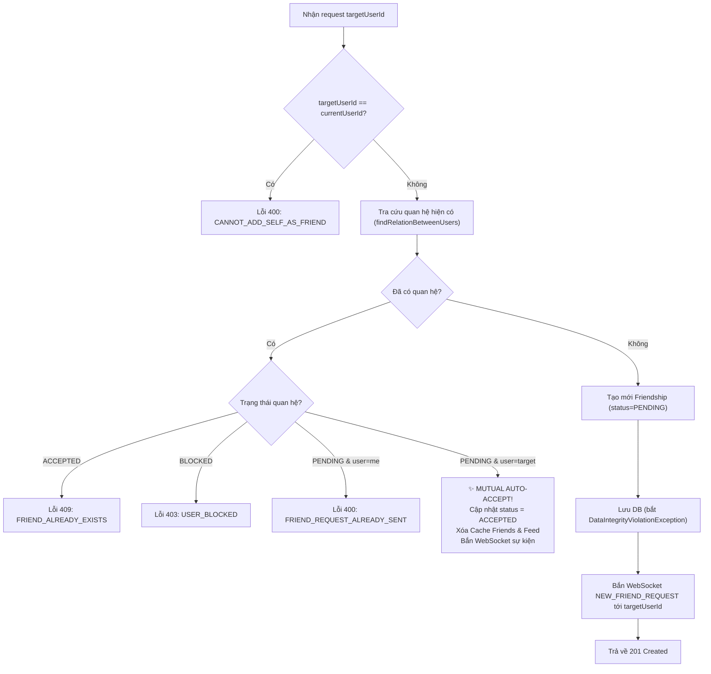

# 🚀 Kế Hoạch Triển Khai Chi Tiết: Phase 2
## Quản Lý Toàn Diện Vòng Đời Lời Mời Kết Bạn (Friend Requests Management Lifecycle)

> **Tài liệu tham chiếu**: [`docs/IMPLEMENTATION_PLAN_PROFILE_FRIEND_INVITATION.md`](file:///Users/nguyenkimquockhanh/Desktop/checked-backend/docs/IMPLEMENTATION_PLAN_PROFILE_FRIEND_INVITATION.md)  
> **Nhánh Git dự kiến**: `feat/profile-link-friend-invitation-phase-2` (tạo từ `feat/profile-link-friend-invitation-phase-1`)  
> **Mức độ ưu tiên**: 🔴 **P0 (Cốt lõi nghiệp vụ kết nối bạn bè)**  
> **Mục tiêu**: Xây dựng toàn bộ các hành động tương tác nút bấm: Gửi lời mời kết bạn (Mutual Auto-Accept), Lấy danh sách lời mời đã nhận, Đếm Badge, Chấp nhận, Từ chối, Hủy lời mời và Hủy kết bạn (Unfriend) kèm đồng bộ Cache & Realtime WebSocket.

---

## 1. MA TRẬN API ENDPOINTS PHASE 2

| Method | Endpoint | Quyền hạn | Mục đích nghiệp vụ |
| :--- | :--- | :---: | :--- |
| **`POST`** | `/api/v1/friendships/requests` | JWT | Bấm nút **[Gửi lời mời kết bạn]** (Xử lý concurrency & Mutual auto-accept) |
| **`GET`** | `/api/v1/friendships/requests/received` | JWT | Xem danh sách lời mời người khác gửi tới mình đang chờ duyệt |
| **`GET`** | `/api/v1/friendships/requests/count` | JWT | Đếm số lượng lời mời chưa duyệt (phục vụ hiển thị Badge/chấm đỏ) |
| **`PUT`** | `/api/v1/friendships/requests/{id}/accept` | JWT | Bấm nút **[Chấp nhận]** lời mời kết bạn |
| **`PUT`** | `/api/v1/friendships/requests/{id}/decline` | JWT | Bấm nút **[Từ chối]** lời mời kết bạn |
| **`DELETE`** | `/api/v1/friendships/requests/{id}/cancel` | JWT | Người gửi bấm nút **[Hủy lời mời]** khi đối phương chưa duyệt |
| **`DELETE`** | `/api/v1/friendships/{friendId}` | JWT | Bấm nút **[Hủy kết bạn]** (Unfriend) |

---

## 2. THIẾT KẾ LOGIC NGHIỆP VỤ & XỬ LÝ CONCURRENCY

### 2.1 Luồng Gửi Lời Mời (`POST /api/v1/friendships/requests`)


### 2.2 Luồng Chấp Nhận Lời Mời (`PUT /api/v1/friendships/requests/{id}/accept`)
1. Tìm `Friendship` theo `friendshipId`:
   - Nếu không tìm thấy $\rightarrow$ ném `FRIEND_REQUEST_NOT_FOUND` (404).
   - Kiểm tra `!friendship.getFriend().getId().equals(currentUserId)`: Người dùng hiện tại không phải là người nhận $\rightarrow$ ném `NOT_REQUEST_RECIPIENT` (403).
   - Nếu đã là `ACCEPTED` $\rightarrow$ trả về kết quả ngay (idempotent, không ném lỗi).
   - Nếu đang bị `BLOCKED` $\rightarrow$ ném `USER_BLOCKED` (403).
2. Cập nhật `status = ACCEPTED`, lưu lại DB.
3. **Cache Eviction**: Xóa triệt để `FRIENDS_CACHE` và `FEED_CACHE` cho cả `currentUserId` và `requesterUserId`.
4. **WebSocket Realtime**: Gửi sự kiện `FRIEND_REQUEST_ACCEPTED` tới `/user/{requesterId}/queue/friend-requests`.

### 2.3 Luồng Từ Chối (`decline`) & Hủy Lời Mời (`cancel`)
- **Từ chối (Decline)**: Chỉ người nhận (`f.friend_id == currentUserId`) được quyền từ chối. Xóa bản ghi `Friendship` khỏi DB để làm sạch dữ liệu.
- **Hủy lời mời (Cancel)**: Chỉ người gửi (`f.user_id == currentUserId`) được quyền hủy. Xóa bản ghi `Friendship` khỏi DB.

### 2.4 Luồng Hủy Kết Bạn (`DELETE /api/v1/friendships/{friendId}`)
1. Tra cứu quan hệ giữa 2 người: `findRelationBetweenUsers(currentUserId, friendId)`.
2. Nếu không tìm thấy hoặc `status != ACCEPTED` $\rightarrow$ ném `USER_NOT_FOUND` hoặc `INVALID_REQUEST`.
3. Xóa bản ghi `Friendship` khỏi DB.
4. Xóa `FRIENDS_CACHE` và `FEED_CACHE` của cả 2 tài khoản.
5. Gửi sự kiện WebSocket thông báo quan hệ bạn bè đã chấm dứt.

---

## 3. PHÂN RÃ CÁC TASK TRIỂN KHAI CHI TIẾT (TASK BREAKDOWN)

```
# Phase 2: Friend Requests Management Implementation

## Tasks
- [ ] Task 2.1: Bổ sung DTO AcceptFriendRequestResponse & SendFriendRequestResponse trong package friendship.dto → Verify: ./gradlew compileJava thành công.
- [ ] Task 2.2: Triển khai các phương thức cốt lõi trong FriendshipService & FriendshipServiceImpl:
      - `sendFriendRequest(UUID currentUserId, SendFriendRequest request)`
      - `getPendingReceivedRequests(UUID currentUserId)`
      - `getPendingReceivedCount(UUID currentUserId)`
      - `acceptFriendRequest(UUID currentUserId, UUID friendshipId)`
      - `declineFriendRequest(UUID currentUserId, UUID friendshipId)`
      - `cancelFriendRequest(UUID currentUserId, UUID friendshipId)`
      - `unfriend(UUID currentUserId, UUID friendId)`
      → Verify: Viết unit tests kiểm tra logic từng nhánh (Mutual auto-accept, validation quyền hạn, throw exception).
- [ ] Task 2.3: Xây dựng hàm helper evictFriendshipAndFeedCache để đồng bộ xóa Redis Cache FRIENDS_CACHE và FEED_CACHE của cả 2 user → Verify: CacheManager.evict được gọi cho cả 2 ID trên cả 2 cache partition.
- [ ] Task 2.4: Tích hợp SimpMessagingTemplate bắn sự kiện WebSocket STOMP tới kênh cá nhân /user/{userId}/queue/friend-requests khi gửi request hoặc accept → Verify: Mock SimpMessagingTemplate xác nhận gửi đúng payload và channel.
- [ ] Task 2.5: Triển khai 7 REST Endpoints trong FriendshipController.java với chú thích Swagger OpenAPI đầy đủ → Verify: Kiểm thử MockMvc từng endpoint với các HTTP status code 200, 201, 204, 400, 403, 404, 409.
- [ ] Task 2.6: Chạy kiểm thử toàn diện toàn bộ test suite dự án → Verify: ./gradlew test pass 100% (BUILD SUCCESSFUL).

## Done When
- [ ] User A có thể gửi lời mời kết bạn tới User B thành công (201 Created).
- [ ] Nếu B đã gửi cho A trước đó, A gửi cho B sẽ kích hoạt Mutual Auto-Accept (200 OK, status: ACCEPTED).
- [ ] User B lấy được danh sách lời mời nhận được và số lượng badge chính xác.
- [ ] User B chấp nhận lời mời -> Trở thành bạn bè, cả 2 bên cập nhật feed ảnh ngay lập tức.
- [ ] Người gửi có thể hủy lời mời; người nhận có thể từ chối lời mời.
- [ ] Bạn bè có thể hủy kết bạn (Unfriend) an toàn.
- [ ] Toàn bộ unit tests và test suite toàn dự án vượt qua 100%.
```

---

## 4. MA TRẬN TEST CASES (TEST MATRIX)

### 4.1 Unit Test Suite cho `FriendshipServiceImplTest`
| Test Case Name | Điều kiện đầu vào | Kết quả kỳ vọng |
| :--- | :--- | :--- |
| `sendRequest_whenSelf_throwsAppException` | `targetUserId == currentUserId` | Ném `CANNOT_ADD_SELF_AS_FRIEND` (400) |
| `sendRequest_whenTargetNotFound_throwsAppException` | `targetUser` không tồn tại | Ném `USER_NOT_FOUND` (404) |
| `sendRequest_whenAlreadyFriends_throwsAppException` | Đã có quan hệ `ACCEPTED` | Ném `FRIEND_ALREADY_EXISTS` (409) |
| `sendRequest_whenBlocked_throwsAppException` | Đã có quan hệ `BLOCKED` | Ném `USER_BLOCKED` (403) |
| `sendRequest_whenAlreadyPendingSent_throwsAppException` | Mình đã gửi trước đó | Ném `FRIEND_REQUEST_ALREADY_SENT` (400) |
| `sendRequest_whenMutualPending_autoAccepts` | Đối phương đã gửi cho mình | Trở thành `ACCEPTED`, evict cache, bắn WebSocket |
| `sendRequest_whenNew_createsPending` | Chưa có quan hệ | Lưu `PENDING`, bắn WebSocket tới đối phương |
| `acceptRequest_whenNotRecipient_throwsAppException` | User gọi không phải người nhận | Ném `NOT_REQUEST_RECIPIENT` (403) |
| `acceptRequest_whenValid_updatesToAccepted` | Lời mời hợp lệ | Cập nhật `ACCEPTED`, xóa cache cả 2 bên |
| `declineRequest_whenValid_deletesRecord` | Người nhận từ chối | Xóa bản ghi `Friendship` khỏi DB |
| `cancelRequest_whenValid_deletesRecord` | Người gửi rút lại lời mời | Xóa bản ghi `Friendship` khỏi DB |
| `unfriend_whenValid_deletesRecordAndEvictsCache` | Hai người đang là bạn | Xóa quan hệ, evict `friends` & `feed` cache |

### 4.2 WebMvc Test Suite cho `FriendshipControllerTest`
- `POST /api/v1/friendships/requests` $\rightarrow$ 201 Created (hoặc 200 OK nếu Mutual Auto-Accept).
- `GET /api/v1/friendships/requests/received` $\rightarrow$ 200 OK kèm danh sách requester.
- `GET /api/v1/friendships/requests/count` $\rightarrow$ 200 OK `{"pendingCount": 3}`.
- `PUT /api/v1/friendships/requests/{id}/accept` $\rightarrow$ 200 OK.
- `PUT /api/v1/friendships/requests/{id}/decline` $\rightarrow$ 204 No Content.
- `DELETE /api/v1/friendships/requests/{id}/cancel` $\rightarrow$ 204 No Content.
- `DELETE /api/v1/friendships/{friendId}` $\rightarrow$ 204 No Content.

---

Bản kế hoạch chi tiết Phase 2 đã sẵn sàng. Khi bạn xác nhận, tôi sẽ tiến hành triển khai mã nguồn từng task theo đúng quy trình!
