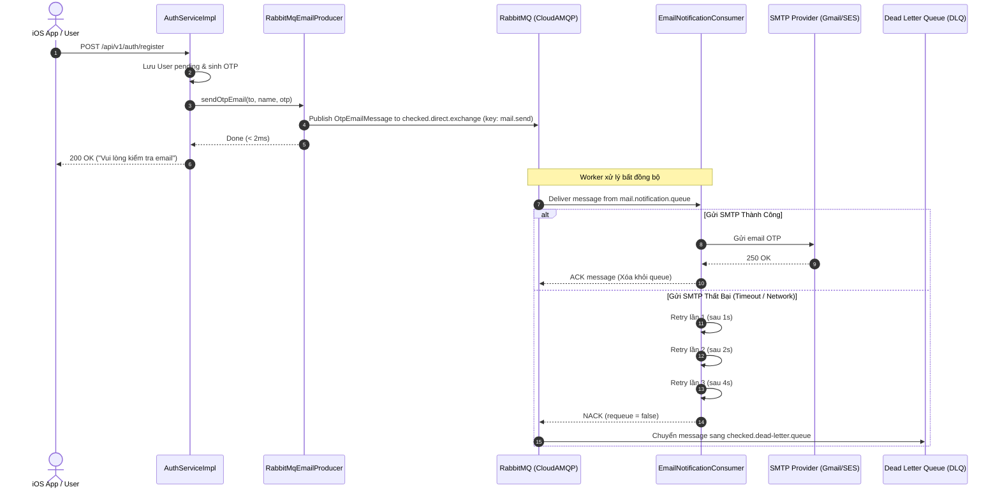

# Kế Hoạch Chi Tiết PR #6: Worker Gửi Email OTP Bất Đồng Bộ & Xử Lý Thất Bại (Async Email Worker with DLQ)

> **Tài liệu tham chiếu:**  
> - [REDIS_VALKEY_AND_RABBITMQ_CLOUD_INTEGRATION_PLAN.md](file:///Users/nguyenkimquockhanh/Desktop/checked-backend/docs/REDIS_VALKEY_AND_RABBITMQ_CLOUD_INTEGRATION_PLAN.md) (Kiến trúc tổng thể)  
> - [REDIS_RABBITMQ_PR_CHECKLIST.md](file:///Users/nguyenkimquockhanh/Desktop/checked-backend/docs/REDIS_RABBITMQ_PR_CHECKLIST.md) (Checklist tiến độ)  
> **Nhánh Git dự kiến:** `feat/rabbitmq-async-email-worker`  
> **Mức độ ưu tiên:** 🟢 **P2 (Medium)**  
> **Mục tiêu:** Chuyển đổi toàn bộ luồng gửi email OTP sang hướng bất đồng bộ (Event-Driven) qua CloudAMQP RabbitMQ, giải phóng thread pool HTTP request, tích hợp chính sách Retry tự động và Dead Letter Queue (DLQ) để chống mất mát dữ liệu 100%.

---

## 1. Vấn Đề Kỹ Thuật & Động Lực (Problem & Motivation)

### 1.1. Hiện Trạng & Rủi Ro
- Hiện tại, luồng đăng ký tài khoản `AuthServiceImpl.register`:
  ```java
  emailService.sendOtpEmail(user.getEmail(), user.getDisplayName(), otpCode);
  ```
- Implementation `SmtpEmailService` đang dùng annotation `@Async("mailTaskExecutor")` dựa trên Thread Pool trong bộ nhớ JVM (`ThreadPoolTaskExecutor`):
  1. **Nguy cơ mất mát tin nhắn (Message Loss)**: Khi dyno Heroku khởi động lại, deploy bản mới hoặc bị restart do OOM, toàn bộ các email OTP đang nằm trong hàng đợi in-memory sẽ bị hủy và biến mất vĩnh viễn. Người dùng không nhận được OTP và bị kẹt luồng đăng ký.
  2. **Không có Dead Letter Queue (DLQ)**: Khi nhà cung cấp SMTP (Gmail, SendGrid, Amazon SES) gặp sự cố timeout hoặc rate limit, lỗi chỉ được ghi vào file log (`log.error`), không có cơ chế lưu trữ để retry hay re-process.
  3. **Không thể scale độc lập**: Xử lý gửi mail gắn chặt với tiến trình web server API, không thể tách riêng worker instance để scale độc lập khi có chiến dịch quảng bá với hàng ngàn người dùng đăng ký cùng lúc.

### 1.2. Giải Pháp với RabbitMQ CloudAMQP
- Chuyển việc gửi email sang mô hình **Message-Driven**:
  1. API Server đẩy message `OtpEmailMessage` vào RabbitMQ Exchange `checked.direct.exchange` với routing key `mail.send` (thời gian xử lý `< 2ms`).
  2. Phản hồi HTTP request `200 OK` cho client iOS ngay lập tức mà không phải chờ đợi SMTP.
  3. Worker `EmailNotificationConsumer` lắng nghe queue `mail.notification.queue`, nhận message và thực thi gửi email HTML/Text.
  4. Nếu gặp lỗi SMTP, Spring AMQP kích hoạt cơ chế **Exponential Backoff Retry** (thử lại 3 lần: 1s, 2s, 4s).
  5. Nếu sau 3 lần vẫn thất bại, message tự động chuyển qua `checked.dlx.exchange` vào **`checked.dead-letter.queue`** để phục vụ giám sát và re-process mà không bao giờ mất thông điệp.

---

## 2. Kiến Trúc Hàng Đợi & Luồng Dữ Liệu (Message Flow)



---

## 3. Thiết Kế Chi Tiết & Thành Phần Triển Khai

### 3.1. DTO Message: `OtpEmailMessage`
Tạo record bất biến (Immutable Record) trong package `com.codegym.locketclone.notification.dto`:
```java
package com.codegym.locketclone.notification.dto;

import java.io.Serializable;
import java.time.LocalDateTime;

public record OtpEmailMessage(
        String toEmail,
        String recipientName,
        String otpCode,
        String subject,
        String messageType,
        LocalDateTime createdAt
) implements Serializable {}
```

### 3.2. Cấu Hình RabbitMQ Listener & Retry Policy (`RabbitMQConfig.java` / `application.yml`)
1. Cấu hình container factory listener trong `RabbitMQConfig.java`:
   - Thiết lập `SimpleRabbitListenerContainerFactory`.
   - Bật retry interceptor:
     - `maxAttempts`: 3
     - `initialInterval`: 1000ms
     - `multiplier`: 2.0
     - `maxInterval`: 5000ms
   - Khi hết số lần retry: cấu hình `RepublishMessageRecoverer` hoặc `RejectAndDontRequeueRecoverer` để message được đẩy sang `checked.dlx.exchange` (`x-dead-letter-exchange` đã được cấu hình từ PR1).
2. Đồng bộ trong `src/main/resources/application.yml` và `src/test/resources/application.yml`:
   ```yaml
   spring:
     rabbitmq:
       listener:
         simple:
           retry:
             enabled: true
             initial-interval: 1000ms
             max-attempts: 3
             multiplier: 2.0
             max-interval: 5000ms
           default-requeue-rejected: false
   ```

### 3.3. Email Producer: `RabbitMqEmailProducer`
Triển khai `EmailService` với annotation `@Primary`:
- Inject `RabbitTemplate`.
- Chuyển đổi tham số thành `OtpEmailMessage`.
- Đẩy message vào `RabbitMQConfig.CHECKED_DIRECT_EXCHANGE` với routing key `RabbitMQConfig.MAIL_NOTIFICATION_ROUTING_KEY`.
- **Graceful Fallback**: Bọc try-catch `AmqpException`. Nếu RabbitMQ tạm thời không kết nối được (circuit open), tự động fallback gọi trực tiếp `SmtpEmailService` hoặc log cảnh báo để đảm bảo luồng đăng ký tài khoản không bao giờ bị dừng (Zero-disruption).

### 3.4. Email Consumer: `EmailNotificationConsumer`
Tạo listener component trong package `com.codegym.locketclone.notification.consumer`:
- `@RabbitListener(queues = RabbitMQConfig.MAIL_NOTIFICATION_QUEUE)`
- Nhận `OtpEmailMessage`.
- Gọi `SmtpEmailService` (hoặc `JavaMailSender`) gửi email thực tế.
- Ghi log tiến trình: nhận message, thời gian xử lý, trạng thái gửi.

---

## 4. Kế Hoạch Kiểm Thử Chi Tiết (Integration Test Suite)

Tạo test class: `src/test/java/com/codegym/locketclone/infra/AsyncEmailWorkerTest.java`:
1. **Test 1: Publish & Consume Thành Công (`testSuccessfulEmailPublishAndConsumption`)**:
   - Gửi `sendOtpEmail` qua `EmailService`.
   - Verify `RabbitTemplate` publish message vào exchange.
   - Verify `EmailNotificationConsumer` nhận được message với đầy đủ thông tin `toEmail`, `recipientName`, `otpCode`.
2. **Test 2: Retry Policy & Dead Letter Queue Routing (`testFailedEmailRoutesToDeadLetterQueue`)**:
   - Giả lập lỗi SMTP trong Consumer (ném `MailSendException`).
   - Xác nhận cơ chế Retry chạy đủ 3 lần với backoff.
   - Xác nhận sau lần thứ 3, message bị nack và được RabbitMQ tự động đẩy vào `checked.dead-letter.queue`.
   - Đọc từ `checked.dead-letter.queue` và xác nhận message vẫn nguyên vẹn.
3. **Test 3: Graceful Fallback (`testProducerFallbackWhenRabbitUnavailable`)**:
   - Xác nhận khi RabbitMQ gặp sự cố, ứng dụng không ném HTTP 500 cho người dùng.

> [!IMPORTANT]
> **Cam Kết Bảo Mật 100%:**
> - Tuyệt đối không hardcode credentials trong class test hay bất kỳ file commit nào.
> - Toàn bộ thông số RabbitMQ kết nối thông qua biến môi trường nạp tự động từ `.env` bởi task Gradle.

---

## 5. Kế Hoạch Triển Khai Từng Bước (Execution Checklist)

| Bước | Nhiệm Vụ | File Ảnh Hưởng |
| :---: | :--- | :--- |
| **1** | Tạo branch Git mới | `git checkout -b feat/rabbitmq-async-email-worker` |
| **2** | Định nghĩa DTO `OtpEmailMessage` | `notification/dto/OtpEmailMessage.java` |
| **3** | Cấu hình Retry & Listener Container Factory | `common/config/RabbitMQConfig.java`, `application.yml` |
| **4** | Xây dựng Producer `RabbitMqEmailProducer` với Graceful Fallback | `notification/RabbitMqEmailProducer.java` |
| **5** | Xây dựng Consumer `EmailNotificationConsumer` | `notification/consumer/EmailNotificationConsumer.java` |
| **6** | Viết Integration Test `AsyncEmailWorkerTest.java` | `infra/AsyncEmailWorkerTest.java` |
| **7** | Chạy kiểm thử toàn bộ dự án | `./gradlew test` (Verify 100% PASS) |
| **8** | Cập nhật checklist & commit Git sạch sẽ | `docs/REDIS_RABBITMQ_PR_CHECKLIST.md` |
| **9** | Merge vào `main`, push GitHub & Deploy Heroku | Release `v36` |
