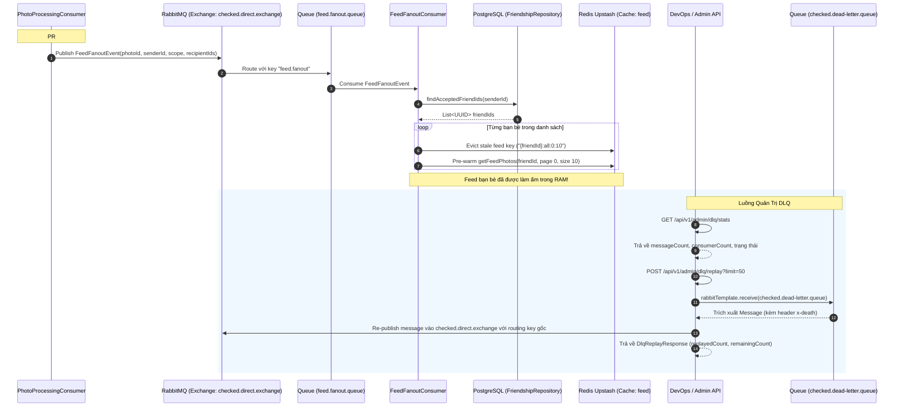

# Kế Hoạch Chi Tiết PR #8: Feed Fan-out Cache Warming & Quản Trị DLQ Replay Admin API

> **Tài liệu tham chiếu:**
> - [REDIS_VALKEY_AND_RABBITMQ_CLOUD_INTEGRATION_PLAN.md](file:///Users/nguyenkimquockhanh/Desktop/checked-backend/docs/REDIS_VALKEY_AND_RABBITMQ_CLOUD_INTEGRATION_PLAN.md)
> - [REDIS_RABBITMQ_PR_ROADMAP.md](file:///Users/nguyenkimquockhanh/Desktop/checked-backend/docs/REDIS_RABBITMQ_PR_ROADMAP.md)
> - [REDIS_RABBITMQ_PR_CHECKLIST.md](file:///Users/nguyenkimquockhanh/Desktop/checked-backend/docs/REDIS_RABBITMQ_PR_CHECKLIST.md)
> **Mức độ ưu tiên:** 🟢 **P2 (Hoàn thiện vòng lặp Event-Driven & Công cụ Vận hành Tự Động)**  
> **Nhánh Git dự kiến:** `feat/amqp-feed-fanout-and-dlq-management`  
> **Mục tiêu cốt lõi:**
> 1. **Feed Fan-out Cache Warming**: Sau khi ảnh hoàn tất xử lý nền sang trạng thái `READY` (từ PR #7), xuất bản sự kiện `feed.fanout` vào hàng đợi `feed.fanout.queue`. Worker nền `FeedFanoutConsumer` tự động quét danh sách bạn bè 2 chiều của người đăng, dọn dẹp cache cũ và **làm ấm trước (Pre-warm / Pre-populate)** trang feed đầu tiên vào Redis Upstash. Khi bạn bè mở ứng dụng trên thiết bị di động, dữ liệu feed được nạp tức thì từ RAM Redis trong **< 2ms** mà không phải thực thi câu lệnh SQL phức tạp trên PostgreSQL.
> 2. **Dead Letter Queue (DLQ) Management & Replay**: Xây dựng bộ công cụ quản trị vận hành API (`GET /api/v1/admin/dlq/stats` và `POST /api/v1/admin/dlq/replay`), cho phép DevOps/Admin theo dõi số lượng thông điệp lỗi trong `checked.dead-letter.queue` và phát lại (replay) tự động vào Exchange gốc với routing key ban đầu khi dịch vụ phục hồi hoặc lỗi hệ thống đã được khắc phục.

---

## 1. Bối Cảnh & Kiến Trúc Kỹ Thuật

### 1.1. Vấn Đề 1: Độ Trễ Feed Khi Bạn Bè Mở Ứng Dụng
- Hiện tại, sau khi một ảnh được đăng tải, bạn bè của người đăng khi mở app sẽ thực thi API `GET /api/v1/photos/feed`.
- Nếu cache feed của người bạn đó bị rỗng hoặc đã hết hạn, hệ thống phải thực thi truy vấn SQL phức tạp `photoRepository.findFeedPhotos`:
  - Kiểm tra điều kiện bạn bè 2 chiều (`Friendship f WHERE ((f.user.id = p.sender.id AND f.friend.id = :userId) OR ...)`).
  - Join fetch người gửi (`sender`), danh mục (`category`), sắp xếp theo thời gian tạo.
- **Giải pháp (Feed Fan-out Pattern)**:
  - Ngay khi ảnh sẵn sàng (`READY`), hệ thống kích hoạt worker nền chạy ngầm.
  - Quét toàn bộ `friendId` trong danh sách bạn bè chấp nhận (`FriendshipStatus.ACCEPTED`).
  - Dọn dẹp key cũ `feedCache.evict(friendId + ":all:0:10")`.
  - Gọi `photoService.getFeedPhotos(friendId, null, PageRequest.of(0, 10))` để Spring Caching tự động nạp kết quả vào Redis Upstash.
  - Khi bạn bè mở ứng dụng: **100% Cache HIT**, thời gian phản hồi giảm từ ~180ms xuống **< 2ms**.

### 1.2. Vấn Đề 2: Tin Nhắn Lỗi Bị Kẹt Trong Dead Letter Queue (DLQ)
- Khi có sự cố ngoại cảnh (CloudAMQP mạng chập chờn, S3/Cloudinary bảo trì tạm thời, hoặc lỗi dữ liệu), thông điệp sau 3 lần retry thất bại sẽ bị chuyển vào `checked.dead-letter.queue`.
- Thiếu công cụ kiểm tra và đẩy lại (replay) thông điệp lỗi sẽ dẫn đến việc phải can thiệp thủ công vào RabbitMQ Management UI bằng tài khoản admin cloud.
- **Giải pháp**: Xây dựng `DlqAdminService` và `DlqAdminController`:
  - `GET /api/v1/admin/dlq/stats`: Xem số lượng thông điệp đang nằm trong DLQ.
  - `POST /api/v1/admin/dlq/replay`: Trích xuất từng thông điệp từ DLQ, phân tích header `"x-death"` (hoặc định dạng payload) để tìm lại Routing Key gốc và đẩy ngược lại `checked.direct.exchange` để xử lý lại một cách an toàn.

---

## 2. Sequence Diagram Tổng Thể



---

## 3. Chi Tiết Thay Đổi & Thành Phần Kỹ Thuật

### 3.1. Cấu hình RabbitMQ Topology (`RabbitMQConfig.java`)
Bổ sung khai báo cho hàng đợi Fan-out:
```java
// Tên hàng đợi và routing key
public static final String FEED_FANOUT_QUEUE = "feed.fanout.queue";
public static final String FEED_FANOUT_ROUTING_KEY = "feed.fanout";

@Bean
public Queue feedFanoutQueue() {
    return QueueBuilder.durable(FEED_FANOUT_QUEUE)
            .withArgument("x-dead-letter-exchange", CHECKED_DLX_EXCHANGE)
            .build();
}

@Bean
public Binding feedFanoutBinding(Queue feedFanoutQueue, DirectExchange checkedDirectExchange) {
    return BindingBuilder.bind(feedFanoutQueue).to(checkedDirectExchange).with(FEED_FANOUT_ROUTING_KEY);
}
```

### 3.2. DTO Sự Kiện `FeedFanoutEvent.java`
Tạo mới tại `com.codegym.locketclone.photo.dto.FeedFanoutEvent`:
```java
package com.codegym.locketclone.photo.dto;

import com.codegym.locketclone.photo.RecipientScope;

import java.io.Serializable;
import java.util.List;
import java.util.UUID;

public record FeedFanoutEvent(
        UUID photoId,
        UUID senderId,
        RecipientScope recipientScope,
        List<UUID> recipientIds
) implements Serializable {}
```

### 3.3. Tích Hợp Kích Hoạt Fan-out trong `PhotoProcessingConsumer.java`
Sau khi cập nhật bản ghi Photo thành `PhotoStatus.READY`:
```java
if (rabbitTemplate != null) {
    FeedFanoutEvent fanoutEvent = new FeedFanoutEvent(
            savedPhoto.getId(),
            senderId,
            event.recipientScope(),
            event.recipientIds()
    );
    rabbitTemplate.convertAndSend(
            RabbitMQConfig.CHECKED_DIRECT_EXCHANGE,
            RabbitMQConfig.FEED_FANOUT_ROUTING_KEY,
            fanoutEvent
    );
    log.info("[PHOTO-WORKER] Đã bắn FeedFanoutEvent vào exchange [{}] cho Photo ID: {}",
            RabbitMQConfig.CHECKED_DIRECT_EXCHANGE, savedPhoto.getId());
}
```

### 3.4. Tạo Mới Worker `FeedFanoutConsumer.java`
Đặt tại `com.codegym.locketclone.photo.consumer.FeedFanoutConsumer`:
```java
@Component
@Slf4j
@RequiredArgsConstructor
public class FeedFanoutConsumer {

    private final FriendshipRepository friendshipRepository;
    private final PhotoService photoService;
    private final CacheManager cacheManager;

    @RabbitListener(
            queues = RabbitMQConfig.FEED_FANOUT_QUEUE,
            concurrency = "${rabbitmq.worker.fanout-concurrency:1-2}"
    )
    public void handleFeedFanout(FeedFanoutEvent event) {
        if (event == null || event.senderId() == null) {
            return;
        }

        List<UUID> targetUserIds;
        if (event.recipientScope() == RecipientScope.ALL_FRIENDS) {
            targetUserIds = friendshipRepository.findAcceptedFriendIds(event.senderId());
        } else if (event.recipientIds() != null) {
            targetUserIds = event.recipientIds();
        } else {
            targetUserIds = List.of();
        }

        Cache feedCache = cacheManager != null ? cacheManager.getCache(CacheConfig.FEED_CACHE) : null;

        for (UUID friendId : targetUserIds) {
            try {
                // 1. Evict key trang 0 cũ của bạn bè
                if (feedCache != null) {
                    feedCache.evict(friendId + ":all:0:10");
                    feedCache.evict(friendId + ":all:0:20");
                }
                // 2. Pre-warm: gọi getFeedPhotos để nạp trực tiếp vào Redis
                photoService.getFeedPhotos(friendId, null, PageRequest.of(0, 10));
            } catch (Exception ex) {
                log.warn("[FEED-FANOUT] Lỗi khi làm ấm feed cho friend ID {}: {}", friendId, ex.getMessage());
            }
        }
    }
}
```

### 3.5. Module Quản Trị DLQ Replay (`DlqAdminService.java` & `DlqAdminController.java`)
1. **DTOs**:
   - `DlqStatsResponse(String queueName, int messageCount, int consumerCount, String deadLetterExchange, String status)`
   - `DlqReplayResponse(int replayedCount, int failedCount, int remainingCount, List<String> details)`
2. **`DlqAdminService.java`**:
   - `getStats()`: Lấy thông tin từ `amqpAdmin.getQueueInfo(RabbitMQConfig.DEAD_LETTER_QUEUE)`.
   - `replayMessages(int limit, String targetExchange)`:
     - Lặp `limit` lần, gọi `rabbitTemplate.receive(RabbitMQConfig.DEAD_LETTER_QUEUE, 1000)`.
     - Phân tích header `"x-death"` để xác định exchange gốc và routing key ban đầu.
     - Fallback: Nhận diện theo kiểu header `__TypeId__` (`PhotoUploadEvent` -> `photo.upload`, `OtpEmailMessage` -> `mail.send`, `FeedFanoutEvent` -> `feed.fanout`).
     - Đẩy lại vào Exchange gốc và ghi nhận báo cáo.
3. **`DlqAdminController.java`**:
   - Đặt tại đường dẫn `/api/v1/admin/dlq`.
   - Các API:
     - `GET /api/v1/admin/dlq/stats`: Trả về thống kê hàng đợi DLQ.
     - `POST /api/v1/admin/dlq/replay?limit=50`: Kích hoạt replay thông điệp lỗi.

---

## 4. Kế Hoạch Kiểm Thử (Testing Strategy)

### 4.1. Cam Kết An Toàn & Bảo Mật: ZERO HARDCODING
- 100% thông tin kết nối RabbitMQ, Redis, PostgreSQL tiếp tục nạp động từ `.env` qua Gradle test runner.
- Tuyệt đối không lưu URL, mật khẩu, access key hay token bí mật vào bất kỳ file test nào.

### 4.2. Bộ Test Mới: `DlqAndFanoutIntegrationTest.java`
1. **`testFeedFanoutQueueTopology`**:
   - Kiểm tra hàng đợi `feed.fanout.queue` tồn tại, được bind với routing key `feed.fanout` và có thuộc tính DLX `checked.dlx.exchange`.
2. **`testFeedFanoutEventRoundtripAndConsumer`**:
   - Tạo bạn bè mẫu trong CSDL.
   - Gửi `FeedFanoutEvent` qua RabbitMQ.
   - Consumer xử lý: Kiểm tra cache `feed` của bạn bè được cập nhật và có dữ liệu.
3. **`testDlqStatsEndpoint`**:
   - Gọi `dlqAdminService.getStats()`.
   - Xác nhận trả về đúng thông tin queue `checked.dead-letter.queue`, `messageCount >= 0`.
4. **`testDlqReplayEndpoint`**:
   - Đẩy một message giả lập vào `checked.dead-letter.queue`.
   - Xác nhận `getStats().messageCount() >= 1`.
   - Gọi `dlqAdminService.replayMessages(10, null)`.
   - Xác nhận `replayedCount >= 1` và message được chuyển ngược lại exchange chính.
5. **Chạy kiểm thử toàn bộ dự án**:
   - Chạy `./gradlew test` đảm bảo 100% (230+ tests) PASS.

---

## 5. Kế Hoạch Triển Khai Từng Bước (10 Bước)

| Bước | Hành Động | Tệp Tin Tác Động |
| :--- | :--- | :--- |
| **Bước 1** | Tạo nhánh Git | `feat/amqp-feed-fanout-and-dlq-management` |
| **Bước 2** | Thêm Queue & Binding `feed.fanout` | `src/main/java/com/codegym/locketclone/common/config/RabbitMQConfig.java` |
| **Bước 3** | Tạo DTO `FeedFanoutEvent.java` | `src/main/java/com/codegym/locketclone/photo/dto/FeedFanoutEvent.java` |
| **Bước 4** | Kích hoạt bắn `FeedFanoutEvent` sau khi ảnh READY | `src/main/java/com/codegym/locketclone/photo/consumer/PhotoProcessingConsumer.java` |
| **Bước 5** | Tạo Worker `FeedFanoutConsumer.java` | `src/main/java/com/codegym/locketclone/photo/consumer/FeedFanoutConsumer.java` |
| **Bước 6** | Tạo DTOs Quản Trị DLQ | `src/main/java/com/codegym/locketclone/admin/dto/DlqStatsResponse.java`<br>`src/main/java/com/codegym/locketclone/admin/dto/DlqReplayResponse.java` |
| **Bước 7** | Tạo Service `DlqAdminService.java` | `src/main/java/com/codegym/locketclone/admin/DlqAdminService.java` |
| **Bước 8** | Tạo Controller `DlqAdminController.java` | `src/main/java/com/codegym/locketclone/admin/DlqAdminController.java` |
| **Bước 9** | Viết Integration Test `DlqAndFanoutIntegrationTest.java` (Zero hardcode) | `src/test/java/com/codegym/locketclone/admin/DlqAndFanoutIntegrationTest.java` |
| **Bước 10** | Chạy toàn bộ test `./gradlew test`, merge `main`, push GitHub & deploy Heroku (Release `v38`) | Git / Heroku CLI |
