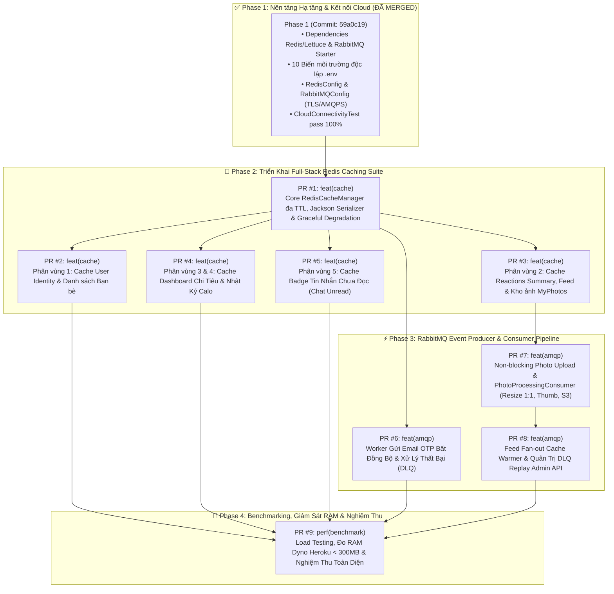

# Lộ Trình & Danh Sách Pull Requests: Tích Hợp Redis & RabbitMQ Cloud

> **Tài liệu căn cứ:** [REDIS_VALKEY_AND_RABBITMQ_CLOUD_INTEGRATION_PLAN.md](file:///Users/nguyenkimquockhanh/Desktop/checked-backend/docs/REDIS_VALKEY_AND_RABBITMQ_CLOUD_INTEGRATION_PLAN.md)  
> **Dự án:** Checked Backend (`locket-clone-api`)  
> **Mục tiêu cốt lõi:**  
> 1. Triệt tiêu 100% nguy cơ sập RAM Heroku (`Error R14`, `Metaspace OOM` trên Dyno 512MB).  
> 2. Giảm độ trễ Upload Ảnh từ 6.700ms xuống < 150ms (Non-blocking Async Worker).  
> 3. Giảm độ trễ Reactions Summary từ 1.600ms xuống < 3ms và Dashboard tính toán từ 800ms xuống < 5ms.  
> 4. Bảo đảm hệ thống an toàn (Graceful Degradation, Dead Letter Queue, Atomic Rollback).  
> **Cập nhật ngày:** 13/10/2026  

---

## 📊 Ma Trận Tổng Thể Các Pull Requests (PR Roadmap Matrix)

---

## 📋 Danh Sách Chi Tiết 9 Pull Requests Thực Hiện

| PR | Nhánh Git | Conventional Commit Title | Độ ưu tiên | Phạm vi tác động | Mục tiêu then chốt |
| :---: | :--- | :--- | :---: | :--- | :--- |
| **#1** | `feat/cache-infra-redis-manager-and-fallback` | `feat(cache): implement multi-ttl redis cache manager with graceful degradation` | 🔴 **P0 (Blocker)** | `common/config`, `security`, `infra` | Thay thế Caffeine bằng Redis đa TTL (10m - 1h), Jackson serializable `UserPrincipal`, Fallback an toàn khi mất mạng Redis. |
| **#2** | `feat/cache-partition-user-and-friendship` | `feat(cache): integrate redis caching for user identity and friendship queries` | 🟡 **P1 (High)** | `security`, `user`, `friendship` | Cache `users::{id}` và `friends::{id}`, giảm 100% query SELECT lặp lại trên JwtFilter và kiểm tra quyền bạn bè. |
| **#3** | `feat/cache-partition-photo-and-reactions` | `feat(cache): cache photo reactions summary, feed, and myphotos with smart eviction` | 🔴 **P0 (Critical)** | `photo`, `photo/dto`, `photo/repository` | Hạ độ trễ Reaction từ 1.600ms xuống < 3ms. Cache feed trang đầu và kho ảnh cá nhân kèm cơ chế evict chuẩn xác. |
| **#4** | `feat/cache-partition-expense-and-calorie` | `feat(cache): cache monthly expense dashboards and daily calorie logs` | 🟡 **P1 (High)** | `expense`, `calorie` | Cache báo cáo thu chi, dòng tiền năm, danh mục chi tiêu và calo hàng ngày. Triệt tiêu các câu lệnh SUM/GROUP BY đắt đỏ. |
| **#5** | `feat/cache-partition-chat-badges` | `feat(cache): cache realtime chat unread badges and conversation previews` | 🟢 **P2 (Medium)** | `chat`, `chat/dto` | Cache tổng số tin nhắn chưa đọc (`chat:unread::{userId}`) cho iOS Badge và danh sách preview hội thoại gần nhất. |
| **#6** | `feat/amqp-mail-notification-worker` | `feat(amqp): decouple otp email delivery into asynchronous rabbitmq consumer` | 🟡 **P1 (High)** | `notification`, `common/config` | Đưa logic gửi mail OTP ra khỏi luồng HTTP, gửi qua `mail.notification.queue`, retry 3 lần, định tuyến DLQ. |
| **#7** | `feat/amqp-photo-processing-worker` | `feat(amqp): implement non-blocking photo upload and async processing worker` | 🔴 **P0 (Critical)** | `photo`, `storage`, `common/config` | Phản hồi Upload API trong < 150ms; chuyển toàn bộ tác vụ giải mã ảnh + nén Thumbnailator + upload S3 sang background worker để chống sập RAM Heroku. |
| **#8** | `feat/amqp-feed-fanout-and-dlq-management` | `feat(amqp): implement feed fan-out cache warming and dlq replay admin api` | 🟢 **P2 (Medium)** | `photo`, `feed`, `common/admin` | Tự động làm ấm cache feed của bạn bè trong nền; cung cấp API `/api/v1/admin/dlq/replay` phục hồi dữ liệu khi có sự cố. |
| **#9** | `perf/redis-rabbitmq-acceptance-and-benchmarking` | `perf(benchmark): verify heroku dyno memory stability and api latency benchmarks` | 🟡 **P1 (High)** | `test`, `docs`, `scripts` | Đo kiểm nghiệm thu: RAM Heroku < 300MB/512MB, Latency Reactions < 3ms, Upload < 150ms; cập nhật tài liệu kiến trúc. |

---

## 🛠️ Chi Tiết Triển Khai Từng Pull Request

---

### PR #1: `feat(cache): implement multi-ttl redis cache manager with graceful degradation`
- **Mức độ ưu tiên:** 🔴 **P0 (Nền tảng bắt buộc trước khi gắn `@Cacheable`)**
- **Nhánh đề xuất:** `feat/cache-infra-redis-manager-and-fallback`
- **Mục tiêu:**
  1. Thay thế [CacheConfig.java](file:///Users/nguyenkimquockhanh/Desktop/checked-backend/src/main/java/com/codegym/locketclone/common/config/CacheConfig.java) từ `CaffeineCacheManager` sang `RedisCacheManager`.
  2. Cấu hình 5 phân vùng thời gian sống (TTL):
     - `30m`: `users`, `expense_summary`, `expense_cashflow`, `expense_categories`, `expense_budgets`, `calorie_daily`, `calorie_summary`, `photo_detail`.
     - `20m`: `friends`.
     - `15m`: `reactions_summary`, `myphotos`.
     - `10m`: `feed`, `chat_unread`, `chat_conversations`.
     - `1h`: `calorie_goal`.
  3. Bổ sung `CustomCacheErrorHandler`: Khi Upstash Redis bị timeout hoặc ngắt kết nối mạng, ứng dụng ghi log cảnh báo và tự động fallback về gọi DB trực tiếp thay vì ném lỗi HTTP 500 làm gián đoạn người dùng.
  4. Cập nhật [UserPrincipal.java](file:///Users/nguyenkimquockhanh/Desktop/checked-backend/src/main/java/com/codegym/locketclone/security/service/UserPrincipal.java): Thêm `@JsonCreator` / `@JsonProperty` và chuẩn hóa cấu trúc để Jackson có thể deserialize `UserPrincipal` khi nạp từ Redis.
- **Tệp thay đổi:**
  - `src/main/java/com/codegym/locketclone/common/config/CacheConfig.java` (Refactor)
  - `src/main/java/com/codegym/locketclone/common/config/CustomCacheErrorHandler.java` (Mới)
  - `src/main/java/com/codegym/locketclone/security/service/UserPrincipal.java` (Sửa Jackson deserialization)
  - `src/test/java/com/codegym/locketclone/infra/RedisCacheManagerTest.java` (Test mới)
- **Tiêu chí nghiệm thu:**
  - Build Gradle thành công, kiểm thử unit test và context test pass 100%.
  - Khi mock lỗi Redis, API vẫn trả lời bình thường nhờ Graceful Degradation.

---

### PR #2: `feat(cache): integrate redis caching for user identity and friendship queries`
- **Mức độ ưu tiên:** 🟡 **P1 (Tối ưu tần suất cao - Auth & Authorization)**
- **Nhánh đề xuất:** `feat/cache-partition-user-and-friendship`
- **Mục tiêu:**
  1. Tích hợp `@Cacheable(value = "users", key = "#id")` trong [UserDetailsServiceImpl.java](file:///Users/nguyenkimquockhanh/Desktop/checked-backend/src/main/java/com/codegym/locketclone/security/service/UserDetailsServiceImpl.java#L32) với Redis serializer an toàn.
  2. Tích hợp `@Cacheable(value = "friends", key = "#userId")` trong [FriendshipServiceImpl.java](file:///Users/nguyenkimquockhanh/Desktop/checked-backend/src/main/java/com/codegym/locketclone/friendship/FriendshipServiceImpl.java#L22).
  3. Bổ sung `@CacheEvict` khi:
     - Người dùng cập nhật thông tin cá nhân / avatar -> Evict `users::{userId}`.
     - Người dùng chấp nhận lời mời kết bạn hoặc hủy kết bạn -> Evict `friends::{userId}` và `friends::{friendId}`.
- **Tệp thay đổi:**
  - `src/main/java/com/codegym/locketclone/security/service/UserDetailsServiceImpl.java`
  - `src/main/java/com/codegym/locketclone/user/UserServiceImpl.java`
  - `src/main/java/com/codegym/locketclone/friendship/FriendshipServiceImpl.java`
  - `src/main/java/com/codegym/locketclone/friendship/invite/FriendInviteLinkServiceImpl.java`
  - `src/test/java/com/codegym/locketclone/user/UserCacheIntegrationTest.java`
- **Tiêu chí nghiệm thu:**
  - Lượt gọi `JwtAuthenticationFilter` thứ hai không phát sinh bất kỳ câu lệnh SQL `SELECT ... FROM users`.
  - Kết bạn mới làm mới danh sách tức thì sau khi evict.

---

### PR #3: `feat(cache): cache photo reactions summary, feed, and myphotos with smart eviction`
- **Mức độ ưu tiên:** 🔴 **P0 (Điểm nóng hiệu năng lớn nhất - Locket Feed)**
- **Nhánh đề xuất:** `feat/cache-partition-photo-and-reactions`
- **Mục tiêu:**
  1. Tách phần tổng hợp Reaction số đông (`totalCount`, `countsByType`, `recentReactors`) thành cấu trúc có thể cache chung theo `photoId`: `reactions:summary::{photoId}` với TTL 15m.
  2. Riêng trường `myReaction` (của user đang đăng nhập) được xử lý nhẹ nhàng hoặc truy vấn nhanh từ cache/repo cá nhân.
  3. Cache trang đầu Feed của người dùng (`feed::{userId}`) và kho ảnh cá nhân (`myphotos::{userId}`).
  4. Triển khai eviction thông minh:
     - Thả cảm xúc / Đổi emoji / Xóa cảm xúc: `@CacheEvict(value = "reactions_summary", key = "#photoId")`.
     - Đăng ảnh mới / Xóa ảnh: Evict `myphotos::{userId}` và các feed liên quan.
- **Tệp thay đổi:**
  - `src/main/java/com/codegym/locketclone/photo/PhotoServiceImpl.java`
  - `src/main/java/com/codegym/locketclone/photo/dto/PhotoReactionAggregateDto.java` (Mới hoặc tối ưu DTO)
  - `src/test/java/com/codegym/locketclone/photo/PhotoCacheIntegrationTest.java`
- **Tiêu chí nghiệm thu:**
  - Gọi API Reaction Summary lần 2 giảm độ trễ từ 1.600ms xuống **< 2ms**.
  - Không xảy ra tình trạng stale reaction quá 15 phút, cập nhật phản hồi realtime chính xác khi user thả tim.

---

### PR #4: `feat(cache): cache monthly expense dashboards and daily calorie logs`
- **Mức độ ưu tiên:** 🟡 **P1 (Giải phóng tải Neon DB khỏi các truy vấn SUM/GROUP BY)**
- **Nhánh đề xuất:** `feat/cache-partition-expense-and-calorie`
- **Mục tiêu:**
  1. Gắn `@Cacheable` cho các điểm nóng thống kê tài chính trong [ExpenseServiceImpl.java](file:///Users/nguyenkimquockhanh/Desktop/checked-backend/src/main/java/com/codegym/locketclone/expense/ExpenseServiceImpl.java):
     - `expense_summary`: `expense:summary::{userId}:{monthKey}` (TTL 30m).
     - `expense_cashflow`: `expense:cashflow::{userId}:{year}` (TTL 30m).
     - `expense_categories`: `expense:categories::{userId}:{monthKey}` (TTL 30m).
  2. Gắn `@Cacheable` cho các điểm nóng calo và dinh dưỡng trong [CalorieServiceImpl.java](file:///Users/nguyenkimquockhanh/Desktop/checked-backend/src/main/java/com/codegym/locketclone/calorie/CalorieServiceImpl.java):
     - `calorie_daily`: `calorie:daily::{userId}:{date}` (TTL 30m).
     - `calorie_summary`: `calorie:summary::{userId}:{monthKey}` (TTL 30m).
     - `calorie_goal`: `calorie:goal::{userId}` (TTL 1h).
  3. Eviction chính xác: Khi thêm/sửa/xóa giao dịch chi tiêu hoặc log calo mới, evict các phân vùng cache tháng/ngày tương ứng của người dùng đó.
- **Tệp thay đổi:**
  - `src/main/java/com/codegym/locketclone/expense/ExpenseServiceImpl.java`
  - `src/main/java/com/codegym/locketclone/calorie/CalorieServiceImpl.java`
  - `src/test/java/com/codegym/locketclone/expense/ExpenseCacheTest.java`
  - `src/test/java/com/codegym/locketclone/calorie/CalorieCacheTest.java`
- **Tiêu chí nghiệm thu:**
  - Tải trang Dashboard chi tiêu và Calo lần 2 phản hồi trong **< 5ms**.
  - Tạo một khoản chi mới làm cập nhật biểu đồ và số dư ngay lập tức.

---

### PR #5: `feat(cache): cache realtime chat unread badges and conversation previews`
- **Mức độ ưu tiên:** 🟢 **P2 (Giảm tải MongoDB Atlas và tối ưu Badge iOS)**
- **Nhánh đề xuất:** `feat/cache-partition-chat-badges`
- **Mục tiêu:**
  1. Cache tổng số tin nhắn chưa đọc (`getTotalUnreadCount`) trong [ChatServiceImpl.java](file:///Users/nguyenkimquockhanh/Desktop/checked-backend/src/main/java/com/codegym/locketclone/chat/service/impl/ChatServiceImpl.java#L359): `chat:unread::{userId}` (TTL 10m).
  2. Cache danh sách preview cuộc trò chuyện gần nhất (`getMyConversations`).
  3. Cập nhật / Invalidate cache khi:
     - Gửi tin nhắn mới -> Tăng unread count của recipient trong Redis.
     - Đọc tin nhắn (`markConversationAsRead`) -> Reset unread count và evict cache hội thoại.
- **Tệp thay đổi:**
  - `src/main/java/com/codegym/locketclone/chat/service/impl/ChatServiceImpl.java`
  - `src/test/java/com/codegym/locketclone/chat/ChatCacheTest.java`
- **Tiêu chí nghiệm thu:**
  - iOS gọi endpoint `/api/v1/chat/unread-total` phản hồi tức thì mà không cần scan toàn bộ MongoDB collections.

---

### PR #6: `feat(amqp): decouple otp email delivery into asynchronous rabbitmq consumer`
- **Mức độ ưu tiên:** 🟡 **P1 (Thử nghiệm & hoàn thiện Pipeline AMQP/DLQ chuẩn)**
- **Nhánh đề xuất:** `feat/amqp-mail-notification-worker`
- **Mục tiêu:**
  1. Định nghĩa `MailNotificationEvent` (toEmail, recipientName, otpCode, template, timestamp).
  2. Chuyển đổi [SmtpEmailService.java](file:///Users/nguyenkimquockhanh/Desktop/checked-backend/src/main/java/com/codegym/locketclone/notification/SmtpEmailService.java) thành Event Publisher qua `RabbitTemplate` bắn vào `mail.notification.queue`.
  3. Tạo mới `MailNotificationConsumer` nhận event với `@RabbitListener`:
     - Gửi email bằng `JavaMailSender`.
     - Cấu hình Retry 3 lần với exponential backoff.
     - Sau 3 lần thất bại (ví dụ: SMTP timeout), tin nhắn tự động chuyển vào `checked.dead-letter.queue`.
- **Tệp thay đổi:**
  - `src/main/java/com/codegym/locketclone/notification/dto/MailNotificationEvent.java` (Mới)
  - `src/main/java/com/codegym/locketclone/notification/SmtpEmailService.java` (Chuyển sang AMQP Producer)
  - `src/main/java/com/codegym/locketclone/notification/consumer/MailNotificationConsumer.java` (Mới)
  - `src/test/java/com/codegym/locketclone/notification/MailAmqpIntegrationTest.java` (Mới)
- **Tiêu chí nghiệm thu:**
  - Endpoint đăng ký tài khoản / gửi OTP phản hồi về client trong **< 80ms** (không còn chờ kết nối SMTP).
  - Mail vẫn được gửi đến hòm thư người nhận trong vòng 1-2 giây.

---

### PR #7: `feat(amqp): implement non-blocking photo upload and async processing worker`
- **Mức độ ưu tiên:** 🔴 **P0 (Khắc phục triệt để lỗi sập RAM Heroku 512MB & Error R14)**
- **Nhánh đề xuất:** `feat/amqp-photo-processing-worker`
- **Mục tiêu:**
  1. Tách luồng upload ảnh trong [PhotoServiceImpl.java](file:///Users/nguyenkimquockhanh/Desktop/checked-backend/src/main/java/com/codegym/locketclone/photo/PhotoServiceImpl.java#L106):
     - Controller/Service chỉ nhận file, lưu tạm thời vào object storage/temp, tạo bản ghi Photo ở trạng thái `PROCESSING`, bắn `PhotoUploadEvent` vào `photo.upload.queue`.
     - Phản hồi HTTP `202 Accepted` hoặc DTO sơ bộ về client trong **< 150ms** (giảm 98% thời gian chờ so với 6.700ms cũ).
  2. Tạo mới `PhotoProcessingConsumer`:
     - Nhận event từ `photo.upload.queue`.
     - Thực hiện nén ảnh vuông 1:1, tạo thumbnail 160x160 qua `Thumbnailator`.
     - Upload file chính thức lên Garage S3.
     - Cập nhật bản ghi `Photo` thành trạng thái `ACTIVE` trong PostgreSQL.
     - Tự động evict / cập nhật cache `feed` và `myphotos`.
  3. Cách ly rủi ro OOM: Việc nạp lớp và xử lý đồ họa diễn ra tuần tự hoặc giới hạn số luồng worker, không làm nghẽn luồng xử lý Web HTTP của Heroku.
- **Tệp thay đổi:**
  - `src/main/java/com/codegym/locketclone/photo/dto/PhotoUploadEvent.java` (Mới)
  - `src/main/java/com/codegym/locketclone/photo/PhotoServiceImpl.java` (Refactor non-blocking)
  - `src/main/java/com/codegym/locketclone/photo/consumer/PhotoProcessingConsumer.java` (Mới)
  - `src/main/java/com/codegym/locketclone/photo/PhotoController.java` (Hỗ trợ 202 hoặc PhotoResponse)
  - `src/test/java/com/codegym/locketclone/photo/PhotoUploadAsyncTest.java` (Mới)
- **Tiêu chí nghiệm thu:**
  - Upload ảnh từ Postman / Mobile trả về HTTP trong **< 150ms**.
  - Ảnh xuất hiện đầy đủ trên S3 và feed sau khi worker hoàn tất xử lý.
  - RAM Heroku không còn bị spike vượt ngưỡng 512MB khi có nhiều lượt tải ảnh liên tiếp.

---

### PR #8: `feat(amqp): implement feed fan-out cache warming and dlq replay admin api`
- **Mức độ ưu tiên:** 🟢 **P2 (Hoàn thiện vòng lặp Event-Driven & Công cụ Vận hành)**
- **Nhánh đề xuất:** `feat/amqp-feed-fanout-and-dlq-management`
- **Mục tiêu:**
  1. Sau khi `PhotoProcessingConsumer` xử lý xong ảnh, xuất bản sự kiện `feed.fanout` vào `feed.fanout.queue`.
  2. Triển khai `FeedFanoutConsumer`:
     - Quét danh sách bạn bè đã chấp nhận của người đăng.
     - Làm ấm trước (Pre-warm / Pre-populate) cache `feed::{friendId}` trong Redis Upstash, giúp bạn bè khi mở ứng dụng có ngay feed mới mà không cần chạm vào DB.
  3. Xây dựng Controller Quản Trị DLQ:
     - `GET /api/v1/admin/dlq/stats`: Đếm số lượng thông điệp lỗi trong `checked.dead-letter.queue`.
     - `POST /api/v1/admin/dlq/replay`: Trích xuất và đẩy lại các thông điệp lỗi vào exchange gốc để xử lý lại khi dịch vụ phục hồi.
- **Tệp thay đổi:**
  - `src/main/java/com/codegym/locketclone/photo/consumer/FeedFanoutConsumer.java` (Mới)
  - `src/main/java/com/codegym/locketclone/common/admin/DlqAdminController.java` (Mới)
  - `src/main/java/com/codegym/locketclone/common/admin/DlqAdminService.java` (Mới)
  - `src/test/java/com/codegym/locketclone/admin/DlqReplayIntegrationTest.java` (Mới)
- **Tiêu chí nghiệm thu:**
  - Đăng ảnh mới tự động cập nhật feed bạn bè trong nền.
  - Tin nhắn giả lập lỗi trong DLQ được replay thành công qua API quản trị.

---

### PR #9: `perf(benchmark): verify heroku dyno memory stability and api latency benchmarks`
- **Mức độ ưu tiên:** 🟡 **P1 (Nghiệm thu toàn diện & Triển khai Production)**
- **Nhánh đề xuất:** `perf/redis-rabbitmq-acceptance-and-benchmarking`
- **Mục tiêu:**
  1. Xây dựng bộ kịch bản kiểm thử tải (Load Testing script) bằng k6 hoặc script automated Java test mô phỏng:
     - 100 requests gọi `/api/v1/photos/{id}/reactions/summary`.
     - 50 requests tải trang Dashboard `/api/v1/expenses/summary` và `/api/v1/calories/summary/daily`.
     - 20 uploads ảnh đồng thời.
  2. Giám sát Heroku Metrics qua `heroku logs --app heroku-7usd`:
     - Kiểm tra mức sử dụng RAM thực tế (mục tiêu: **< 300MB / 512MB**).
     - Xác nhận không còn xuất hiện cảnh báo `Error R14 (Memory quota exceeded)` hoặc `Metaspace OOM`.
  3. Cập nhật tài liệu kỹ thuật và đánh dấu hoàn thành 100% trong [REDIS_VALKEY_AND_RABBITMQ_CLOUD_INTEGRATION_PLAN.md](file:///Users/nguyenkimquockhanh/Desktop/checked-backend/docs/REDIS_VALKEY_AND_RABBITMQ_CLOUD_INTEGRATION_PLAN.md).
- **Tệp thay đổi:**
  - `docs/BENCHMARK_RESULTS_REDIS_RABBITMQ.md` (Tạo báo cáo nghiệm thu)
  - `docs/REDIS_VALKEY_AND_RABBITMQ_CLOUD_INTEGRATION_PLAN.md` (Cập nhật trạng thái Phase 2, 3, 4)
- **Tiêu chí nghiệm thu:**
  - Đạt 100% Tiêu chuẩn nghiệm thu kỹ thuật (Acceptance Criteria) trong kế hoạch tổng thể.
  - Dyno hoạt động ổn định 24/7 trên môi trường Heroku.

---

## 🚦 Quy Tắc Triển Khai & Kiểm Soát Rủi Ro (Rollout Rules)

1. **Nguyên tắc Độc lập & Từng bước (Incremental & Atomic):**
   - Mỗi PR chỉ tập trung vào một phân vùng cache hoặc một tác vụ pipeline AMQP cụ thể.
   - Không gộp chung PR Caching vào PR RabbitMQ để việc code review và kiểm thử lỗi diễn ra minh bạch.
2. **Kế hoạch Rollback An toàn:**
   - Mọi cấu hình cache đều có fallback `CustomCacheErrorHandler` nên nếu Redis gặp sự cố, hệ thống vẫn tự động chạy bình thường bằng DB Postgres/Mongo.
   - Các queue RabbitMQ đều có Dead Letter Queue hứng tin nhắn nên không bao giờ bị mất dữ liệu sự cố.
3. **Bảo mật Biến Môi Trường:**
   - Tuyệt đối không commit giá trị bí mật lên repository. Chỉ cập nhật vào `.env` cục bộ và Heroku Config Vars qua CLI.
