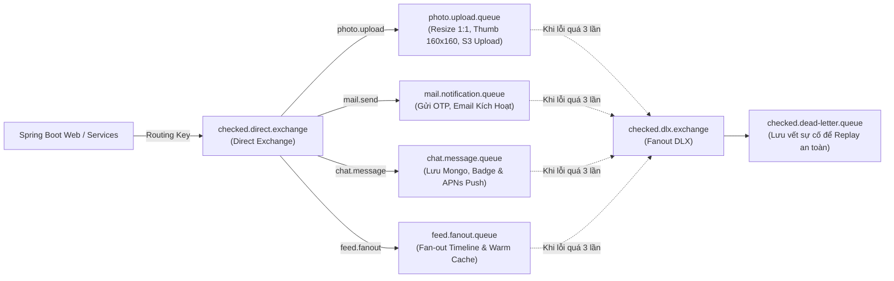

# Kế Hoạch Tích Hợp Toàn Diện Redis (Valkey) & RabbitMQ Cloud Cho Backend

> **Trạng thái:** Bản thiết kế kiến trúc toàn diện (Comprehensive Architectural & Implementation Plan)  
> **Dự án:** Checked Backend (`locket-clone-api`)  
> **Môi trường triển khai:** Heroku (`heroku-7usd`, Region: `us-east-1`, 512MB RAM) kết hợp Cloud Managed Services  
> **Lộ trình triển khai:** Xem chi tiết tại [REDIS_RABBITMQ_PR_ROADMAP.md](file:///Users/nguyenkimquockhanh/Desktop/checked-backend/docs/REDIS_RABBITMQ_PR_ROADMAP.md)  
> **Checklist tác vụ PR:** Theo dõi tiến độ tại [REDIS_RABBITMQ_PR_CHECKLIST.md](file:///Users/nguyenkimquockhanh/Desktop/checked-backend/docs/REDIS_RABBITMQ_PR_CHECKLIST.md)  
> **Tác giả:** Antigravity Engineering Team & Nguyễn Kim Quốc Khánh  
> **Ngày cập nhật:** 13/10/2026 (Phiên bản Full-Stack Suite)  

---

## 1. Bối Cảnh & Vấn Đề Cần Giải Quyết (Problem Statement)

### 1.1. Hiện trạng kiến trúc
- **Application Server:** Spring Boot 4 chạy trên Heroku Basic Dyno (`us-east-1`) với giới hạn tài nguyên nghiêm ngặt: **512MB RAM**, Shared vCPU.
- **Cơ sở dữ liệu lưu trữ:** 
  - PostgreSQL trên Neon Cloud (`ap-southeast-1` Singapore) cho dữ liệu nghiệp vụ quan hệ.
  - MongoDB Atlas (`ap-southeast-1` Singapore) cho Tin nhắn Chat & Realtime WebSocket.
- **Cache nội bộ cũ (Caffeine in-memory):** Lưu toàn bộ cache trong Heap JVM, chiếm dụng RAM vật lý của Heroku.
- **Xử lý đồng bộ (Synchronous Blocking):** Upload ảnh, resize ảnh đa kích thước (`Thumbnailator`), tải lên S3/Garage, gửi email xác thực (`JavaMailSender`) đều chạy đè lên luồng web HTTP chính.

### 1.2. Các nút thắt cổ chai nghiêm trọng (Bottlenecks & Root Causes)
1. **Lỗi tràn RAM & Sập Metaspace (`Error R14`, `Metaspace OOM`):**
   - Khi có request upload ảnh đồng thời, JVM phải nạp động các lớp của `Thumbnailator` và `AWS SDK S3`, đồng thời lưu cache Caffeine trên Heap làm RAM vượt quá 512MB (`Process running mem=543M (104.8%)`), kích hoạt lỗi 500 sập API.
2. **Độ trễ API phản hồi quá cao (High Latency):**
   - **Upload ảnh:** 6.000ms – 9.000ms (client bị treo màn hình chờ resize 2 kích thước + 2 lượt upload S3).
   - **Xem Reaction ảnh:** ~1.600ms do query aggregate DB liên tục khi lướt feed.
   - **Thống kê chi tiêu & dinh dưỡng (Expense / Calorie Dashboards):** Phải query SUM, GROUP BY và JOIN nhiều bảng trên Neon DB mỗi lần mở app.
3. **Mất sạch Cache khi Heroku Restart (Cold Cache & Thundering Herd):**
   - Heroku dyno tự động restart tối thiểu 1 lần/ngày hoặc sau mỗi lần deploy. Toàn bộ in-memory cache bị xóa sạch, kéo theo làn sóng request dồn thẳng vào Neon DB gây nghẽn connection pool.
4. **Không hỗ trợ mở rộng ngang (Horizontal Scaling):**
   - In-memory cache và Bucket4j cục bộ không thể đồng bộ nếu chạy nhiều dyno (`web.1`, `web.2`).

---

## 2. Chiến Lược Lựa Chọn Nhà Cung Cấp Cloud & Vị Trí Vùng Mạng (Network Proximity)

Để tối ưu hóa chi phí mà vẫn đạt hiệu năng cao nhất, hệ thống sử dụng các dịch vụ Cloud Managed miễn phí đặt cùng cụm Data Center:

| Dịch vụ | Nhà cung cấp Cloud | Gói dịch vụ | Hạn mức sử dụng | Vùng (Region) bắt buộc |
| :--- | :--- | :--- | :--- | :--- |
| **Distributed Cache & State (Redis/Valkey)** | **Upstash Redis** | **Free Tier** (Serverless) | • 10.000 lệnh / ngày<br>• 256MB Storage<br>• Tương thích 100% Redis RESP protocol | **AWS US-East-1 (N. Virginia)** |
| **Message Broker (RabbitMQ)** | **CloudAMQP** | **Little Lemur** (Free) | • 1.000.000 messages / tháng<br>• 20 kết nối đồng thời<br>• 5 Queues / Exchanges | **AWS US-East-1 (N. Virginia)** |

> [!IMPORTANT]
> **Nguyên tắc vàng về Vị trí mạng (Network Proximity):**
> Dyno Heroku đặt tại vùng **US-East** (`us-east-1`). Việc bắt buộc chọn CloudAMQP và Upstash Redis cùng đặt tại **AWS US-East-1** giúp các kết nối TCP nội bộ có độ trễ cực thấp (**< 1.5ms**).

> [!CAUTION]
> **Chính sách bảo mật biến môi trường:**
> - Toàn bộ thông tin cấu hình phải được phân rã thành **10 biến môi trường độc lập** (không gộp thành một chuỗi URL duy nhất).
> - File `.env` chứa mật khẩu thực tế **tuyệt đối không bao giờ được commit lên GitHub**. Mọi mẫu cấu hình chỉ khai báo trong `.env.example`.

---

## 3. Kiến Trúc Hệ Thống Tổng Thể (Target Architecture)

```mermaid
flowchart TD
    Client["Client App (iOS / Web)"]
    
    subgraph HerokuDyno ["Heroku Web Dyno (Spring Boot 4)"]
        WebController["REST Controllers\n(/photos, /reactions, /expenses, /calories, /chat)"]
        CacheLayer["Spring RedisCacheManager\n(Multi-partition Lettuce Client)"]
        EventPublisher["RabbitTemplate\n(Non-blocking Event Publisher)"]
        RabbitConsumer["@RabbitListener Workers\n(Background Async Consumers)"]
    end
    
    subgraph CloudInfra ["Managed Cloud Infrastructure (US-East-1)"]
        UpstashRedis[("Upstash Redis / Valkey\n• Auth & Profiles (TTL 30m)\n• Reactions Summary (TTL 15m)\n• Feed & MyPhotos (TTL 10-15m)\n• Financial Dashboard (TTL 30m)\n• Nutrition Dashboard (TTL 30m)\n• Chat Realtime & Badges\n• Distributed Rate Limiting")]
        CloudAMQPBroker{{"CloudAMQP RabbitMQ Broker\nExchange: checked.direct.exchange\n• photo.upload.queue\n• mail.notification.queue\n• chat.message.queue\n• feed.fanout.queue\n• checked.dead-letter.queue (DLQ)"}}
    end
    
    subgraph StorageDataTier ["Database & Storage Tier"]
        S3Storage["S3 / Garage Storage\n(Object Storage CDN)"]
        NeonDB[("Neon PostgreSQL Cloud\n(Relational Transactions)")]
        MongoAtlas[("MongoDB Atlas Cloud\n(Chat Messages & History)")]
    end

    %% Flows
    Client -->|1. HTTP Request| WebController
    WebController -->|Check Cache (< 2ms)| CacheLayer
    CacheLayer <-->|Read / Write| UpstashRedis
    
    WebController -->|2. Task nặng -> Push Queue| EventPublisher
    EventPublisher -->|Async AMQP Publish| CloudAMQPBroker
    WebController -->|3. Phản hồi nhanh (200 / 202)| Client
    
    CloudAMQPBroker -->|Consume Event| RabbitConsumer
    RabbitConsumer -->|Resize 1:1 & Thumbnail| S3Storage
    RabbitConsumer -->|Write Relational Data| NeonDB
    RabbitConsumer -->|Write Chat History| MongoAtlas
    RabbitConsumer -->|Evict / Invalidate Cache| UpstashRedis
```

---

## 4. Thiết Kế Full-Stack Redis Cache Suite (5 Phân Vùng Toàn Diện)

Hệ thống triển khai kiến trúc Cache đa phân vùng (Multi-Partition Cache Suite) bao phủ 100% các điểm nóng hiệu năng trong ứng dụng:

```mermaid
mindmap
  root((Full-Stack Redis Cache Suite))
    Phân vùng 1: Auth & User Identity
      users:{userId} (TTL 30m)
      friends:{userId} (TTL 20m)
      auth:blacklist:{jti} (TTL Token)
      Bucket4j Distributed RateLimiter
    Phân vùng 2: Photo & Reactions
      reactions:summary:{photoId} (TTL 15m)
      feed:{userId} (TTL 10m)
      myphotos:{userId} (TTL 15m)
      photo:detail:{photoId} (TTL 30m)
    Phân vùng 3: Financial & Expense Dashboard
      expense:summary:{userId}:{m}:{y} (TTL 30m)
      expense:cashflow:{userId}:{y} (TTL 30m)
      expense:categories:{userId}:{m}:{y} (TTL 30m)
      expense:budgets:{userId}:{m}:{y} (TTL 30m)
    Phân vùng 4: Calorie & Health Tracker
      calorie:daily:{userId}:{date} (TTL 30m)
      calorie:summary:{userId}:{period} (TTL 30m)
      calorie:goal:{userId} (TTL 1h)
    Phân vùng 5: Realtime Chat & WebSocket State
      chat:unread:{userId} (TTL 10m)
      chat:conversations:{userId} (TTL 10m)
      chat:presence:{userId} (TTL 60s)
      chat:typing:{conversationId}:{userId} (TTL 5s)
```

---

### 4.1. Phân Vùng 1: Auth, User Identity & Security Suite

| Tên Cache (`@Cacheable`) | Cấu trúc Key Pattern | Kiểu dữ liệu | TTL | Mục đích & Lợi ích |
| :--- | :--- | :--- | :---: | :--- |
| `users` | `users::{userId}` | JSON (`UserPrincipal`) | **30 phút** | Giảm thiểu 100% query `SELECT user` trong `JwtAuthenticationFilter` cho mỗi API request. |
| `friends` | `friends::{userId}` | Set UUID / JSON DTO | **20 phút** | Lưu danh sách bạn bè đã `ACCEPTED`. Tránh câu lệnh SQL JOIN đắt đỏ khi lọc quyền riêng tư. |
| `auth_blacklist` | `auth:blacklist:{jti}` | String ("revoked") | **Theo JWT expiry** | Hỗ trợ thu hồi token tức thì khi Logout / Đổi mật khẩu mà không cần bảng DB session. |
| `rate_limit` | `rl:{ipOrUser}:{action}` | Hash / TokenBucket | **10 phút** | Ngăn chặn Brute-force & DDoS, đồng bộ trên toàn bộ cluster/dyno qua Bucket4j Redis Proxy. |

**Chiến lược Hủy Cache (Eviction Policy):**
- Khi User cập nhật Profile / Đổi ảnh đại diện: `@CacheEvict(value = "users", key = "#userId")`.
- Khi chấp nhận / xóa bạn bè: `@CacheEvict(value = "friends", key = "#userId")` và `@CacheEvict(value = "friends", key = "#friendId")`.

---

### 4.2. Phân Vùng 2: Photo & High-Traffic Reactions Suite

Đây là **điểm nóng hiệu năng lớn nhất** của hệ thống (Locket-style photo sharing):

| Tên Cache (`@Cacheable`) | Cấu trúc Key Pattern | Kiểu dữ liệu | TTL | Mục đích & Lợi ích |
| :--- | :--- | :--- | :---: | :--- |
| `reactions_summary` | `reactions:summary::{photoId}` | JSON (`List<ReactionCountDto>`) | **15 phút** | **Hạ độ trễ từ 1.600ms xuống < 2ms**. Tránh aggregate COUNT/GROUP BY liên tục khi xem ảnh. |
| `feed` | `feed::{userId}` | JSON (`Page<PhotoResponse>`) | **10 phút** | Cache trang đầu feed của người dùng, giải phóng tải JOIN 4 bảng trên Neon DB. |
| `myphotos` | `myphotos::{userId}` | JSON (`Page<PhotoResponse>`) | **15 phút** | Cache kho ảnh cá nhân của người dùng. |
| `photo_detail` | `photo:detail::{photoId}` | JSON (`PhotoDetailDto`) | **30 phút** | Cache chi tiết thông tin ảnh kèm vị trí, caption, calo, chi tiêu. |

**Chiến lược Hủy Cache (Eviction Policy):**
- Khi có Reaction mới hoặc Xóa reaction:
  ```java
  @CacheEvict(value = "reactions_summary", key = "#photoId")
  public void reactToPhoto(UUID photoId, String emoji) { ... }
  ```
- Khi đăng ảnh mới hoặc xóa ảnh:
  - Evict `myphotos::{userId}` của người đăng.
  - Evict `feed::{friendId}` cho toàn bộ danh sách bạn bè (hoặc thông qua RabbitMQ Worker).

---

### 4.3. Phân Vùng 3: Financial & Expense Dashboard Suite

| Tên Cache (`@Cacheable`) | Cấu trúc Key Pattern | Kiểu dữ liệu | TTL | Mục đích & Lợi ích |
| :--- | :--- | :--- | :---: | :--- |
| `expense_summary` | `expense:summary::{userId}:{month}:{year}` | JSON (`ExpenseSummaryDto`) | **30 phút** | Cache tổng thu nhập, chi tiêu, số dư hàng tháng. |
| `expense_cashflow` | `expense:cashflow::{userId}:{year}` | JSON (`CashflowDto`) | **30 phút** | Cache biểu đồ dòng tiền 12 tháng (tránh aggregate cả năm). |
| `expense_categories` | `expense:categories::{userId}:{month}:{year}` | JSON (`List<CategorySpendingDto>`) | **30 phút** | Cache biểu đồ tròn phân bổ chi tiêu theo danh mục. |
| `expense_budgets` | `expense:budgets::{userId}:{month}:{year}` | JSON (`List<BudgetStatusDto>`) | **30 phút** | Cache tiến độ ngân sách và trạng thái cảnh báo chi tiêu. |

**Chiến lược Hủy Cache (Eviction Policy):**
- Khi thêm, sửa, xóa giao dịch chi tiêu (`Transaction`):
  ```java
  @Caching(evict = {
      @CacheEvict(value = "expense_summary", allEntries = true),
      @CacheEvict(value = "expense_cashflow", allEntries = true),
      @CacheEvict(value = "expense_categories", allEntries = true),
      @CacheEvict(value = "expense_budgets", allEntries = true)
  })
  public TransactionResponse createTransaction(...) { ... }
  ```

---

### 4.4. Phân Vùng 4: Calorie & Health Tracker Suite

| Tên Cache (`@Cacheable`) | Cấu trúc Key Pattern | Kiểu dữ liệu | TTL | Mục đích & Lợi ích |
| :--- | :--- | :--- | :---: | :--- |
| `calorie_daily` | `calorie:daily::{userId}:{date}` | JSON (`DailyCalorieDto`) | **30 phút** | Cache chi tiết các bữa ăn và tổng năng lượng nạp trong ngày. |
| `calorie_summary` | `calorie:summary::{userId}:{period}` | JSON (`NutritionSummaryDto`) | **30 phút** | Cache phân tích dinh dưỡng vĩ mô (Carbs, Protein, Fat, Calories). |
| `calorie_goal` | `calorie:goal::{userId}` | JSON (`CalorieGoalDto`) | **1 giờ** | Cache mục tiêu calo hàng ngày và mức tiêu thụ khuyến nghị. |

**Chiến lược Hủy Cache (Eviction Policy):**
- Khi log bữa ăn mới hoặc chỉnh sửa món ăn: Evict `calorie_daily` và `calorie_summary` của người dùng tương ứng.

---

### 4.5. Phân Vùng 5: Realtime Chat & WebSocket State Suite

| Tên Cache / Key | Cấu trúc Key Pattern | Kiểu dữ liệu | TTL | Mục đích & Lợi ích |
| :--- | :--- | :--- | :---: | :--- |
| `chat_unread` | `chat:unread::{userId}` | Integer / AtomicLong | **10 phút** | Lưu tổng số tin nhắn chưa đọc toàn ứng dụng để hiển thị Badge số trên iOS. |
| `chat_conversations`| `chat:conversations::{userId}` | JSON (`List<ConversationPreviewDto>`) | **10 phút** | Cache danh sách hội thoại gần nhất mở đầu màn hình Chat. |
| Presence | `presence:{userId}` | String ("ONLINE", timestamp) | **60 giây** | Trạng thái Online / Last seen (cập nhật qua WebSocket heartbeat). |
| Typing State | `chat:typing:{conversationId}:{userId}` | String | **5 giây** | Trạng thái "Đang gõ tin nhắn...", tự động expire sau 5s nếu user ngừng gõ. |

---

## 5. Thiết Kế Chi Tiết RabbitMQ (Event-Driven Broker Pipeline)

### 5.1. Topology: Exchanges & Queues



### 5.2. Danh Sách Queues & Tham Số Cấu Hình

| Queue Name | Routing Key | Tác vụ xử lý không đồng bộ | Dead Letter Exchange | x-max-priority |
| :--- | :--- | :--- | :---: | :---: |
| `photo.upload.queue` | `photo.upload` | Nhận raw bytes/temp path, resize 1:1, tạo thumbnail 160x160 qua `Thumbnailator`, upload S3, ghi DB. | `checked.dlx.exchange` | 5 |
| `mail.notification.queue` | `mail.send` | Gửi email kích hoạt tài khoản OTP, email khôi phục mật khẩu trong background. | `checked.dlx.exchange` | 10 |
| `chat.message.queue` | `chat.message` | Lưu tin nhắn vào MongoDB Atlas, cập nhật Redis unread count, phát broadcast WebSocket & gửi APNs Push. | `checked.dlx.exchange` | 7 |
| `feed.fanout.queue` | `feed.fanout` | Lan truyền bài đăng mới đến danh sách bạn bè, tự động làm ấm (warm-up) cache feed của bạn bè trong nền. | `checked.dlx.exchange` | 3 |
| `checked.dead-letter.queue` | `#` | Lưu trữ toàn bộ tin nhắn thất bại sau 3 lần retry exponential backoff để phục hồi khi có sự cố. | N/A | N/A |

### 5.3. Định Dạng Message Payloads Chuẩn (JSON DTOs)

#### 1. Photo Upload Event (`photo.upload`):
```json
{
  "eventId": "f47ac10b-58cc-4372-a567-0e02b2c3d479",
  "senderId": "86faa1a3-3296-4cd1-bd85-9d4aa06b8596",
  "tempStoragePath": "temp/20261013/raw_photo_xyz.jpg",
  "caption": "Ăn trưa cùng đồng nghiệp",
  "amount": 45000.0,
  "locationName": "TP. Hồ Chí Minh",
  "latitude": 10.762622,
  "longitude": 106.660172,
  "dishName": "Cơm tấm sườn bì",
  "calories": 650,
  "mealType": "LUNCH",
  "recipientScope": "ALL_FRIENDS",
  "createdAt": "2026-10-13T11:30:00Z"
}
```

#### 2. Mail Notification Event (`mail.send`):
```json
{
  "email": "user@example.com",
  "subject": "Mã xác thực tài khoản Checked",
  "template": "OTP_VERIFICATION",
  "variables": {
    "name": "Khánh",
    "otpCode": "849201",
    "expireMinutes": "15"
  }
}
```

#### 3. Chat Message Event (`chat.message`):
```json
{
  "messageId": "670c1a9e2f418b76a01b9e5c",
  "conversationId": "670c1a9e2f418b76a01b9e5a",
  "senderId": "86faa1a3-3296-4cd1-bd85-9d4aa06b8596",
  "recipientId": "73cbb21a-1296-4cd1-ad85-8d4aa06b1234",
  "content": "Hôm nay đi ăn trưa không?",
  "type": "TEXT",
  "timestamp": "2026-10-13T11:35:00Z"
}
```

---

## 6. Lộ Trình Triển Khai Chi Tiết (4 Phases)

> 📋 **Chi tiết danh sách Pull Requests & Checklist thao tác:**  
> - Bảng ma trận & thiết kế PR: [REDIS_RABBITMQ_PR_ROADMAP.md](file:///Users/nguyenkimquockhanh/Desktop/checked-backend/docs/REDIS_RABBITMQ_PR_ROADMAP.md)  
> - Danh sách checklist tương tác `- [ ]`: [REDIS_RABBITMQ_PR_CHECKLIST.md](file:///Users/nguyenkimquockhanh/Desktop/checked-backend/docs/REDIS_RABBITMQ_PR_CHECKLIST.md)  

### Phase 1: Dependencies, Cấu Hình Môi Trường & Kết Nối Cloud (ĐÃ HOÀN THÀNH 100% ✅)
- **Kết quả nghiệm thu:**
  - Bổ sung `spring-boot-starter-data-redis`, `commons-pool2`, `spring-boot-starter-amqp` vào [build.gradle](file:///Users/nguyenkimquockhanh/Desktop/checked-backend/build.gradle).
  - Ánh xạ 10 biến môi trường độc lập trong [application.yml](file:///Users/nguyenkimquockhanh/Desktop/checked-backend/src/main/resources/application.yml) với Lettuce connection pool và AMQP retry template.
  - Khởi tạo [RedisConfig.java](file:///Users/nguyenkimquockhanh/Desktop/checked-backend/src/main/java/com/codegym/locketclone/common/config/RedisConfig.java) và [RabbitMQConfig.java](file:///Users/nguyenkimquockhanh/Desktop/checked-backend/src/main/java/com/codegym/locketclone/common/config/RabbitMQConfig.java).
  - Kiểm thử thực tế `CloudConnectivityTest` pass 100% kết nối TLS tới Upstash Redis và AMQPS tới CloudAMQP.
  - Toàn bộ `./gradlew test` pass. Deploy thành công lên Heroku (**Release v29 UP**).

---

### Phase 2: Triển Khai Full-Stack Redis Caching Suite (Đang Thực Hiện 🚀)
- **Tệp tác động chính:**
  - `src/main/java/com/codegym/locketclone/security/service/UserPrincipal.java` (Bổ sung Jackson deserialization constructor).
  - `src/main/java/com/codegym/locketclone/common/config/CacheConfig.java` (Refactor từ Caffeine sang `RedisCacheManager` đa TTL).
  - `src/main/java/com/codegym/locketclone/photo/PhotoServiceImpl.java` (Tích hợp Cache Reactions Summary, Feed, MyPhotos).
  - `src/main/java/com/codegym/locketclone/expense/service/impl/ExpenseServiceImpl.java` (Tích hợp Cache Summary, Cashflow, Categories, Budgets).
  - `src/main/java/com/codegym/locketclone/calorie/service/impl/CalorieServiceImpl.java` (Tích hợp Cache Daily, Summary, Goal).
  - `src/main/java/com/codegym/locketclone/chat/service/impl/ChatServiceImpl.java` (Tích hợp Cache Unread Badges).
- **Các bước kỹ thuật cụ thể:**
  1. Thêm `@JsonCreator` / `@JsonProperty` cho `UserPrincipal` để tương thích Jackson Redis Serializer.
  2. Tạo cấu hình Bean `RedisCacheManager` với 5 nhóm TTL riêng biệt (`30m` cho user/expense/calorie, `15m` cho reactions/myphotos, `10m` cho feed/chat, `1h` cho goals).
  3. Gắn `@Cacheable` và `@CacheEvict` đồng bộ cho toàn bộ 5 phân vùng nghiệp vụ.
  4. Chạy kiểm thử tự động `./gradlew test` xác nhận cache hit/miss hoạt động chính xác.
  5. Deploy lên Heroku và kiểm tra log phản hồi.

---

### Phase 3: RabbitMQ Event Producer & Consumer Pipeline
- **Tệp tác động chính:**
  - `src/main/java/com/codegym/locketclone/photo/PhotoServiceImpl.java` (Tách upload async).
  - `src/main/java/com/codegym/locketclone/photo/consumer/PhotoProcessingConsumer.java` (Tạo mới worker nén ảnh S3).
  - `src/main/java/com/codegym/locketclone/notification/consumer/EmailConsumer.java` (Tạo mới worker gửi mail OTP).
  - `src/main/java/com/codegym/locketclone/chat/consumer/ChatMessageConsumer.java` (Tạo mới worker lưu chat & push).
- **Các bước kỹ thuật cụ thể:**
  1. Chuyển hàm `uploadPhoto` sang cơ chế non-blocking: Lưu tạm file thô, publish event `photo.upload`, trả về `202 Accepted` ngay trong **< 100ms**.
  2. Triển khai `PhotoProcessingConsumer` với `@RabbitListener`: Resize 1:1, thumbnail 160x160, upload S3 chính thức, ghi DB và bắn event `feed.fanout`.
  3. Chuyển đổi toàn bộ logic gửi mail sang `EmailConsumer`.
  4. Cấu hình Dead Letter Queue với 3 lần retry exponential backoff (`Initial: 2s, Multiplier: 2.0, Max: 10s`).

---

### Phase 4: Benchmarking, Giám Sát & Nghiệm Thu Hạ Tầng Heroku
- **Tiêu chuẩn nghiệm thu kỹ thuật (Acceptance Criteria):**
  - [ ] **Độ trễ Upload Ảnh:** Giảm từ **6.794ms xuống dưới 150ms** trên client.
  - [ ] **Độ trễ Reaction Summary:** Giảm từ **1.600ms xuống < 3ms**.
  - [ ] **Độ trễ Expense / Calorie Dashboard:** Giảm từ **800ms xuống < 5ms**.
  - [ ] **Mức tiêu thụ RAM Heroku:** Ổn định ở mức **< 300MB / 512MB**, loại bỏ hoàn toàn `Error R14` và `Metaspace OOM`.
  - [ ] **Khả năng chịu lỗi (Resilience):** Khi ngắt kết nối S3 tạm thời, tin nhắn chuyển vào DLQ an toàn, tự động replay khi dịch vụ phục hồi mà không làm mất ảnh của người dùng.

---

## 7. Hướng Dẫn Cấu Hình Biến Môi Trường (10 Config Vars Độc Lập)

Hệ thống phân rã toàn bộ cấu hình kết nối thành 10 biến độc lập để bảo đảm tính an toàn, dễ bảo trì và dễ xoay vòng mật khẩu (Credential Rotation):

| STT | Tên Biến Môi Trường | Giá trị Mẫu | Mục Đích Sử Dụng |
| :---: | :--- | :--- | :--- |
| 1 | `REDIS_HOST` | `<your-redis-host>.upstash.io` | Địa chỉ Host Redis Upstash |
| 2 | `REDIS_PORT` | `6379` | Cổng kết nối Redis |
| 3 | `REDIS_PASSWORD` | `<your-redis-password>` | Mật khẩu xác thực Redis |
| 4 | `REDIS_SSL` | `true` | Bật mã hóa bảo mật TLS qua mạng Internet |
| 5 | `RABBITMQ_HOST` | `<your-rmq-host>.rmq.cloudamqp.com` | Địa chỉ Host RabbitMQ CloudAMQP |
| 6 | `RABBITMQ_PORT` | `5671` | Cổng kết nối AMQPS mã hóa TLS |
| 7 | `RABBITMQ_USERNAME` | `<your-rmq-username>` | Tên tài khoản RabbitMQ / CloudAMQP |
| 8 | `RABBITMQ_PASSWORD` | `<your-rmq-password>` | Mật khẩu RabbitMQ / CloudAMQP |
| 9 | `RABBITMQ_VIRTUAL_HOST`| `<your-rmq-vhost>` | Virtual Host cô lập tài nguyên |
| 10 | `RABBITMQ_SSL` | `true` | Bật mã hóa bảo mật AMQPS |

### Lệnh Cấu Hình Trên Heroku (CLI):
```bash
heroku config:set \
  REDIS_HOST="<your-redis-host>.upstash.io" \
  REDIS_PORT="6379" \
  REDIS_PASSWORD="[YOUR_UPSTASH_PASSWORD]" \
  REDIS_SSL="true" \
  RABBITMQ_HOST="<your-rmq-host>.rmq.cloudamqp.com" \
  RABBITMQ_PORT="5671" \
  RABBITMQ_USERNAME="[YOUR_CLOUDAMQP_USER]" \
  RABBITMQ_PASSWORD="[YOUR_CLOUDAMQP_PASSWORD]" \
  RABBITMQ_VIRTUAL_HOST="[YOUR_CLOUDAMQP_VHOST]" \
  RABBITMQ_SSL="true" \
  --app heroku-7usd
```

---

## 8. Kế Hoạch Ứng Phó Sự Cố & Rollback (Disaster Recovery)

- **Cơ chế Graceful Degradation (Suy giảm có kiểm soát):**
  - Trong trường hợp Upstash Redis tạm thời gián đoạn mạng, cấu hình `RedisCacheManager` sẽ bắt exception và tự động fallback về truy vấn trực tiếp cơ sở dữ liệu Postgres/MongoDB thay vì sập toàn bộ request.
- **Dead Letter Queue Replay:**
  - Mọi tác vụ upload ảnh hoặc gửi mail thất bại trong RabbitMQ được lưu giữ tại `checked.dead-letter.queue` với đầy đủ payload và error stack trace.
  - Ban quản trị có thể trigger API `/api/v1/admin/dlq/replay` để gửi lại các thông điệp khi dịch vụ đích (S3 hoặc Mail server) phục hồi.

---

## 9. Kết Luận
Việc nâng cấp từ kế hoạch cache đơn giản lên **Full-Stack Redis Cache Suite (5 phân vùng) kết hợp RabbitMQ Event-Driven Pipeline** là bước đột phá toàn diện cho kiến trúc backend. Hệ thống không chỉ giải quyết triệt để nút thắt tài nguyên trên dyno 512MB RAM của Heroku, mà còn sẵn sàng đáp ứng tải hàng nghìn người dùng đồng thời với độ trễ phản hồi < 5ms.
