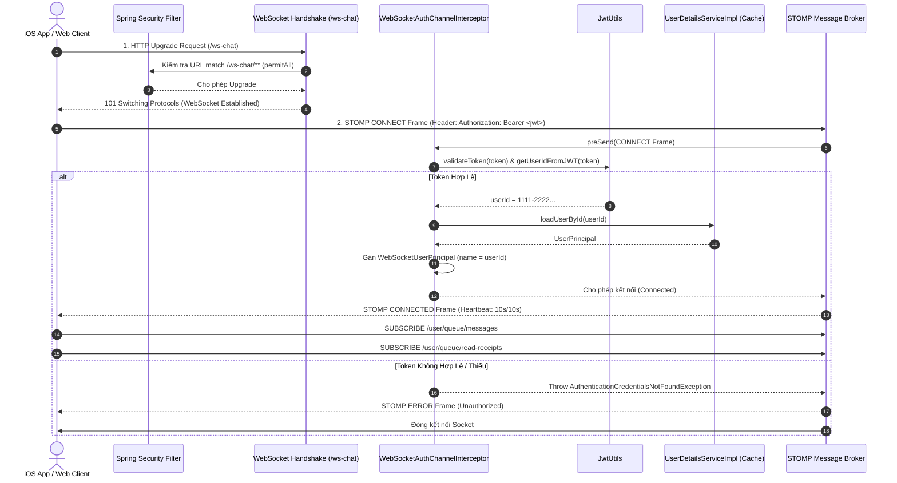
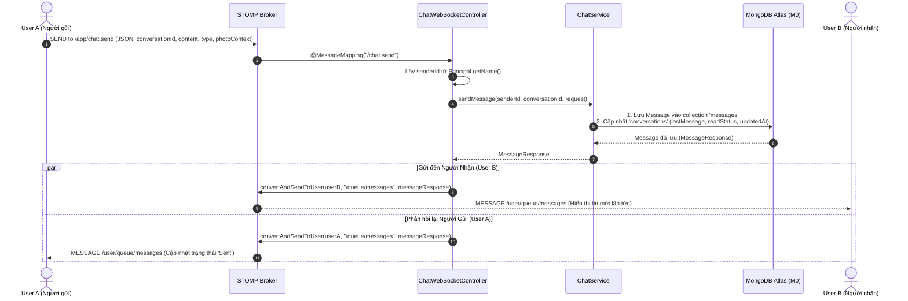
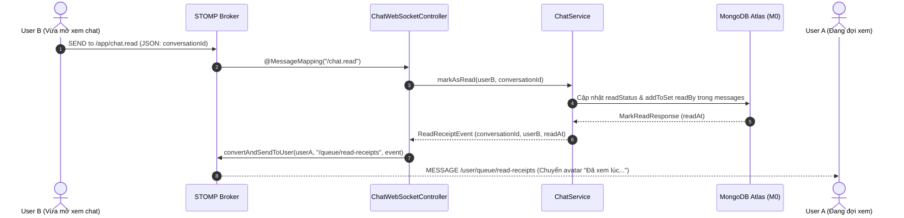

# Kế Hoạch Triển Khai Chi Tiết: PR-Chat-2

> **Tiêu đề PR**: `feat(chat): websocket-stomp-and-realtime-messaging`  
> **Nhánh Git**: `feature/chat-websocket-stomp` (tạo từ `main`)  
> **Mức độ ưu tiên**: 🔴 **P0 (Realtime Core Feature - Trải nghiệm tức thời cho người dùng)**  
> **Phạm vi ảnh hưởng**: `build.gradle`, `SecurityConfig.java`, `common/config`, `security/websocket/*`, `chat/controller/*`, `chat/dto/websocket/*`  
> **Cam kết an toàn**: ❌ **KHÔNG DEPLOY HEROKU TRƯỚC KHI TESTED** (Kiểm thử cục bộ với local STOMP client và unit test)

---

## 1. 🎯 Mục Tiêu Của PR-Chat-2

1. **Thiết Lập STOMP WebSocket Broker**:
   - Tích hợp `spring-boot-starter-websocket` vào Spring Boot backend.
   - Kích hoạt `@EnableWebSocketMessageBroker`, cấu hình Application Destination `/app`, User Destination `/user`, Broker Destination `/queue` và `/topic`.
   - Đăng ký endpoint `/ws-chat` hỗ trợ cả **Native WebSocket** (cho iOS Swift `URLSessionWebSocketTask`) và **SockJS fallback** (cho Web / Testing tools).
2. **Cơ Chế Xác Thực JWT Trong WebSocket (Connection Security)**:
   - Cấp phép HTTP Handshake tại `SecurityConfig` (`/ws-chat/**`).
   - Xây dựng `WebSocketAuthChannelInterceptor`: Bắt chặn STOMP `CONNECT` frame, trích xuất JWT Token từ STOMP Header `Authorization: Bearer <token>` hoặc Query Parameter `?token=<token>`.
   - Validate token qua `JwtUtils`, load `UserPrincipal` qua `UserDetailsServiceImpl` (đã có Caffeine Cache tối ưu 0ms).
   - Thiết lập `WebSocketUserPrincipal` trả về `id.toString()` cho `getName()` nhằm đảm bảo `SimpMessagingTemplate.convertAndSendToUser` khớp chính xác 100%.
3. **Cơ Chế Chống Ngắt Kết Nối Heroku (55s Idle Timeout Mitigation)**:
   - Cấu hình STOMP Heartbeat `10000, 10000` (10 giây ping/pong 2 chiều giữa Client và Server) qua `ThreadPoolTaskScheduler` chuyên dụng.
4. **Hiện Thực Hai Luồng Realtime Chính (`ChatWebSocketController`)**:
   - **Gửi tin nhắn (`/app/chat.send`)**:
     - Lưu tin nhắn vào MongoDB qua `ChatService.sendMessage()`.
     - Bắn realtime đến người nhận: `/user/{recipientId}/queue/messages`.
     - Đồng thời phản hồi về người gửi: `/user/{senderId}/queue/messages` (đồng bộ ID, timestamp, trạng thái).
   - **Đánh dấu đã đọc (`/app/chat.read`)**:
     - Cập nhật `readStatus` vào MongoDB qua `ChatService.markAsRead()`.
     - Bắn sự kiện Read Receipt đến đối phương: `/user/{recipientId}/queue/read-receipts`.

---

## 2. 🗂️ Danh Sách Files Thay Đổi & Tạo Mới

### 2.1. Thay đổi mã nguồn hiện có
- [build.gradle](file:///Users/nguyenkimquockhanh/Desktop/checked-backend/build.gradle): Bổ sung dependency `implementation 'org.springframework.boot:spring-boot-starter-websocket'`.
- [SecurityConfig.java](file:///Users/nguyenkimquockhanh/Desktop/checked-backend/src/main/java/com/codegym/locketclone/common/config/SecurityConfig.java): Thêm rule `.requestMatchers("/ws-chat/**").permitAll()`.
- [ChatService.java](file:///Users/nguyenkimquockhanh/Desktop/checked-backend/src/main/java/com/codegym/locketclone/chat/service/ChatService.java): Bổ sung phương thức hỗ trợ lấy người tham gia còn lại trong cuộc trò chuyện `getRecipientId(String conversationId, UUID senderId)`.

### 2.2. Files mã nguồn tạo mới
```
src/main/java/com/codegym/locketclone/
├── common/config/
│   └── WebSocketConfig.java                          ← STOMP Broker & Endpoint Config
├── security/websocket/
│   ├── WebSocketUserPrincipal.java                   ← Principal bọc UUID cho STOMP
│   └── WebSocketAuthChannelInterceptor.java          ← JWT Authenticator trong CONNECT Frame
└── chat/
    ├── dto/websocket/
    │   ├── SendChatMessagePayload.java               ← Payload gửi qua STOMP
    │   ├── MarkChatReadPayload.java                  ← Payload báo đã đọc qua STOMP
    │   └── ReadReceiptEvent.java                     ← Event bắn về client khi đã đọc
    └── controller/
        └── ChatWebSocketController.java              ← MessageMapping handlers
```

### 2.3. Files kiểm thử tạo mới
```
src/test/java/com/codegym/locketclone/
├── security/websocket/
│   └── WebSocketAuthChannelInterceptorTest.java      ← Test xác thực JWT WebSocket
└── chat/
    └── ChatWebSocketControllerTest.java              ← Test xử lý message STOMP
```

---

## 3. 🔄 Sơ Đồ Trình Tự Luồng Realtime (Sequence Diagrams)

### 3.1. Luồng Bắt Tay Kết Nối & Xác Thực (Handshake & Authentication)


---

### 3.2. Luồng Gửi & Nhận Tin Nhắn Realtime (`/app/chat.send`)


---

### 3.3. Luồng Báo Đã Đọc & Bắn Sự Kiện Read Receipt (`/app/chat.read`)


---

## 4. 📐 Thiết Kế Chi Tiết Các Lớp (Class Specifications)

### 4.1. `WebSocketConfig.java`
```java
@Configuration
@EnableWebSocketMessageBroker
@RequiredArgsConstructor
public class WebSocketConfig implements WebSocketMessageBrokerConfigurer {

    private final WebSocketAuthChannelInterceptor authChannelInterceptor;

    @Override
    public void registerStompEndpoints(StompEndpointRegistry registry) {
        // 1. Endpoint cho SockJS fallback (Web)
        registry.addEndpoint("/ws-chat")
                .setAllowedOriginPatterns("*")
                .withSockJS();

        // 2. Endpoint WebSocket thuần (Native iOS URLSessionWebSocketTask)
        registry.addEndpoint("/ws-chat")
                .setAllowedOriginPatterns("*");
    }

    @Override
    public void configureMessageBroker(MessageBrokerRegistry registry) {
        // Cấu hình TaskScheduler cho Heartbeat 10s ping / 10s pong
        ThreadPoolTaskScheduler taskScheduler = new ThreadPoolTaskScheduler();
        taskScheduler.setPoolSize(1);
        taskScheduler.setThreadNamePrefix("ws-heartbeat-");
        taskScheduler.initialize();

        registry.enableSimpleBroker("/queue", "/topic")
                .setTaskScheduler(taskScheduler)
                .setHeartbeatValue(new long[]{10000, 10000}); // 10s / 10s -> Ngăn Heroku 55s timeout

        registry.setApplicationDestinationPrefixes("/app");
        registry.setUserDestinationPrefix("/user");
    }

    @Override
    public void configureClientInboundChannel(ChannelRegistration registration) {
        // Đăng ký Interceptor kiểm tra JWT khi kết nối
        registration.interceptors(authChannelInterceptor);
    }
}
```

---

### 4.2. `WebSocketUserPrincipal.java`
```java
@Getter
@AllArgsConstructor
public class WebSocketUserPrincipal implements Principal {

    private final UUID id;
    private final UserPrincipal userPrincipal;

    @Override
    public String getName() {
        // Cực kỳ quan trọng: Phải trả về UUID string để simpMessagingTemplate.convertAndSendToUser() định tuyến khớp
        return id.toString();
    }
}
```

---

### 4.3. `WebSocketAuthChannelInterceptor.java`
```java
@Component
@Slf4j
@RequiredArgsConstructor
public class WebSocketAuthChannelInterceptor implements ChannelInterceptor {

    private final JwtUtils jwtUtils;
    private final UserDetailsServiceImpl userDetailsService;

    @Override
    public Message<?> preSend(Message<?> message, MessageChannel channel) {
        StompHeaderAccessor accessor = MessageHeaderAccessor.getAccessor(message, StompHeaderAccessor.class);

        if (accessor != null && StompCommand.CONNECT.equals(accessor.getCommand())) {
            String token = extractToken(accessor);

            if (!StringUtils.hasText(token) || !jwtUtils.validateToken(token)) {
                log.warn("WebSocket kết nối bị từ chối: Token không hợp lệ hoặc bị thiếu");
                throw new AuthenticationCredentialsNotFoundException("JWT token không hợp lệ hoặc bị thiếu");
            }

            try {
                UUID userId = jwtUtils.getUserIdFromJWT(token);
                UserPrincipal userPrincipal = (UserPrincipal) userDetailsService.loadUserById(userId);

                WebSocketUserPrincipal wsPrincipal = new WebSocketUserPrincipal(userId, userPrincipal);
                Authentication auth = new UsernamePasswordAuthenticationToken(
                        wsPrincipal, null, userPrincipal.getAuthorities());

                accessor.setUser(auth);
                log.info("WebSocket xác thực thành công cho User ID: {}", userId);
            } catch (Exception ex) {
                log.error("Lỗi khi tải thông tin User cho kết nối WebSocket: {}", ex.getMessage());
                throw new AuthenticationCredentialsNotFoundException("Không thể xác thực danh tính người dùng");
            }
        }

        return message;
    }

    private String extractToken(StompHeaderAccessor accessor) {
        // 1. Kiểm tra Authorization header trong STOMP Frame
        String authHeader = accessor.getFirstNativeHeader("Authorization");
        if (StringUtils.hasText(authHeader) && authHeader.startsWith("Bearer ")) {
            return authHeader.substring(7);
        }

        // 2. Fallback kiểm tra query param 'token' nếu client gửi qua URL
        String queryToken = accessor.getFirstNativeHeader("token");
        if (StringUtils.hasText(queryToken)) {
            return queryToken;
        }

        return null;
    }
}
```

---

### 4.4. DTOs Realtime
- **`SendChatMessagePayload.java`**:
  ```java
  @Getter
  @Setter
  @NoArgsConstructor
  @AllArgsConstructor
  public class SendChatMessagePayload {
      @NotBlank
      private String conversationId;
      @NotBlank
      private String content;
      private MessageType type;
      private String replyToMessageId;
      private PhotoContextInfo photoContext;
  }
  ```
- **`MarkChatReadPayload.java`**:
  ```java
  @Getter
  @Setter
  @NoArgsConstructor
  @AllArgsConstructor
  public class MarkChatReadPayload {
      @NotBlank
      private String conversationId;
  }
  ```
- **`ReadReceiptEvent.java`**:
  ```java
  @Getter
  @Setter
  @Builder
  @NoArgsConstructor
  @AllArgsConstructor
  public class ReadReceiptEvent {
      private String conversationId;
      private UUID readerId;
      private Instant readAt;
  }
  ```

---

### 4.5. `ChatWebSocketController.java`
```java
@Controller
@Slf4j
@RequiredArgsConstructor
public class ChatWebSocketController {

    private final ChatService chatService;
    private final SimpMessagingTemplate messagingTemplate;

    @MessageMapping("/chat.send")
    public void sendMessage(@Valid @Payload SendChatMessagePayload payload, Principal principal) {
        if (principal == null) return;
        UUID senderId = UUID.fromString(principal.getName());

        SendMessageRequest request = SendMessageRequest.builder()
                .content(payload.getContent())
                .type(payload.getType())
                .replyToMessageId(payload.getReplyToMessageId())
                .photoContext(payload.getPhotoContext())
                .build();

        MessageResponse response = chatService.sendMessage(senderId, payload.getConversationId(), request);
        UUID recipientId = chatService.getRecipientId(payload.getConversationId(), senderId);

        // 1. Gửi tin nhắn đến người nhận
        messagingTemplate.convertAndSendToUser(recipientId.toString(), "/queue/messages", response);

        // 2. Gửi phản hồi lại cho người gửi
        messagingTemplate.convertAndSendToUser(senderId.toString(), "/queue/messages", response);
    }

    @MessageMapping("/chat.read")
    public void markAsRead(@Valid @Payload MarkChatReadPayload payload, Principal principal) {
        if (principal == null) return;
        UUID readerId = UUID.fromString(principal.getName());

        MarkReadResponse response = chatService.markAsRead(readerId, payload.getConversationId());
        UUID partnerId = chatService.getRecipientId(payload.getConversationId(), readerId);

        ReadReceiptEvent event = ReadReceiptEvent.builder()
                .conversationId(payload.getConversationId())
                .readerId(readerId)
                .readAt(response.getReadAt())
                .build();

        // Gửi thông báo đối phương đã đọc
        messagingTemplate.convertAndSendToUser(partnerId.toString(), "/queue/read-receipts", event);
    }
}
```

---

## 5. 🧪 Kế Hoạch Kiểm Thử (Testing Strategy)

1. **Unit Test: `WebSocketAuthChannelInterceptorTest`**:
   - `testConnect_withValidBearerToken_authenticatesUserSuccessfully`: Gửi STOMP frame CONNECT với JWT hợp lệ, kiểm tra `accessor.getUser()` được gán chính xác `WebSocketUserPrincipal` với `getName() = userId`.
   - `testConnect_withoutToken_throwsAuthenticationException`: CONNECT không có header, kiểm tra ném `AuthenticationCredentialsNotFoundException`.
   - `testConnect_withInvalidToken_throwsAuthenticationException`: CONNECT với token hỏng/hết hạn.
   - `testNonConnectCommands_ignoredByInterceptor`: Frame `SUBSCRIBE`, `SEND` không bị lặp lại bước authenticate.
2. **Unit Test: `ChatWebSocketControllerTest`**:
   - `testSendMessage_broadcastsToBothUsers`: Mock gửi tin thành công, kiểm tra `messagingTemplate.convertAndSendToUser` được gọi đúng 2 lần (cho `recipientId` và `senderId`).
   - `testMarkAsRead_broadcastsReadReceiptToPartner`: Mock đọc tin, kiểm tra bắn event đến đúng `partnerId`.

---

## 6. ✅ Checklist Hoàn Thành PR-Chat-2

- [ ] Gradle import `spring-boot-starter-websocket` thành công.
- [ ] Endpoint `/ws-chat` bắt tay HTTP thành công, không bị 401/403 tại Spring Security Filter.
- [ ] STOMP CONNECT frame chặn đúng token sai và chấp nhận token đúng.
- [ ] Heartbeat 10s/10s ping/pong hoạt động ổn định.
- [ ] Định tuyến `@MessageMapping("/chat.send")` lưu MongoDB và bắn event realtime tới người nhận.
- [ ] Định tuyến `@MessageMapping("/chat.read")` cập nhật trạng thái và bắn Read Receipt event.
- [ ] 100% Unit Tests viết mới đều PASS.
- [ ] `./gradlew test` và `./gradlew bootJar` thành công.
