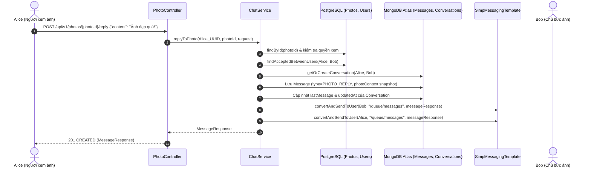

# Kế Hoạch Triển Khai Chi Tiết: PR-Chat-3

> **Tiêu đề PR**: `feat(chat): photo-reply-typing-indicator-and-message-lifecycle`  
> **Nhánh Git**: `feature/chat-photo-reply-advanced` (tạo từ `main`)  
> **Mức độ ưu tiên**: 🟡 **P1 (Nâng cao trải nghiệm chat & Khép kín tương tác ảnh Locket-style)**  
> **Phạm vi ảnh hưởng**: `photo/*`, `chat/*`, `application.yml`, `.env.example`  
> **Cam kết an toàn**: ❌ **KHÔNG DEPLOY HEROKU TRƯỚC KHI TESTED** (Kiểm thử cục bộ với Mockito unit test & local verification)

---

## 1. 🎯 Mục Tiêu Của PR-Chat-3

Sau khi hoàn thành PR-Chat-1 (MongoDB Data & REST) và PR-Chat-2 (STOMP WebSocket Realtime), PR-Chat-3 tập trung vào các tính năng hoàn thiện trải nghiệm trò chuyện đặc thù phong cách Locket / iMessage:

1. **Tích Hợp Phản Hồi Ảnh Nhanh (Photo Reply Integration)**:
   - Cung cấp API `POST /api/v1/photos/{photoId}/reply`: Người dùng đang lướt Feed hoặc xem ảnh chi tiết (`PhotoDetailView`) có thể gõ tin nhắn phản hồi trực tiếp bức ảnh của bạn bè.
   - Backend tự động xác thực quyền xem ảnh trong PostgreSQL, lấy snapshot tin cậy (`photoId`, `thumbnailUrl`, `senderName`), tìm/tạo cuộc trò chuyện 1-1, lưu tin nhắn `PHOTO_REPLY` vào MongoDB và phát sóng WebSocket realtime đến chủ ảnh.
   - Tự động kiểm tra và enrich `photoContext` khi gửi qua REST và STOMP để chống làm giả URL hoặc tên chủ ảnh từ client.

2. **Chỉ Báo Soạn Tin Nhắn Realtime (Typing Indicator)**:
   - Cung cấp luồng STOMP `/app/chat.typing`: Thông báo trạng thái *"đang gõ tin nhắn..."* giữa 2 người bạn.
   - Hoàn toàn xử lý in-memory realtime, không ghi database để bảo toàn hạn mức I/O của MongoDB Atlas M0.
   - Dispatch sự kiện đến đối phương qua `/user/{recipientId}/queue/typing`.

3. **API Tổng Số Tin Nhắn Chưa Đọc (Unread Total Badge)**:
   - Cung cấp API `GET /api/v1/conversations/unread-total`: Trả về tổng số tin nhắn chưa đọc của người dùng trên tất cả các cuộc trò chuyện.
   - Giúp client hiển thị ngay chấm đỏ / số badge trên Top Bar mà không cần tải toàn bộ danh sách hội thoại.

4. **Quản Lý Vòng Đời Tin Nhắn (Delete & Revoke Message)**:
   - **Xóa ở phía tôi (`DELETE ...?mode=FOR_ME`)**: Đánh dấu tin nhắn bị ẩn đối với người dùng gọi API (`deletedFor`), đối phương vẫn xem được bình thường.
   - **Thu hồi tin nhắn với cả hai (`DELETE ...?mode=FOR_EVERYONE`)**: Chỉ người gửi được thu hồi trong thời gian cho phép (`CHAT_REVOKE_TIME_LIMIT_MINUTES: 60`). Cập nhật nội dung thành *"Tin nhắn đã được thu hồi"*, đổi loại thành `REVOKED`, và phát sóng sự kiện WebSocket `/user/{recipientId}/queue/message-revoked`.

---

## 2. 🗂️ Danh Sách Files Thay Đổi & Tạo Mới

### 2.1. Files mã nguồn hiện có sẽ cập nhật
- [PhotoController.java](file:///Users/nguyenkimquockhanh/Desktop/checked-backend/src/main/java/com/codegym/locketclone/photo/PhotoController.java): Bổ sung endpoint `POST /{photoId}/reply`.
- [MessageType.java](file:///Users/nguyenkimquockhanh/Desktop/checked-backend/src/main/java/com/codegym/locketclone/chat/document/MessageType.java): Thêm giá trị `REVOKED` vào enum.
- [ChatService.java](file:///Users/nguyenkimquockhanh/Desktop/checked-backend/src/main/java/com/codegym/locketclone/chat/service/ChatService.java):
  - Bổ sung `replyToPhoto(UUID currentUserId, UUID photoId, PhotoReplyRequest request)`.
  - Bổ sung `getTotalUnreadCount(UUID currentUserId)`.
  - Bổ sung `deleteMessage(UUID currentUserId, String conversationId, String messageId, DeleteMode mode)`.
- [ChatServiceImpl.java](file:///Users/nguyenkimquockhanh/Desktop/checked-backend/src/main/java/com/codegym/locketclone/chat/service/impl/ChatServiceImpl.java): Hiện thực các phương thức trên, tích hợp với `PhotoRepository` để xác thực ảnh.
- [ChatController.java](file:///Users/nguyenkimquockhanh/Desktop/checked-backend/src/main/java/com/codegym/locketclone/chat/controller/ChatController.java):
  - Thêm endpoint `GET /unread-total`.
  - Thêm endpoint `DELETE /{conversationId}/messages/{messageId}`.
- [ChatWebSocketController.java](file:///Users/nguyenkimquockhanh/Desktop/checked-backend/src/main/java/com/codegym/locketclone/chat/controller/ChatWebSocketController.java):
  - Thêm `@MessageMapping("/chat.typing")` để dispatch trạng thái gõ phím.
- [ErrorCode.java](file:///Users/nguyenkimquockhanh/Desktop/checked-backend/src/main/java/com/codegym/locketclone/common/exception/ErrorCode.java): Bổ sung các mã lỗi `PHOTO_NOT_ACCESSIBLE`, `CANNOT_REVOKE_OTHERS_MESSAGE`, `MESSAGE_REVOKE_TIME_EXPIRED`.
- [application.yml](file:///Users/nguyenkimquockhanh/Desktop/checked-backend/src/main/resources/application.yml) & [.env.example](file:///Users/nguyenkimquockhanh/Desktop/checked-backend/.env.example): Bổ sung cấu hình `app.chat.revoke-time-limit-minutes: ${CHAT_REVOKE_TIME_LIMIT_MINUTES:60}`.

### 2.2. Files mã nguồn tạo mới
```
src/main/java/com/codegym/locketclone/chat/
├── dto/
│   ├── request/
│   │   ├── PhotoReplyRequest.java                  ← Request gửi phản hồi từ màn hình xem ảnh
│   │   └── DeleteMode.java                         ← Enum: FOR_ME | FOR_EVERYONE
│   ├── response/
│   │   ├── UnreadTotalResponse.java                ← Response số tin nhắn chưa đọc tổng cộng
│   │   └── MessageRevokedEvent.java                ← Event báo tin nhắn đã bị thu hồi
│   └── websocket/
│       ├── TypingIndicatorPayload.java             ← Payload client gửi lên khi gõ phím
│       └── TypingIndicatorEvent.java               ← Event dispatch sang cho đối phương
```

### 2.3. Files kiểm thử mới & cập nhật
- [PhotoReplyTest.java](file:///Users/nguyenkimquockhanh/Desktop/checked-backend/src/test/java/com/codegym/locketclone/chat/PhotoReplyTest.java): Test phản hồi ảnh, kiểm tra quyền xem ảnh và tạo conversation tự động.
- [ChatServiceImplTest.java](file:///Users/nguyenkimquockhanh/Desktop/checked-backend/src/test/java/com/codegym/locketclone/chat/ChatServiceImplTest.java): Cập nhật thêm test cho `getTotalUnreadCount`, `deleteMessage (FOR_ME)`, `deleteMessage (FOR_EVERYONE)`.
- [ChatWebSocketControllerTest.java](file:///Users/nguyenkimquockhanh/Desktop/checked-backend/src/test/java/com/codegym/locketclone/chat/ChatWebSocketControllerTest.java): Thêm test cho typing indicator STOMP handler.

---

## 3. 📐 Thiết Kế Chi Tiết Chức Năng

### 3.1. Phản Hồi Ảnh Nhanh (Photo Reply)
Khi người dùng bấm vào thanh phản hồi dưới một bức ảnh:
1. **Kiểm tra quyền sở hữu & bạn bè**:
   - Truy vấn `Photo photo = photoRepository.findById(photoId)`.
   - Người gọi không được phản hồi ảnh của chính mình (`senderId == currentUserId` $\rightarrow$ `CANNOT_CHAT_WITH_SELF`).
   - Kiểm tra xem người gọi có trong danh sách bạn bè được nhận ảnh hoặc là bạn bè của người đăng ảnh.
2. **Snapshot đáng tin cậy**:
   - Backend tự bóc tách `thumbnailUrl` (hoặc `imageUrl`) và `sender.getDisplayName()` từ thực thể `Photo` trong PostgreSQL.
   - Khởi tạo `PhotoContextInfo` chuẩn xác, không tin tưởng URL do client gửi.
3. **Mở hoặc tìm hội thoại 1-1**:
   - Gọi logic nội bộ tương đương `getOrCreateConversation(currentUserId, friendId)`.
4. **Lưu tin nhắn & Bắn realtime**:
   - Tạo `Message` với `type = PHOTO_REPLY`, đính kèm `photoContext`.
   - Cập nhật `lastMessage` của cuộc hội thoại.
   - Phát sóng sự kiện WebSocket đến người nhận (`/user/{photoOwnerId}/queue/messages`) và người gửi.



---

### 3.2. Chỉ Báo Đang Soạn Tin Nhắn (Typing Indicator)
- **STOMP Destination gửi**: `/app/chat.typing`
- **Request Payload**:
  ```json
  {
    "conversationId": "670c1234abcd5678ef901234",
    "isTyping": true
  }
  ```
- **Xử lý tại `ChatWebSocketController`**:
  1. Trích xuất `senderId` từ `Principal`.
  2. Lấy `recipientId = chatService.getRecipientId(conversationId, senderId)`.
  3. Bắn event tới người nhận qua `/user/{recipientId}/queue/typing`:
     ```json
     {
       "conversationId": "670c1234abcd5678ef901234",
       "userId": "c8a1b2c3-4d5e-6f7a-8b9c-0d1e2f3a4b5c",
       "isTyping": true
     }
     ```
- **Đặc tính**: Hoàn toàn **In-Memory**, độ trễ < 5ms, không ghi database.

---

### 3.3. Tổng Số Tin Nhắn Chưa Đọc (Unread Total Badge)
- **REST Endpoint**: `GET /api/v1/conversations/unread-total`
- **Xử lý tối ưu**:
  - Lấy danh sách conversations của user: `findByParticipantIdsContainingOrderByUpdatedAtDesc(currentUserId)`.
  - Duyệt qua từng conversation và gọi `computeUnreadCount(conv, currentUserId)` đã được tối ưu hóa in-memory ở PR-Chat-1 & PR-Chat-2 (bỏ qua ngay 0ms các phòng chat đã đọc hoặc mình là người gửi cuối).
  - Trả về tổng:
    ```json
    {
      "totalUnread": 3
    }
    ```

---

### 3.4. Xóa & Thu Hồi Tin Nhắn (Message Delete & Revoke)
- **REST Endpoint**: `DELETE /api/v1/conversations/{conversationId}/messages/{messageId}?mode=FOR_ME|FOR_EVERYONE`
- **Xử lý `mode = FOR_ME` (Xóa phía tôi)**:
  - Thêm `currentUserId` vào `deletedFor` của `Message`.
  - Lưu lại message. Không gửi realtime thông báo cho đối phương.
  - Khi gọi `getMessages`: bổ sung filter loại trừ tin nhắn có `deletedFor.contains(currentUserId)`.
- **Xử lý `mode = FOR_EVERYONE` (Thu hồi toàn bộ)**:
  - Kiểm tra `message.getSenderId().equals(currentUserId)` $\rightarrow$ nếu không phải ném `CANNOT_REVOKE_OTHERS_MESSAGE`.
  - Kiểm tra thời gian kể từ `sentAt`: nếu vượt quá `revokeTimeLimitMinutes` (mặc định 60 phút) $\rightarrow$ ném `MESSAGE_REVOKE_TIME_EXPIRED`.
  - Cập nhật tin nhắn:
    - `content = "Tin nhắn đã được thu hồi"`
    - `type = MessageType.REVOKED`
  - Nếu tin nhắn này chính là `lastMessage` trong `Conversation`, cập nhật lại snapshot `lastMessage` tương ứng.
  - Bắn sự kiện realtime WebSocket tới cả 2 người: `/user/{id}/queue/message-revoked`:
    ```json
    {
      "conversationId": "670c1234abcd5678ef901234",
      "messageId": "670c5678abcd5678ef909999",
      "revokedAt": "2026-10-13T15:30:00Z"
    }
    ```

---

## 4. 📝 API Contracts (Chi Tiết Request & Response)

### 4.1. `POST /api/v1/photos/{photoId}/reply`
- **Request Body**:
  ```json
  {
    "content": "Bát phở sáng nay trông hấp dẫn quá!"
  }
  ```
- **Response**: `201 CREATED`
  ```json
  {
    "id": "670c5678abcd5678ef909999",
    "conversationId": "670c1234abcd5678ef901234",
    "senderId": "c8a1b2c3-4d5e-6f7a-8b9c-0d1e2f3a4b5c",
    "content": "Bát phở sáng nay trông hấp dẫn quá!",
    "type": "PHOTO_REPLY",
    "replyTo": null,
    "photoContext": {
      "photoId": "9a8b7c6d-5e4f-3a2b-1c0d-ef9876543210",
      "imageUrl": "https://storage.locketclone.com/.../pho_thumbnail.jpg",
      "senderName": "Nguyen Kim Quoc Khanh"
    },
    "isRead": false,
    "sentAt": "2026-10-13T15:30:00Z"
  }
  ```

### 4.2. `GET /api/v1/conversations/unread-total`
- **Response**: `200 OK`
  ```json
  {
    "totalUnread": 4
  }
  ```

### 4.3. `DELETE /api/v1/conversations/{conversationId}/messages/{messageId}?mode=FOR_EVERYONE`
- **Response**: `200 OK`
  ```json
  {
    "message": "Tin nhắn đã được thu hồi thành công",
    "messageId": "670c5678abcd5678ef909999",
    "mode": "FOR_EVERYONE"
  }
  ```

### 4.4. STOMP WebSocket: `/app/chat.typing`
- **Destination Gửi**: `/app/chat.typing`
- **Payload**:
  ```json
  {
    "conversationId": "670c1234abcd5678ef901234",
    "isTyping": true
  }
  ```
- **Destination Nhận (Client lắng nghe)**: `/user/queue/typing`
- **Event Nhận Được**:
  ```json
  {
    "conversationId": "670c1234abcd5678ef901234",
    "userId": "c8a1b2c3-4d5e-6f7a-8b9c-0d1e2f3a4b5c",
    "isTyping": true
  }
  ```

---

## 5. 🧪 Kế Hoạch Kiểm Thử Tự Động (Testing Strategy)

1. **Unit Test Cho Photo Reply (`PhotoReplyTest`)**:
   - Thử phản hồi ảnh khi không có quyền xem $\rightarrow$ ném `FORBIDDEN`.
   - Thử phản hồi ảnh của chính mình $\rightarrow$ ném `CANNOT_CHAT_WITH_SELF`.
   - Thử phản hồi ảnh thành công $\rightarrow$ tự tạo hội thoại 1-1, lưu message `PHOTO_REPLY` với snapshot chuẩn, bắn STOMP tới cả 2 user.
2. **Unit Test Cho Thu Hồi & Xóa Tin Nhắn (`ChatServiceImplTest`)**:
   - Xóa `FOR_ME`: user bị thêm vào `deletedFor`, đối phương không bị ảnh hưởng.
   - Thu hồi `FOR_EVERYONE` hợp lệ: nội dung đổi thành *"Tin nhắn đã được thu hồi"*, đổi loại `REVOKED`.
   - Thu hồi tin nhắn người khác $\rightarrow$ ném `CANNOT_REVOKE_OTHERS_MESSAGE`.
   - Thu hồi tin nhắn quá thời hạn $\rightarrow$ ném `MESSAGE_REVOKE_TIME_EXPIRED`.
3. **Unit Test Cho Typing Indicator (`ChatWebSocketControllerTest`)**:
   - Gửi payload typing $\rightarrow$ dispatch sự kiện tới `/user/{recipientId}/queue/typing`.
4. **Unit Test Cho Unread Total (`ChatServiceImplTest`)**:
   - Tính tổng unread count chính xác trên nhiều phòng chat.

---

## 6. 🚀 Các Bước Triển Khai Tiếp Theo (Next Steps)

1. **Bước 1**: Tạo các DTO mới (`PhotoReplyRequest`, `DeleteMode`, `UnreadTotalResponse`, `MessageRevokedEvent`, `TypingIndicatorPayload`, `TypingIndicatorEvent`).
2. **Bước 2**: Cập nhật `ErrorCode` và `MessageType` (thêm `REVOKED`).
3. **Bước 3**: Triển khai nghiệp vụ `replyToPhoto`, `getTotalUnreadCount`, `deleteMessage` trong `ChatService` & `ChatServiceImpl`.
4. **Bước 4**: Bổ sung endpoint trong `PhotoController`, `ChatController`, và `@MessageMapping("/chat.typing")` trong `ChatWebSocketController`.
5. **Bước 5**: Viết unit tests kiểm thử 100% các kịch bản.
6. **Bước 6**: Chạy `./gradlew test` và `./gradlew check` để xác minh an toàn trước khi thông báo.
